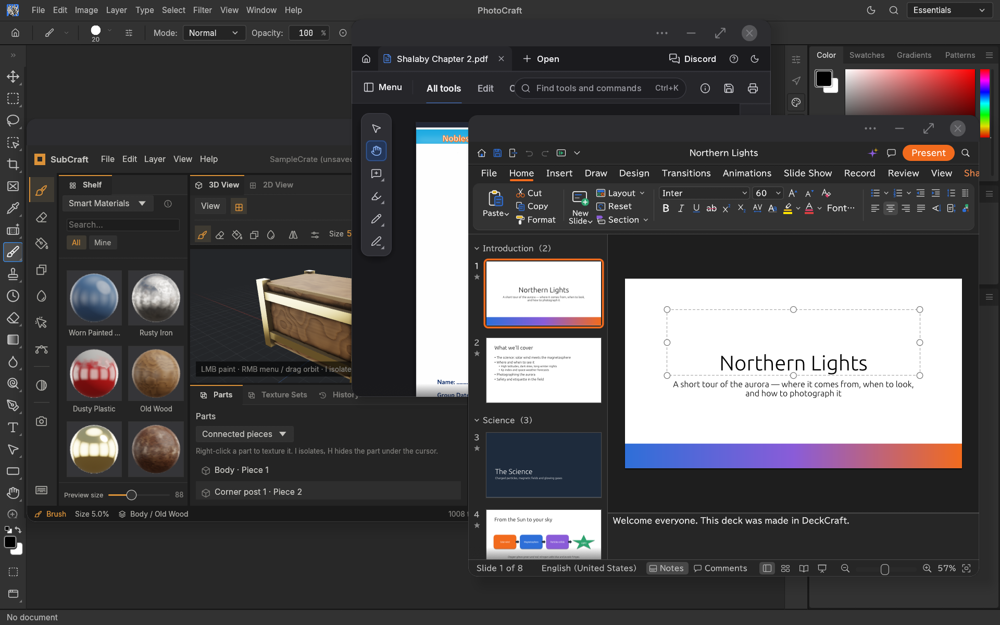

# UNOFFICIAL ArtCraft Android

# We were banned from ArtCraft, statement coming soon.
### Join the unofficial [Artcraft Android discord](https://discord.gg/J8GhXx8tCD) for updates. All android project maintainers are welcomed to join and apply for their own channel.

> [!NOTE]
> **About this project:** We are an independent group of people who love ArtCraft very much and want to make these apps available on Android. We are not affiliated with, related to, or endorsed by ArtCraft / Storytold, and all our ports are completely unofficial.

**The full ArtCraft PC experience, now on Android.**

[**Download the apps**](https://github.com/MostafaXS1/artcraft-android/releases/) · [ArtCraft website](https://getartcraft.com/) · [Explore the apps](https://getartcraft.com/apps)



ArtCraft Android brings the complete functionality of the ArtCraft PC applications to Android devices. The apps retain their PC capabilities while gaining native Android integrations for file access, touch input, keyboards, mice, trackpads, and other system features.

Whether you're using a phone, tablet, or an Android device with a keyboard and mouse, ArtCraft gives you the same powerful creative tools available on PC, adapted to work naturally with Android.

## The Full PC Experience on Android

ArtCraft Android is not a stripped-down mobile edition. The applications are built with the exact source code used in their PC counterparts, with Android-specific adaptations that connect them to the platform's input, storage, and system APIs.

### Native Android File Integration

- **Storage Access Framework (SAF):** Open files and choose save destinations using Android's system document picker.
- **Direct document access:** Work with files selected from Android document providers, including supported cloud storage providers and external storage locations.
- **Save changes back:** SAF integration handles document staging and writes updated content back to the selected document.
- **Open with:** Open supported files directly from compatible file managers and other Android applications.
- **File sharing:** Receive files through Android's sharing and intent mechanisms where applicable.
- **Drag and drop:** Open files by dragging them from compatible applications, including file managers and browsers.
- **File associations:** A shared registry connects supported file types with the appropriate ArtCraft application.

Your existing creative workflow stays available, with Android providing the system-level file access needed to make it work.

### Touch, Mouse, Trackpad, and Keyboard

ArtCraft Android adapts the applications' input handling to Android while preserving their PC functionality.

- **Touch gestures:** Two-finger scrolling and momentum scrolling for navigating large documents and canvases.
- **Mouse support:** Pointer movement, hover events, mouse buttons, and wheel scrolling.
- **Trackpad support:** Desktop-style navigation and scrolling on compatible devices.
- **Physical keyboards:** Keyboard shortcuts and modifier keys, including Ctrl, Alt, and Shift.
- **Android soft keyboard:** Input Method Editor (IME) integration for text entry, composition, deletion, and editor actions.
- **International text input:** Support for composed text and non-English input through Android's input system.
- **System clipboard:** Copy, cut, and paste through Android's clipboard, including keyboard shortcuts.
- **Back-button integration:** Android Back is mapped to the appropriate application behavior where supported by the runtime.

Connect a keyboard and mouse, use a trackpad, or work directly on a touchscreen. The applications remain fully featured regardless of the input method.

### Android System Integration

- **System fonts:** Android system fonts are exposed to the application renderer. User font discovery is also supported where configured.
- **Android printing:** Printing integrates with Android's print framework in supported workflows, including WordCraft and GridCraft.
- **Persistent preferences:** Application settings and configuration can persist between launches.
- **Display adaptation:** Full-screen presentation and appropriate UI scaling help the applications fit Android displays.
- **System appearance:** Light and dark appearance support integrates with the Android environment where applicable.
- **Release notifications:** The application can check for newer ArtCraft Android releases and notify you when updates are available.

These capabilities are implemented through shared Android runtime components, platform compatibility patches, and app-specific adapters.

### Hardware-Accelerated Video Rendering & Playback Engine

Video editing and timeline applications on mobile require extreme throughput that traditional CPU software decoding cannot sustain. ArtCraft Android features a dedicated, hardware-accelerated video rendering and playback engine engineered for native mobile hardware:
- **MediaCodec NDK Acceleration:** Hardware-accelerated decoding via Android's NDK `AMediaCodec` framework (`h264_mediacodec`, `hevc_mediacodec`, `vp9_mediacodec`, `av1_mediacodec`).
- **Direct System Memory Buffering:** AMediaCodec automatically unpacks hardware stride alignment and cropping directly into standard RGBA/NV12/YUV memory buffers, allowing instantaneous texture uploads to egui (`TextureHandle`) without expensive CPU colorspace conversion or extra staging copies.
- **Custom Android FFmpeg Engine:** Custom cross-compiled FFmpeg and FFprobe binaries built with `--enable-jni --enable-mediacodec`, `--enable-libx264`, `--enable-libvpx`, and `--enable-libopus` are embedded directly in the APK (`extra-jniLibs/arm64-v8a/`) and dynamically resolved at runtime.
- **Adaptive Fallback:** Intelligent fallback to multi-threaded CPU software decoding if hardware decoders encounter unsupported profiles or codec constraints.
- **Suite-Wide Integration:** Active across all video timeline and editing applications: **PicassoSuite** and **FilmCraft**.


[**Download the latest APKs**](https://github.com/MostafaXS1/artcraft-android/releases/)

## Built for Android Without Removing PC Functionality

The ArtCraft applications originate from the official Storytold repositories and community creative suites. ArtCraft Android adds the Android launch environment, shared platform integrations, and app-specific adapters required to run them natively on Android.

The ecosystem currently supports **46 applications**:
- **16 Official Storytold Suite applications** (PhotoCraft, VectorCraft, FilmCraft, WordCraft, etc.)
- **22 Community applications** with in-tree adapters and direct CI build targets (SubCraft, SolidCraft, Coiman IDE, Transit, ClothCraft, etc.)
- **7 External community applications** indexed and tracked via the launcher catalog
- **ArtCraft Launcher:** A dedicated Android dashboard for installing, launching, and updating the suite

The Android build process uses templates, adapters, vendored changes, and compatibility patches as needed. This keeps the Android integration organized and makes it easier to maintain across the app suite.

## Community Apps in the Android Launcher

The ArtCraft Launcher (originally created by ArtCraft / Storytold, and adapted by us for Android) includes support for community applications alongside the official suite. If you maintain or develop an open-source creative tool, utility, or desktop app (especially those built with Rust, egui, or similar frameworks) and would like it available on Android:

- **Get Listed in the Launcher:** Community apps can be included in our Android launcher's catalog (`launcher/apps/artcraft-launcher-android/app-catalog.json`), allowing Android users to discover, install, and receive release updates for your APK directly.
- **Porting Assistance:** You can take advantage of our shared Android integration components, Storage Access Framework (SAF) bridges, soft-keyboard IME handling, and touch/trackpad patches to adapt your desktop app for Android.
- **How to Apply:** If you would like your app featured in our Android build of the launcher or want help porting it, **you must contact us on the unofficial [Artcraft Android Discord](https://discord.gg/J8GhXx8tCD)**. Project maintainers are also welcome to join and apply for their own dedicated channel. (For technical porting details, see the [CI & porting guide](docs/ci-workflow.md#9-adding-new-android-ports-to-the-build-system--ci)). Heads up, we will do a security audit to check for vulnerabilities before we add any app.

## Links

- **Downloads:** [GitHub Releases](https://github.com/MostafaXS1/artcraft-android/releases/)
- **ArtCraft website:** [getartcraft.com](https://getartcraft.com/)
- **Explore the apps:** [getartcraft.com/apps](https://getartcraft.com/apps)
- **Source code:** [ArtCraft Android repository](https://github.com/MostafaXS1/artcraft-android)
- **Ported Applications:** [`docs/ported-apps.md`](docs/ported-apps.md)
- **Porting Guide & Processes:** [`docs/porting-guide.md`](docs/porting-guide.md)
- **CI/CD Workflow:** [`docs/ci-workflow.md`](docs/ci-workflow.md)
- **Tooling & Testing Guide:** [`docs/tooling-and-testing.md`](docs/tooling-and-testing.md)
- **Adapter documentation:** [`adapters/README.md`](adapters/README.md)
- **Architecture documentation:** [`architecture.md`](architecture.md)
- **Changelog:** [`CHANGELOG.md`](CHANGELOG.md)
- **Security Policy:** [`SECURITY.md`](SECURITY.md)

---

## Build from Source

Build locally signed, 64-bit ARM Android APKs from the official Storytold repositories and supported community projects.

### Requirements

- Git
- Rust and Cargo
- Python 3
- A Java Development Kit (JDK)
- Android SDK and NDK build components

The build scripts can discover or bootstrap supported Android build components when they are not already available.

### Quick Start

Run the scripts from any directory. Each script resolves its own location and switches to the project directory before building.

```sh
# Optimized release APK for any supported application
bash build.sh -pdfcraft

# Debug APK for testing
bash build-debug.sh -pdfcraft

# Build the ArtCraft Launcher APK
bash build-launcher.sh
```

Replace `-pdfcraft` with any supported application name.

### Supported Build Targets

App names are passed as command-line flags, such as `-photocraft` or `-vectorcraft`. Below is the complete catalog of all 40 directly buildable applications:

#### Official Storytold Suite (16 apps)
- **PhotoCraft** (`-photocraft`): Professional image editing and retouching
- **VectorCraft** (`-vectorcraft`): Vector illustration and path design
- **FilmCraft** (`-filmcraft`): Non-linear video editing, color grading & audio (MediaCodec accelerated)
- **LightCraft** (`-lightcraft`): Photo library management and RAW photo development
- **PdfCraft** (`-pdfcraft`): PDF reading, organizing, annotations & security
- **EffectCraft** (`-effectcraft`): Visual effects, image filters and motion graphics
- **DesignCraft** (`-designcraft`): Desktop publishing, page layout and editorial design
- **FigCraft** (`-figcraft`): Diagramming, whiteboarding and UI prototyping
- **WordCraft** (`-wordcraft`): Document design, typography and word processing
- **SoundCraft** (`-soundcraft`): Multi-track audio recording, editing and mixing
- **DeckCraft** (`-deckcraft`): Presentations, slide decks and speaker notes
- **CadCraft** (`-cadcraft`): 2D and 3D computer-aided design (CAD)
- **GridCraft** (`-gridcraft`): Spreadsheets, table formulas and data analysis
- **MaterialCraft** (`-materialcraft`): Procedural 3D material design and PBR textures
- **TextureCraft** (`-texturecraft`): 3D model texture painting and surface sculpting
- **AniCraft** (`-anicraft`): Frame-by-frame 2D animation and onion skinning

#### Community Applications with In-Tree Adapters & CI Targets (24 apps)
- **SubCraft** (`-subcraft`): 3D texture painting directly on 3D models
- **SolidCraft** (`-solidcraft`): Parametric 3D CAD modeling
- **BIMCraft** (`-bimcraft`): Building Information Modeling (BIM) & architectural design
- **CapsuleCraft** (`-capsulecraft`): Note-taking and email message archives using `.eml` files
- **DiagramCraft** (`-diagramcraft`): Visio-style technical diagrams, flowcharts and stencils
- **EarthCraft** (`-earthcraft`): Interactive 3D globe explorer and geographic visualization
- **HumanMotionCraft** (`-humanmotioncraft`): Humanoid character posing, skeletal kinematics & animation
- **MapCraft** (`-mapcraft`): Brush-based 3D level editor and geometric environment design
- **NoteCraft** (`-notecraft`): Local-first markdown notebooks and knowledge management
- **PaintCraft** (`-paintcraft`): Painting, raster sketching and digital canvas illustration
- **PicassoSuite** (`-picassosuite`): DaVinci Resolve-style video editing suite (MediaCodec accelerated)
- **ProWave** (`-prowave`): Digital audio workstation (DAW), synthesizer & music production
- **RustGIS** (`-rustgis`): Geospatial information systems (GIS) and map analysis
- **TraceDraw** (`-tracedraw`): Vector illustration, bezier tracing and print design
- **Transit** (`-transit`): Digital audio workstation for sequencing and arrangement
- **Coiman IDE** (`-coimanide`): Code editor with language servers (LSP), Git and Termux bridge
- **PCBCraft** (`-pcbcraft`): Printed circuit board design and layout
- **FieldCraft** (`-fieldcraft`): Finite element analysis and physics simulation
- **PaperCraft** (`-papercraft`): Local design canvas built in Rust and egui
- **Ferrite** (`-ferrite`): Fast, lightweight text editor for Markdown and JSON
- **PixelCraft** (`-pixelcraft`): Fast, native pixel art editor and animator
- **ClothCraft** (`-clothcraft`): Cloth simulation, garment patterning and 3D draping

#### Suite Dashboard
- **ArtCraft Launcher** (`bash build-launcher.sh`): Centralized Android dashboard for discovering, managing, launching, and updating ArtCraft apps

For external community applications distributed through the launcher catalog, see [`docs/ported-apps.md`](docs/ported-apps.md).

### Build Options

| Option | Description |
| --- | --- |
| `-stable` | Build against the latest stable upstream release tag. This is the default. |
| `-main` or `-latest` | Build against the rolling upstream `main` branch. |
| `-tag=<tag>` | Build against a specific Git tag, for example `-tag=v0.12.1`. |
| `-branch=<branch>` | Build against a specific Git branch. |
| `-appname=<name>` | Override the Android display name. |
| `-packagename=<pkg>` | Override the Android package name. The default is `com.artcraft.<app>`. |
| `-appicon=<path>` | Use a custom launcher icon PNG. |
| `-h` or `--help` | Show command help. |

### Build Examples

```sh
# Build PhotoCraft
bash build.sh -photocraft

# Build a debug APK for testing
bash build-debug.sh -photocraft

# Build from a specific upstream branch
bash build.sh -photocraft -branch=main

# Customize the Android application
bash build.sh -vectorcraft \
  -appname="My Vector App" \
  -packagename=com.example.myvectorapp \
  -appicon=/path/to/icon.png
```

### Build Output

- **APK files:** `output/<app>-<version>.apk`
- **Build logs:** `logs/`
- **Checked-out source:** `source/<app>/`
- **Build artifacts:** `build/<app>/target/`

Release APKs are optimized for installation and everyday use. Debug APKs are larger and slower, and are intended for testing and troubleshooting.

### Testing on a Device

Install an APK and inspect its logs using Android Debug Bridge (ADB).

```sh
# Install an APK
adb install -r output/photocraft-*.apk

# View application logs
adb logcat -s com.artcraft.photocraft

# Check requested permissions
adb shell dumpsys package com.artcraft.photocraft | grep -A 15 "requested permissions"
```

### Signing and Source Checkouts

Builds are signed with a local development keystore stored under `keys/`. Keep the keystore and its password safe if you want future builds to install as updates over earlier builds signed with the same key.

Do not use the local development key for public distribution. Use a separately managed release-signing key for public releases.

Existing source checkouts are reused to preserve local Android port work. The build does not automatically reset or overwrite local source changes. Update existing checkouts deliberately with Git and review the diff before switching versions or incorporating upstream changes.

---

## Frequently Asked Questions (FAQ)

### What does it mean to be unofficial?
ArtCraft Android is a community-driven, independent open-source initiative. We love the ArtCraft creative suite and want to make these desktop tools accessible on Android devices, but **we are not affiliated with, sponsored by, or endorsed by Storytold or the official ArtCraft project**.

In practice, this means:
- **Upstream Source Code:** The applications run the authentic desktop codebases pulled directly from upstream releases, coupled with our open-source Android runtime adapters (SAF document pickers, soft-keyboard IME, and touch/trackpad handling).
- **Independent Maintenance:** Upstream maintainers do not develop, test, or provide support for Android. All mobile porting work, Android compatibility patches, release packaging, and device-specific fixes are managed independently by our community.
- **Support & Issues:** For questions, bug reports, or feature requests regarding the Android ports, please use our [GitHub Issues](https://github.com/MostafaXS1/artcraft-android/issues) or join the [Artcraft Android Discord](https://discord.gg/J8GhXx8tCD) rather than contacting official ArtCraft / Storytold channels.

### How can we build and port apps so fast?
ArtCraft Android does not rewrite or maintain separate mobile forks of each application. Instead, our automated build harness pulls the exact upstream desktop Rust source code directly from official releases, applies modular Android runtime adapters (GameActivity, Storage Access Framework bridges, and native IME input), and vendors platform compatibility patches (for `winit`, `egui`, etc.). In CI, multi-tier caching (`sccache`, Cargo registry caching, and Gradle cache) allows parallel cross-compilation of all 36 applications in minutes rather than hours.

### Are these stripped-down mobile editions?
No. Every application is the full, unabridged PC desktop application running natively on Android (`aarch64-linux-android`). All desktop tools, rendering pipelines, panels, and format support are preserved.

### How does file storage work on Android?
The ports integrate with Android's Storage Access Framework (SAF). Clicking **File ▸ Open** or **Save** opens Android's native system document picker, giving you direct access to internal storage, SD cards, and connected cloud providers (Google Drive, Nextcloud, OneDrive, etc.).

### Do touch gestures, stylus, mouse, and physical keyboards work?
Yes. The runtime adapts input across form factors:
- **Touch & Stylus:** Native two-finger scrolling, pinch zoom, and pen pressure where supported.
- **Mouse & Trackpad:** Full cursor hover states, right-click context menus, smooth trackpad scrolling, and mouse wheel navigation.
- **Keyboards:** Android soft keyboard (IME) with real-time text composition, as well as physical keyboard shortcut chords (`Ctrl`, `Alt`, `Shift`).

### How do I install and update the applications?
The recommended way is through the **ArtCraft Launcher** APK, which lets you browse, install, and update all official and community applications in one place. Alternatively, individual standalone APKs can be downloaded directly from [GitHub Releases](https://github.com/MostafaXS1/artcraft-android/releases/).

### Can my open-source app be added to the launcher?
Yes! If you develop an open-source Rust, egui, or desktop creative application, we can index your APK in the ArtCraft Launcher catalog. Please contact us on our [Discord](https://discord.gg/J8GhXx8tCD) to discuss inclusion.

---

## Security
We take security very seriously across all our Android ports. For vulnerability reporting guidelines, please see our [Security Policy](SECURITY.md).


