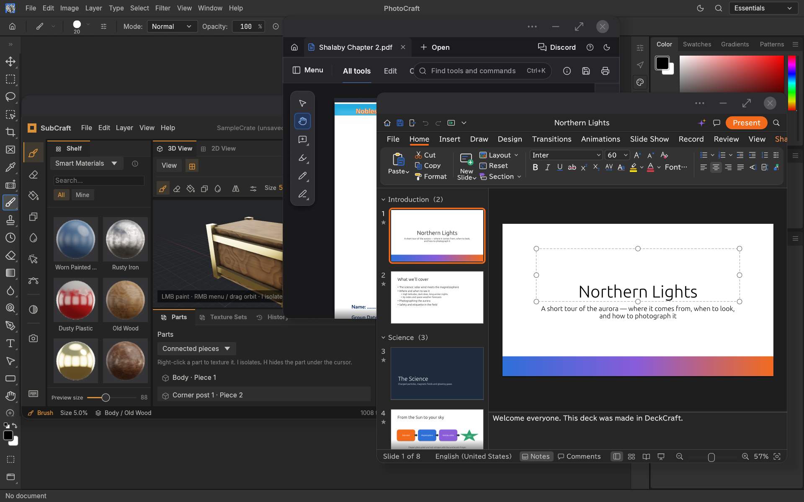

# ArtCraft Android

**The full ArtCraft PC experience, now on Android.**

[**Download the apps**](https://github.com/MostafaXS1/artcraft-android/releases/) · [ArtCraft website](https://getartcraft.com/) · [Explore the apps](https://getartcraft.com/apps)



ArtCraft Android brings the complete functionality of the ArtCraft PC applications to Android devices. The apps retain their PC capabilities while gaining native Android integrations for file access, touch input, keyboards, mice, trackpads, and other system features.

Whether you're using a phone, tablet, or an Android device with a keyboard and mouse, ArtCraft gives you the same powerful creative tools available on PC, adapted to work naturally with Android.

## The Full PC Experience on Android

ArtCraft Android is not a stripped-down mobile edition. The applications are built with the exact source code used in their PC counterparts, with Android-specific adaptations that connect them to the platform's input, storage, and system APIs.

### Native Android File Integration

- **Storage Access Framework (SAF):** Open files and choose save destinations using Android's system document picker.
- **Direct document access:** Work with files selected from Android document providers, including supported cloud storage providers and external storage locations.
- **Save changes back:** SAF integration handles document staging and writes updated content back to the selected document.
- **Open with:** Open supported files directly from compatible file managers and other Android applications.
- **File sharing:** Receive files through Android's sharing and intent mechanisms where applicable.
- **Drag and drop:** Open files by dragging them from compatible applications, including file managers and browsers.
- **File associations:** A shared registry connects supported file types with the appropriate ArtCraft application.

Your existing creative workflow stays available, with Android providing the system-level file access needed to make it work.

### Touch, Mouse, Trackpad, and Keyboard

ArtCraft Android adapts the applications' input handling to Android while preserving their PC functionality.

- **Touch gestures:** Two-finger scrolling and momentum scrolling for navigating large documents and canvases.
- **Mouse support:** Pointer movement, hover events, mouse buttons, and wheel scrolling.
- **Trackpad support:** Desktop-style navigation and scrolling on compatible devices.
- **Physical keyboards:** Keyboard shortcuts and modifier keys, including Ctrl, Alt, and Shift.
- **Android soft keyboard:** Input Method Editor (IME) integration for text entry, composition, deletion, and editor actions.
- **International text input:** Support for composed text and non-English input through Android's input system.
- **System clipboard:** Copy, cut, and paste through Android's clipboard, including keyboard shortcuts.
- **Back-button integration:** Android Back is mapped to the appropriate application behavior where supported by the runtime.

Connect a keyboard and mouse, use a trackpad, or work directly on a touchscreen. The applications remain fully featured regardless of the input method.

### Android System Integration

- **System fonts:** Android system fonts are exposed to the application renderer. User font discovery is also supported where configured.
- **Android printing:** Printing integrates with Android's print framework in supported workflows, including WordCraft and GridCraft.
- **Persistent preferences:** Application settings and configuration can persist between launches.
- **Display adaptation:** Full-screen presentation and appropriate UI scaling help the applications fit Android displays.
- **System appearance:** Light and dark appearance support integrates with the Android environment where applicable.
- **Release notifications:** The application can check for newer ArtCraft Android releases and notify you when updates are available.

These capabilities are implemented through shared Android runtime components, platform compatibility patches, and app-specific adapters.


[**Download the latest APKs**](https://github.com/MostafaXS1/artcraft-android/releases/)

## Built for Android Without Removing PC Functionality

The ArtCraft applications originate from the official Storytold repositories. ArtCraft Android adds the Android launch environment, shared platform integrations, and app-specific adapters required to run them on Android.

The objective is to preserve the functionality of the PC applications while making them work properly with Android's storage, input, and system services.

The Android build process uses templates, adapters, vendored changes, and compatibility patches as needed. This keeps the Android integration organized and makes it easier to maintain across the app suite.

## Model Context Protocol (MCP) Integration

Follow these steps to enable the Model Context Protocol (MCP) server for ArtCraft Android apps.

### 1. Enable MCP on the Android app

- Open the ArtCraft Android app.
- Enable the MCP server in the app's settings.
- Make sure the MCP server is running on port `27880`.

### 2. Forward the MCP port using ADB

Connect your Android device to your computer with USB debugging enabled, then run:

```bash
adb forward tcp:27880 tcp:27880
```

This forwards port `27880` from your computer to the Android device, allowing MCP clients running on your computer to access the app's MCP endpoint.

To make the forwarded port accessible over your LAN, use an appropriate LAN-accessible proxy or port-forwarding setup, since `adb forward` itself binds to the host's local interface.

### 3. Configure your MCP client

Add the following configuration to your MCP client's configuration file:

```json
{
  "mcp": {
    "servers": {
      "artcraft": {
        "type": "remote",
        "url": "http://localhost:27880/mcp",
        "oauth": false,
        "headers": {
          "Authorization": "Bearer artcraft"
        }
      }
    }
  }
}
```

### 4. Verify the connection

Restart or refresh your MCP client and check that the `artcraft` server is connected. You should now be able to access the MCP tools exposed by the ArtCraft Android app.

## Links

- **Downloads:** [GitHub Releases](https://github.com/MostafaXS1/artcraft-android/releases/)
- **ArtCraft website:** [getartcraft.com](https://getartcraft.com/)
- **Explore the apps:** [getartcraft.com/apps](https://getartcraft.com/apps)
- **Source code:** [ArtCraft Android repository](https://github.com/MostafaXS1/artcraft-android)
- **ArtCraft Launcher:** [launcher](https://github.com/MostafaXS1/artcraft-android/tree/main/launcher)
- **Adapter documentation:** [`adapters/README.md`](adapters/README.md)
- **Architecture documentation:** [`architecture.md`](architecture.md)
- **Changelog:** [`CHANGELOG.md`](CHANGELOG.md)

---

### ArtCraft Launcher

The **ArtCraft Launcher** is an Android app that installs, updates, and launches all 35 ArtCraft applications (16 official + 19 community). It connects to the `MostafaXS1/artcraft-android` GitHub releases (plus each external app's own release feed), downloads APKs with SHA-256 verification, and manages them through a native Rust/egui interface.

### Launcher Features

- **Live release checks** on launch and every 12 minutes (respects GitHub rate limits with ETag caching)
- **In-app download/install/launch** — no browser hand-off
- **All 35 apps** with brand colors and icons (official apps match getartcraft.com colors; community apps use their project colors)
- **Search with soft keyboard** — IME input via hidden `ArtCraftInputView`
- **Auto-refresh** after install/uninstall — no need to reopen the app
- **Pause/resume/cancel** downloads
- **Uninstall** via system dialog with immediate re-detection
- **Theme follows system** light/dark mode automatically
- **Package name:** `com.artcraft.launcher`

### Launcher Screenshots

| Home (35 apps) | Search + Keyboard | Install Progress |
|:---:|:---:|:---:|
|  |  |  |

### Installing the Launcher

```sh
# From a release
adb install -r Artcraft-launcher.apk

# Or build from source (see below)
```

---

## Build from Source

Build locally signed, 64-bit ARM Android APKs from the official Storytold repositories.

### Requirements

- Git
- Rust and Cargo
- Python 3
- A Java Development Kit (JDK)
- Android SDK and NDK build components

The build scripts can discover or bootstrap supported Android build components when they are not already available.

### Quick Start

Run the scripts from any directory. Each script resolves its own location and switches to the project directory before building.

```sh
# Optimized release APK
bash build.sh -pdfcraft

# Debug APK for testing
bash build-debug.sh -pdfcraft
```

### Building the ArtCraft Launcher

The launcher is built from `launcher/` using the provided build script.

```sh
# From project root
./build-launcher.sh                    # Release APK (output/Artcraft-launcher.apk)
PROFILE=dev ./build-launcher.sh        # Debug APK (faster, unoptimized)
RELEASE_BUILD=3 ./build-launcher.sh    # 3rd Android release of same version
```

**Requirements:**
- Rust toolchain with `aarch64-linux-android` target
- `cargo-ndk` (`cargo install cargo-ndk`)
- Android SDK (platform 35) and NDK (r27+)
- JDK 17
- `rustup target add aarch64-linux-android`

**Output:** `output/Artcraft-launcher.apk`

### Modifying the Launcher's App Catalog

The launcher's 35 apps are defined in a single JSON file: `launcher/apps/artcraft-launcher-android/app-catalog.json`

To add/remove/edit apps:

1. Edit `app-catalog.json` with the app's details:
   ```json
   {
     "id": "myapp",
     "name": "MyApp",
     "tagline": "What it does",
     "color": [18, 52, 86],
     "repo": "owner/repo",
     "publisher": "Publisher Name",
     "site": "https://example.com",
     "bundle": "com.example.myapp"
   }
   ```

2. Regenerate the Rust catalog (optional — the build scripts do it automatically):
   ```sh
   cd launcher/apps/artcraft-launcher-android
   ./generate-catalog.sh
   ```

3. Rebuild the launcher:
   ```sh
   cd /home/mostafa/artcraft-android-builder
   ./build-launcher.sh
   ```

**Apps from an external GitHub repository:** by default every app's APK comes from the
`MostafaXS1/artcraft-android` shared release, named `<app-id>-<version>.apk`. An app can instead
name its own repository and the file to fetch from that repository's latest release. Add a
`release` block and (for installed detection, launching and uninstalling) the Android package id:

```json
{
  "id": "keydeck",
  "name": "Keydeck",
  "tagline": "Presentations: Keynote and PowerPoint files",
  "color": [194, 48, 106],
  "repo": "bramble-apps/bramble-office",
  "publisher": "Bramble Apps",
  "site": "https://bramble-apps.github.io",
  "release": {
    "repo": "bramble-apps/bramble-office",
    "asset": "Keydeck*apk"
  },
  "package": "app.bramble.keydeck"
}
```

`asset` is a case-insensitive glob matched against the latest release's files (`*` matches any
run of characters), so `Bramble*apk`, `Keydeck*apk`, or `*-android.apk` all work. Each repository
is checked separately and cached separately, so one feed being rate-limited doesn't hide the
others. Without `package`, the launcher assumes `com.artcraft.<id>`.

**Installed-app detection:** Android 11+ only lets the launcher see packages named in its
manifest's `<queries>`. `generate-catalog.sh` rebuilds that list from every app's `package` (or
`com.artcraft.<id>`) plus the optional top-level `"query_packages"` array, so adding an app or an
alternate package id does not require editing the XML. Put any extra application ids the launcher
should detect there:

```json
{
  "version": 1,
  "query_packages": ["com.example.alternate.id"],
  "official_apps": []
}
```

**Official apps** (16): Match getartcraft.com colors, repo is `storytold/<id>`, publisher is "ArtCraft"

**Community apps** (19): Use project's GitHub repo as `repo`, display name as `publisher`, optional `site` and `bundle` fields

### GitHub Actions

The launcher builds automatically on push to `main` and on tags matching `android-v*`. The workflow:
- Builds the APK with cargo-ndk + Gradle
- Outputs to `output/Artcraft-launcher.apk`
- Uploads as artifact
- Creates GitHub Release on tag push with APK attached

See [`.github/workflows/build-android-launcher.yml`](.github/workflows/build-android-launcher.yml) for details.

Replace `-pdfcraft` with any supported application name.

### Supported Build Targets

| App | Status | Repo |
| --- | --- | --- |
| `photocraft`, `vectorcraft`, `filmcraft`, `lightcraft`, `pdfcraft`, `effectcraft`, `designcraft`, `figcraft`, `wordcraft`, `soundcraft`, `deckcraft`, `cadcraft`, `gridcraft`, `materialcraft`, `texturecraft`, `anicraft` | Official | Storytold |
| `subcraft` | Unofficial | [Aalzard/subcraft](https://github.com/Aalzard/subcraft) |
| `solidcraft` | Unofficial | [tangency-labs/solidcraft](https://github.com/tangency-labs/solidcraft) |
| `bimcraft` | Unofficial | [IPedrax/BIMCraft](https://github.com/IPedrax/BIMCraft) |
| `capsulecraft` | Unofficial | [kostyk348/CapsuleCraft](https://github.com/kostyk348/CapsuleCraft) |
| `diagramcraft` | Unofficial | [baradhili/DiagramCraft](https://github.com/baradhili/DiagramCraft) |
| `earthcraft` | Unofficial | [therichronicles/EarthCraft](https://github.com/therichronicles/EarthCraft) |
| `humanmotioncraft` | Unofficial | [YalKouassi/HumanMotionCraft](https://github.com/YalKouassi/HumanMotionCraft) |
| `mapcraft` | Unofficial | [bearlikelion/MapCraft](https://github.com/bearlikelion/MapCraft) |
| `notecraft` | Unofficial | [AlienTechSoftware/notecraft](https://github.com/AlienTechSoftware/notecraft) |
| `paintcraft` | Unofficial | [replicraft/PaintCraft](https://github.com/replicraft/PaintCraft) |
| `picassosuite` | Unofficial | [fabox-os/Picasso-Suite](https://github.com/fabox-os/Picasso-Suite) |
| `prowave` | Unofficial | [fabox-os/Pro-Wave](https://github.com/fabox-os/Pro-Wave) |
| `rustgis` | Unofficial | [opengeos/RustGIS](https://github.com/opengeos/RustGIS) |
| `tracedraw` | Unofficial | [tracedraw/tracedraw](https://github.com/tracedraw/tracedraw) |
| `transit` | Unofficial | [transit-audio/transit](https://github.com/transit-audio/transit) |
| `coimanide` | Unofficial | [ManuelCoimbra/coiman-ide](https://github.com/ManuelCoimbra/coiman-ide) |

App names are passed as command-line flags, such as `-photocraft` or `-anicraft`.

#### Coiman IDE needs Termux

**Coiman IDE** is an IDE, so it runs programs: Git, the language servers, the compilers and the
tools of the project you are working on. Android does not let an app run another app's programs,
so Coiman IDE runs them **in Termux**, over Termux's official `RUN_COMMAND` service. The editor
itself works without it; the Git panel, the Run button, the tests and the terminal need it.

To get the full IDE on a device:

1. Install **Termux** (the F-Droid build, `com.termux`) and open it once. Coiman IDE asks for
   Termux's `RUN_COMMAND` permission the first time it starts; if Termux is missing, the app
   offers to download it.
2. In Termux, run `pkg install util-linux` — the interactive terminal needs Termux's `script` for
   a real pty (without it the terminal still runs, but without job control) — and
   `pkg install git` for the Git panel.
3. Run `termux-setup-storage` in Termux so it can reach the project folders in shared storage.

The bridge is documented in `adapters/README.md`, and its log is on the device at
`/sdcard/Documents/CoimanTermux/coiman-termux.log`.

### Build Options

| Option | Description |
| --- | --- |
| `-stable` | Build against the latest stable upstream release tag. This is the default. |
| `-main` or `-latest` | Build against the rolling upstream `main` branch. |
| `-tag=<tag>` | Build against a specific Git tag, for example `-tag=v0.12.1`. |
| `-branch=<branch>` | Build against a specific Git branch. |
| `-appname=<name>` | Override the Android display name. |
| `-packagename=<pkg>` | Override the Android package name. The default is `com.artcraft.<app>`. |
| `-appicon=<path>` | Use a custom launcher icon PNG. |
| `--no-buttons` | Build without virtual on-screen Shift/Alt/Ctrl modifier buttons and Cut/Copy/Paste/Delete text buttons. |
| `--noupdate` | Skip checking for and downloading newer source checkouts. |
| `-h` or `--help` | Show command help. |

### Build Examples

```sh
# Build PhotoCraft
bash build.sh -photocraft

# Build a debug APK for testing
bash build-debug.sh -photocraft

# Build from a specific upstream branch
bash build.sh -photocraft -branch=main

# Customize the Android application
bash build.sh -vectorcraft \
  -appname="My Vector App" \
  -packagename=com.example.myvectorapp \
  -appicon=/path/to/icon.png
```

### Build Output

- **APK files:** `output/<app>-<version>.apk`
- **Build logs:** `logs/`
- **Checked-out source:** `source/<app>/`
- **Build artifacts:** `build/<app>/target/`

Release APKs are optimized for installation and everyday use. Debug APKs are larger and slower, and are intended for testing and troubleshooting.

### Testing on a Device

Install an APK and inspect its logs using Android Debug Bridge (ADB).

```sh
# Install an APK
adb install -r output/photocraft-*.apk

# View application logs
adb logcat -s com.artcraft.photocraft

# Check requested permissions
adb shell dumpsys package com.artcraft.photocraft | grep -A 15 "requested permissions"
```

### Signing and Source Checkouts

Builds are signed with a local development keystore stored under `keys/`. Keep the keystore and its password safe if you want future builds to install as updates over earlier builds signed with the same key.

Do not use the local development key for public distribution. Use a separately managed release-signing key for public releases.

Existing source checkouts are reused to preserve local Android port work. The build does not automatically reset or overwrite local source changes. Update existing checkouts deliberately with Git and review the diff before switching versions or incorporating upstream changes.
