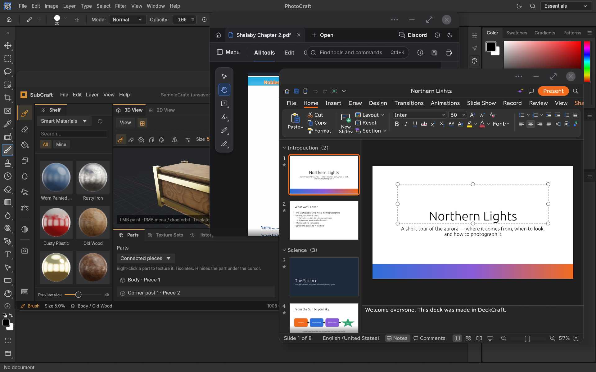

# ArtCraft Android Builder
## Go to [Releases](https://github.com/MostafaXS1/artcraft-android/releases/) to download the apps.



Build locally signed, 64-bit ARM (arm64) Android APKs from the official Storytold repositories for the ArtCraft apps.

The builder provides a repeatable path from an existing app repository to an installable Android package. It includes release and debug builds, optional app metadata overrides, a shared file-association registry, and persistent app-specific adapters for projects that need more than the generic launcher.

Project links: [ArtCraft](https://getartcraft.com/) · [The Crafting Apps](https://getartcraft.com/apps)

## Quick start

Run the scripts from any directory. Each script resolves its own location and switches to the project directory before building.

```sh
bash build.sh -pdfcraft          # Optimized release APK
bash build-debug.sh -pdfcraft    # Debug APK; larger and slower
```

Replace `-pdfcraft` with any supported app name.

## Supported apps

```text
photocraft vectorcraft filmcraft lightcraft pdfcraft effectcraft
designcraft figcraft wordcraft soundcraft deckcraft cadcraft gridcraft
subcraft
```

App names are passed as command-line flags, such as `-photocraft` or `-vectorcraft`.

## Options

| Option | Description |
| --- | --- |
| `-stable` | Build against latest stable release tag of the upstream app (default). |
| `-main`, `-latest` | Build against the rolling upstream `main` branch. |
| `-tag=<tag>` | Build against a specific git tag (e.g. `-tag=v0.12.1`). |
| `-branch=<branch>` | Build against a specific git branch. |
| `-appname=<name>` | Override the Android display name. By default, the app's built-in title is used. |
| `-packagename=<pkg>` | Override the Android package name. By default, the package is `com.artcraft.<app>`. |
| `-appicon=<path>` | Use a custom launcher icon PNG. By default, the app's own icon is used. |
| `-h`, `--help` | Show command help. |

## Examples

```sh
# Build PhotoCraft
bash build.sh -photocraft
bash build.sh -vectorcraft
bash build.sh -soundcraft
# ... any of the 14 apps

# Build a debug APK for testing
bash build-debug.sh -photocraft
```

### Build Options
- `-stable` (default) - Build from latest stable tag
- `-main` or `-latest` - Build from latest main branch
- `-tag=<tag>` - Build from specific git tag
- `-branch=<branch>` - Build from specific branch

### Output
Built APKs are placed in the `output/` directory as `<app>-<version>.apk`. Build logs are saved to `logs/`.

### Testing on Device
```bash
# Install APK
adb install -r output/photocraft-*.apk

# View logs
adb logcat -s com.artcraft.photocraft

# Check permissions
adb shell dumpsys package com.artcraft.photocraft | grep -A 15 "requested permissions"
```

## Links

- **Website:** [getartcraft.com](https://getartcraft.com/)
- **Apps:** [getartcraft.com/apps](https://getartcraft.com/apps)
- **Releases:** [GitHub Releases](https://github.com/MostafaXS1/artcraft-android/releases/)
- **Source:** [GitHub Repository](https://github.com/MostafaXS1/artcraft-android)

---

*All apps are built from official Storytold repositories with extensive Android platform adaptations. No upstream source is modified - all Android integration is done through templates, adapters, and vendored patches.*
