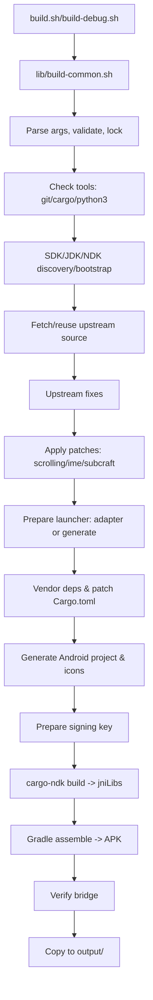

# ArtCraft Android Builder - Architecture

This document describes the end-to-end architecture of the ArtCraft Android Builder. It is intended to be a complete technical reference covering every system, component, and integration point in this repository.

## Table of Contents

- [Overview](#overview)
- [Repository Layout](#repository-layout)
- [Supported Apps](#supported-apps)
- [High-Level Build Flow](#high-level-build-flow)
- [Entry Points and Orchestration](#entry-points-and-orchestration)
- [Build Pipeline (8 Stages)](#build-pipeline-8-stages)
- [Source Acquisition and Integrity](#source-acquisition-and-integrity)
- [Upstream Fixes and Patches](#upstream-fixes-and-patches)
- [Launcher Generation (Generated vs Adapters)](#launcher-generation-generated-vs-adapters)
- [Cargo Workspace Patching and Vendoring](#cargo-workspace-patching-and-vendoring)
- [Android Project Generation](#android-project-generation)
- [Shared Runtime Modules](#shared-runtime-modules)
- [Storage Access Framework (SAF)](#storage-access-framework-saf)
- [File Associations and Intents](#file-associations-and-intents)
- [Soft Keyboard and IME](#soft-keyboard-and-ime)
- [System Fonts](#system-fonts)
- [Persistence and UI Scale](#persistence-and-ui-scale)
- [Staged Copy Management](#staged-copy-management)
- [Printing](#printing)
- [Clipboard](#clipboard)
- [Updates](#updates)
- [Icons and Theming](#icons-and-theming)
- [Mouse, Touch, Scrolling, and Input](#mouse-touch-scrolling-and-input)
- [Back Button Handling](#back-button-handling)
- [Lifecycle, Fullscreen, and Edge-to-Edge](#lifecycle-fullscreen-and-edge-to-edge)
- [Signing and Build Output](#signing-and-build-output)
- [Verification](#verification)
- [Adapters (Custom Ports)](#adapters-custom-ports)
- [Vendored Crates](#vendored-crates)
- [CI/CD](#cicd)
- [Logging and Debugging](#logging-and-debugging)
- [Operational Notes and Failure Modes](#operational-notes-and-failure-modes)
- [Key Files Reference](#key-files-reference)

---

## Overview

The ArtCraft Android Builder produces locally-signed, 64-bit ARM (`arm64-v8a`) Android APKs from official upstream repositories of the ArtCraft suite. It uses a hybrid approach:
- For most apps, it generates a thin GameActivity-based Rust launcher that wires up services (file dialogs, persistence, printing, etc.) into the app's APIs.
- For some apps (PhotoCraft, VectorCraft, SubCraft), it uses custom adapters with app-specific SAF/intent handling.
- It vendors and patches dependencies (winit, egui-winit, rfd, arboard, egui-wgpu, android-activity) to add Android-specific functionality (mouse/trackpad, two-finger gestures/momentum, system clipboard via JNI, SAF integration, ANR-safe callbacks, surface recovery fixes).
- It shares runtime modules (SAF bridge, IME bridge, system fonts, update checker) across generated launchers and adapters.
- It manages SDK/NDK/JDK/Gradle, signing, and produces versioned APKs in `output/`.

---

## Repository Layout

```
artcraft-android-builder/
├── build.sh                # Release build entry (wrapper calling lib/build-common.sh)
├── build-debug.sh          # Debug build entry
├── clean.sh                # Cleanup script
├── lib/
│   ├── build-common.sh     # Main orchestrator (large shell script)
│   ├── android_project.py  # Generates AndroidManifest.xml, Gradle project, themes
│   ├── app_icons.py        # Generates adaptive/legacy launcher icons
│   ├── file_associations.py # Central intent filter registry
│   ├── scrolling.sh        # App-side two-finger scroll/momentum patches
│   ├── ime.sh              # Soft keyboard return patches (WordCraft)
│   └── subcraft.sh         # SubCraft file handoff patch (files::deliver_android)
├── templates/
│   ├── android/            # Shared Java/Rust modules
│   │   ├── SafActivity.java
│   │   ├── saf_bridge.rs
│   │   ├── ime_bridge.rs
│   │   ├── system_fonts.rs
│   │   └── UpdateCheck.java
│   └── gradle/             # Gradle wrapper template
├── adapters/               # Per-app custom adapters (photocraft, vectorcraft, subcraft)
├── vendor/                 # Vendored patched crates
├── .github/workflows/      # CI
├── docs/                   # Documentation
├── source/                 # Upstream checkouts (per-app)
├── build/                  # Isolated Cargo target dirs per app
├── output/                 # Built APKs
├── logs/                   # Build logs
└── keys/                   # Signing keystore and password
```

Notes:
- `source/` checkouts are preserved across builds (not reset). Changes to Android port are kept.
- `build/<app>/target/` is isolated per app.
- `android-sdk/` may be created by builder if missing.
- `.cache/jdk/` for downloaded Temurin JDK if needed.

---

## Supported Apps

From `README.md` and `lib/build-common.sh`:
```
photocraft vectorcraft filmcraft lightcraft pdfcraft effectcraft
designcraft figcraft wordcraft soundcraft deckcraft cadcraft gridcraft
subcraft
```
(14 apps). CI matrix matches these.

---

## High-Level Build Flow



---

## Entry Points and Orchestration

### `build.sh` / `build-debug.sh`
Simple wrappers that call `lib/build-common.sh` with `MODE` ("release"/"debug") and pass args.

### `lib/build-common.sh`
Main orchestrator (~4110 lines). Key responsibilities:
- Argument parsing: `-<app>`, `-stable|-main|-latest`, `-tag=`, `-branch=`, `-appname=`, `-packagename=`, `-appicon=`, `-h`
- Resolve app metadata: `TITLE`, `REPO` (defaults to `https://github.com/storytold/<app>.git`), special case SubCraft from `https://github.com/Aalzard/subcraft` (origin check uses `APP_ORIGIN`)
- Constants: `BUILDER_VERSION="0.2.0"`, `UPDATE_API_URL`, `UPDATE_PAGE_URL`, `GENERATOR_VERSION="55"`
- Locking: single build lock via `flock` on `.artcraft-build.lock` (records PID)
- Tool checks: git, cargo, python3 with tomllib
- SDK/JDK/NDK discovery and bootstrap
- Source fetch/reuse with integrity checks
- Upstream fixes (Python script)
- Patches: `scrolling.sh`, `subcraft.sh`, `ime.sh`
- Launcher preparation (adapter or generator)
- Vendoring and Cargo.toml patching
- Gradle project generation
- Signing key management
- Build (cargo-ndk + Gradle)
- Verification
- Output copy

---

## Build Pipeline (8 Stages)

As indicated by `say 1`..`say 8`:
1. **Checking build tools...** - verify git/cargo/python3/tomllib, cargo-ndk present/installed
2. **Finding Android SDK and NDK...** - discover/bootstrap SDK/NDK/JDK for Gradle
3. **Fetching official source for $TITLE...** - clone/reuse source with integrity checks
4. **Preparing the GameActivity launcher...** - adapter or generator, apply patches
5. **Preparing a builder-owned signing key...** - create/use JKS keystore
6. **Building $TITLE ($MODE)...** - cargo-ndk + Gradle
7. **Verifying the Android file bridge in the built APK...** - `verify_android_bridge`
8. **Build succeeded.**

---

## Source Acquisition and Integrity

### Reuse logic
If `source/$APP` exists:
- Must be a git checkout (`.git` dir) else fail
- Origin must match expected origin (`APP_ORIGIN` or `REPO` trimmed) else fail
- `source_tree_is_complete()` checks tracked files in `crates` and `apps` exist on disk; if missing (interrupted clone) fail and ask to move aside

### Clone logic
If missing:
- Clone to scratch `source/.clone-$APP.$$`, verify complete, move into place
- Disk space check: >= 1GB free in `source/`
- Ref selection:
  - `-stable` (default): find latest tag matching `v*` via `git ls-remote --tags --sort=-v:refname`, checkout tag if found else default branch
  - `-main|-latest`: default branch
  - `-tag=...` or `-branch=...`: use specified ref
- Clone with `--depth 1`

### Craft fonts (optional)
For apps embedding shared fonts (WordCraft, PdfCraft): looks for `source/craft-fonts/fonts/manifest.txt`, clones from `https://github.com/storytold/craft-fonts.git` if missing (depth 1), sets `CRAFT_FONTS_DIR` if present.

---

## Upstream Fixes and Patches

### Upstream compile fixes (Python in build-common)
Guarded fixes applied only if broken text present and not already fixed:
- **PhotoCraft**: adds missing `export_presets: take(&mut m, "export_presets")` in `crates/engine/src/presets/mod.rs`
- **CADCraft**: downgrades dependencies due to egui 0.37 breakage (egui/eframe/egui-wgpu to 0.36, harfrust to 0.13.3, quick-xml to 0.41, rstar to 0.12)

### App-side patches (shell scripts)
- **`lib/scrolling.sh`**: Patches app source for two-finger scrolling/momentum. Works with vendored winit/egui-winit that recognize gestures. Patches to prevent selection on first finger, add momentum (Android sends no momentum). Applied to all apps.
- **`lib/subcraft.sh`**: Adds `files::deliver_android(purpose, paths)` to SubCraft so incoming files (intents/drops) go into same queue as picked files. Only for SubCraft.
- **`lib/ime.sh`**: Patches for soft keyboard return after back-dismiss. Applied only to WordCraft (per comment). Installs IME handling in Activity/shared bridge.

All patches are guarded/idempotent.

---

## Launcher Generation (Generated vs Adapters)

### Detection
- If `adapters/$APP/prepare.sh` exists and is executable: run it with args `"$APP" "$TITLE" "$SRC" "$MODE"`. Sets up custom adapter.
- Else: run inline Python generator (heredoc in build-common.sh starting around line ~613) to create `source/$APP/apps/$APP-android/`.

### Generator behavior (summary)
- Creates Android crate dir `apps/$APP-android/`
- Uses `GENERATOR_VERSION="55"`. Marker file `.artcraft-android-builder-generated` contains version; if present and matches, may skip full regen in some cases, but generator runs each build and writes files.
- Inspects upstream workspace: reads `Cargo.toml` to find crates, detects UI crate type (eframe/App, Services/Hooks patterns), determines app type/constructors
- Copies shared modules: `templates/android/system_fonts.rs`, `templates/android/ime_bridge.rs`, and conditionally `templates/android/saf_bridge.rs` (if SAF needed)
- Generates `src/lib.rs` with `android_main` wiring eframe/GameActivity, immersive fullscreen, modifier key handling, clipboard shortcuts (Ctrl/Cmd+C/X/V), IME bridge, system fonts, bar appearance, back button mapping to Escape, close-guard integration, input probe, persistence/UI scale/staged pruning logic as applicable
- Adds dependencies to `Cargo.toml` of launcher (eframe with features, egui-winit, android-activity, log, android_logger, serde_json if needed, jni)
- Copies resources/icons via `lib/app_icons.py`
- Patches intent filters via `lib/file_associations.py`
- Installs update checker (`UpdateCheck.java`) later

### Adapter behavior
- `adapters/README.md` describes adapter structure: `adapters/<app>/Cargo.toml`, `src/lib.rs`, `res/...`, optionally `java/...`, `prepare.sh`
- `prepare.sh` copies adapter into `source/$APP/apps/$APP-android/`, removes `prepare.sh`/`README.md`, copies shared `system_fonts.rs` next to adapter sources
- Adapters provide complete shell (e.g. PhotoCraft/VectorCraft have custom JNI SAF bridges, SubCraft inlines SAF bridge)
- Builder does not rewrite adapter sources like it does generated ones

---

## Cargo Workspace Patching and Vendoring

For each build, patches applied to `source/$APP/Cargo.toml` via Python regex replacements in `[patch.crates-io]`:

- **egui-winit**: replace with `vendor/egui-winit` (patched for Android clipboard via JNI)
- **rfd** (if used): replace with `vendor/rfd` (Android stub/backend routing through `rfd::artcraft_saf`)
- **arboard** (if used): replace with `vendor/arboard` (Android stub)
- **winit**: replace with `vendor/winit` (patched Android backend for mouse/trackpad/wheel/hover; for apps that already vendor winit, only `src/platform_impl/android` overwritten)
- **egui-wgpu**: replace with `vendor/egui-wgpu` (surface recovery fix)
- **android-activity**: replace with `vendor/android-activity` (ANR-safe callbacks, IME view preference, exported `set_nonblocking_callbacks`)

Also copies from `ROOT/vendor/*` to `SRC/vendor/*`, removes `vendor/*/target` dirs.

---

## Android Project Generation

`lib/android_project.py` reads launcher crate `[package.metadata.android]` and generates:
- `AndroidManifest.xml`: permissions, application/activity entries, MAIN/LAUNCHER intent filter, meta-data. No `<package>` attr (AGP sets namespace), no `<uses-sdk>` (handled by defaultConfig).
- `res/values/themes.xml`: `Theme.Artcraft` parent `Theme.AppCompat.NoActionBar`, `android:windowFullscreen=true`, `android:windowBackground=@android:color/black`
- `android/` Gradle project: `settings.gradle`, `build.gradle` (AGP 8.7.3), `gradle.properties`, wrapper copied from `templates/gradle/`. Source sets point up one level to `../java`, `../res`, `../jniLibs`, manifest at `../AndroidManifest.xml`. Signing configured via env vars `ARTCRAFT_KEYSTORE*`. Dependencies include AppCompat, androidx.core, androidx.games:games-activity, Kotlin BOM.
- `.artcraft-gradle.properties`: `MIN_SDK` for cargo-ndk

`versionCode` computed as `(1 << 24) | (major << 16) | (minor << 8) | patch` from app semver (ndk-build2 compatible).

---

## Shared Runtime Modules

### `templates/android/SafActivity.java` (shared Activity base logic)
Extends `GameActivity` (via generated/adapted Activities), package `__PACKAGE__`. Key features:
- Permissions: requests MANAGE_EXTERNAL_STORAGE/READ/WRITE as needed, `safRequestStoragePermission()`
- SAF pickers: `safRequestOpen(id,multiple)`, `safRequestSave(id,name)`, `safRequestFolder(id)` start `Intent.ACTION_OPEN_DOCUMENT`/`ACTION_CREATE_DOCUMENT`/`ACTION_OPEN_DOCUMENT_TREE`, results in `onActivityResult` queued as JSON to `results` queue
- URI persistence: `SharedPreferences PREFS = "<pkg>_saf_uri_map"` maps staged paths to `content://` URIs (`uri:<path>`)
- Staging: files copied to app-private storage under `files/media/` with collision handling (suffixes like ` (2)`) and name sanitization. Reuses existing staged file if name matches and not taken. Tracks suggested names.
- `safCommit(path)`: writes staged file bytes to remembered SAF URI via `ContentResolver.openOutputStream`, tries to match by stem if exact path not found, adjusts extension if needed
- Intent handling: collects incoming URIs from `getIntent()`/`getClipData()`, copies them off UI thread to `files/media/` staging, queues paths for `intentPoll()`. Supports drag-drop.
- IME: installs invisible focusable `EditText` (`imeView`), custom `InputConnection` queues events (`commit`, `setComposingText`, `deleteSurroundingText`, `finishComposingText`, `performEditorAction`, key events), `imeShow()`/`imeHide()` manage visibility, `imePoll()` returns queued JSON/events. Backspace pair guard 30ms. Wakes loop via `onKeyDown` with `KEYCODE_UNKNOWN` -> native glue wakes ALooper.
- Printing: `printDocument(title, pdfBytes)` creates temp PDF, uses `PrintManager` with custom `PdfPrintAdapter`, returns "OK" or error
- Fullscreen/insets: applies immersive sticky mode, edge-to-edge, bar icon appearance based on theme
- Back key: `onKeyDown` for `KEYCODE_BACK` returns false (lets winit see it as handled) so winit reports `Key::BrowserBack` (mapped to Escape by shell)
- Drag-drop, motion events, modifiers handled
- Device classification: `isHighDensityDevice()` returns `true` if `smallestScreenWidthDp < 600` (phone-class) — despite comments saying ">600 dpi" in some places, implementation is width-based
- Update checker integration point (`UpdateCheck.start(this)`)
- Markers and logging

### `templates/android/saf_bridge.rs` (Rust JNI SAF bridge)
Module `saf`. Shared by generated launchers and SubCraft adapter copies it inline.
- `SAF_MARKER = "ARTCRAFT_ANDROID_SAF_BRIDGE_V3"`, `PICK_TIMEOUT = 180s`
- `NonblockingCallbacks` RAII: sets `android_activity::set_nonblocking_callbacks(true)` during blocking picks, restores on drop (prevents ANR of JVM callbacks)
- `Bridge` holds `AndroidApp` and `Arc<JavaVM>`, methods: `request_open/save/folder`, `pick_blocking`, `pick_blocking_worker`, `commit`, `poll`, `files_dir`, `intent_poll`, `intent_pending`, `print_document`, `request_storage_permission`
- `SaveMirror`: tracks staged save paths by id, watches for writes, calls `commit()` to mirror to SAF URI. Scans periodically (every ~200ms family scan mentioned) to detect writes
- JSON protocol over JNI for picker results

### `templates/android/ime_bridge.rs`
Module `ime`. `IME_MARKER = "ARTCRAFT_ANDROID_IME_BRIDGE_V1"`. Queues IME events from Java, drains into egui IME events per frame.

### `templates/android/system_fonts.rs`
Installs system fonts from `/system/fonts`, `/product/fonts` as lowest priority in egui font families (checked each frame). Links fonts to user locations in **internal** storage: `$HOME/.fonts`, `$HOME/.local/share/fonts`, `$XDG_DATA_HOME/fonts` with minimal `fonts.conf`. Internal storage needed because external refuses symlink. Discovers user fonts from `/storage/emulated/0/Fonts`, `/sdcard/Fonts` or subdirs (needs MANAGE_EXTERNAL_STORAGE). Maintains links every few seconds, handles migration from old single-link setup. Also provides `install_font_env(app)` to set `HOME`/`XDG_DATA_HOME` to internal dir and env vars.

### `templates/android/UpdateCheck.java`
Checks GitHub latest release vs baked `__BUILDER_VERSION__`, shows notification once per version after 5s delay. Uses `INTERNET` permission.

---

## Storage Access Framework (SAF)

### Design
- Java side stages chosen documents in app-private external dir: `/storage/emulated/0/Android/data/<pkg>/files/media/<name>` (with collision suffixes). External dir preferred (visible via USB/MTP) vs internal (invisible). Internal used only for font links.
- `SharedPreferences` maps `uri:<stagedPath>` -> SAF `content://` URI for write-back.
- Apps write to staged paths as if local files; `SaveMirror` detects writes and calls `safCommit()` to copy to original SAF URI.
- `safCommit()` tries exact path match, else matches by stem (extension may change), ensures suggested extension preserved.
- Picker results queued as JSON to `results` queue, polled by Rust `saf_poll()`.
- Blocking picks use `NonblockingCallbacks` (android-activity patch) to avoid ANR.
- Timeout 180s for blocking picks.

### SAF Apps
`SAF_APPS` in build-common includes: `designcraft deckcraft gridcraft wordcraft lightcraft effectcraft filmcraft cadcraft soundcraft pdfcraft figcraft subcraft` (12). PhotoCraft/VectorCraft use custom adapters with similar SAF patterns.

### Per-app SAF Recipes (in generator)
Complex recipes define how each app integrates SAF:
- **State**: `SafState` with id counter, inboxes/maps, `SaveMirror`
- **Services/Hooks**: injected into app (e.g. `Services::pick_open`, `pick_save`, `file_dialog`, `Hooks::file_dialog_async`, `printer`/`print_native`, etc.)
- **Poll**: `saf_poll()` consumes results, routes to inboxes or triggers commits
- **Async dialogs**: many apps run pickers on worker threads (to avoid blocking frame loop / ANR on surface loss)
- **WordCraft** special: async file dialog via worker thread (prevents ANR/surface issues), uses `file_dialog` service, handles both old/new answer types (Option vs Vec), watches saves via `SaveMirror`
- **PDFCraft**: uses vendored rfd Android backend routed through `rfd::artcraft_saf`, `saf_poll` delivers results to rfd
- **GridCraft/DeckCraft/LightCraft/CADCraft/SoundCraft/EffectCraft/FilmCraft/FigCraft**: various patterns (sync blocking, async workers, Services trait vs struct, etc.)
- **Intent opening**: apps can register `open_incoming(path)` and watcher thread calls `intentPending()` every ~200ms to wake, polls with `intentPoll()`. Note: shared `SafActivity.java` does NOT define `intentPending()` - adapters (PhotoCraft/VectorCraft/SubCraft) define it; generated launchers rely on it? Generator adds watcher if intent handling configured; missing method causes NoSuchMethodError caught in Rust (logs and stops watcher per comments in codebase)

---

## File Associations and Intents

`lib/file_associations.py` is single source of truth:
- `EXT_MIME`: maps extensions to MIME types (verified against Android). First is primary, others are aliases.
- `ASSOCIATIONS`: per-app extension lists
- `intent_filter_toml(app)`: builds full intent filter array
  - Always includes MAIN/LAUNCHER
  - For apps with mimes: adds VIEW with mimes, VIEW http/https with mimes (browsable), SEND/SEND_MULTIPLE with mimes
  - For apps with extensions: adds VIEW by extension (no MIME, matches typeless) and VIEW by extension with `mimeType="*/*"` (for octet-stream cases). Uses `scheme` content/file, `host="*"`, `pathPattern` for `.*\.<ext>` (properly escaped for TOML/manifest)
- Patched into Cargo.toml manifests by generator and adapters

---

## Soft Keyboard and IME

- Invisible focusable `EditText` in Activity with custom `InputConnection`
- Queues events: commit text, composing text, finish composing text, delete surrounding text, editor action, key events
- `imeShow()`/`imeHide()` control visibility
- `imePoll()` returns queued events to Rust
- Rust `ime_bridge` converts to egui IME events for focused text fields
- Events wake loop via `onKeyDown` KEYCODE_UNKNOWN (ALooper_wake) so backspace doesn't wait for repaint
- Duplicate backspace pair guard 30ms
- Keyboard overlays surface (doesn't resize)

---

## System Fonts

- Loads faces from `/system/fonts`, `/product/fonts` as lowest priority in every egui font family (re-checked each frame)
- Links to internal dirs: `$HOME/.fonts`, `$HOME/.local/share/fonts`, `$XDG_DATA_HOME/fonts` (internal because symlink not allowed on external). Creates minimal `fonts.conf`
- Finds user fonts in `/storage/emulated/0/Fonts` (or subdirs) after MANAGE_EXTERNAL_STORAGE granted
- Deduplicates via single real folder with symlinks from others
- Migrates old single-link setups
- Refreshes links every few seconds
- `HOME`/`XDG_DATA_HOME` point to internal even though other data goes to external

---

## Persistence and UI Scale

### Persistence
- Apps with persistence recipes get load/save hooks
- Config stored in app's private external storage under `config/` (restored at startup)
- `XDG_CONFIG_HOME`, `XDG_CACHE_HOME` pointed to same location; `HOME`, `XDG_DATA_HOME` pointed to internal (for fonts)
- Persist dir helpers, load after construction, save periodically/on exit
- Per-app recipes define how to load/save (e.g. from `inner.ui`/`inner.session`)

### UI Scale
- On first launch for phone-class devices (smallest width < 600dp): applies default scale once
- PhotoCraft-like 150% for document apps, 85% for canvas apps (VectorCraft 75%), others per recipe
- Controlled by `device_scale_first_time(dir)` using `device_class` sidecar (independent of settings file so upgrades get it)
- Applied after `persist_load`, written back via `persist_save`
- Tablets left alone

`isHighDensityDevice()` in Java returns `smallestScreenWidthDp < 600` (phone-class).

---

## Staged Copy Management

For apps with `recent_paths`/`open_paths` in recipes:
- Tracks staged files in `files/media/`
- When files leave recent list and not open, staged copy deleted (original SAF URI remains)
- `uri:` mappings in SharedPreferences kept for re-opening
- Delayed sweep after 30s clears orphaned staged copies (not referenced, older than 60s)
- Pruning runs periodically

---

## Printing

- WordCraft/GridCraft offer printer "Android print system"
- Rust calls `bridge.print_document(title, pdf_bytes)`
- Java creates temp PDF, uses `PrintManager.print()` with `PdfPrintAdapter` 
- Returns "OK" or error string

---

## Clipboard

- Patched egui-winit provides system clipboard via JNI (`ClipboardManager`) on Android
- Shell also handles Ctrl/Cmd+C/X/V shortcuts, synthesizing egui Copy/Cut/Paste events

---

## Updates

- `UpdateCheck.java` checks GitHub releases API after 5s delay
- Compares baked `BUILDER_VERSION` with latest release tag/version
- Notifies once per version if newer
- Needs `INTERNET` permission

---

## Icons and Theming

### Icons
- Generated via `lib/app_icons.py` 
- Produces legacy mipmaps + adaptive icons (API 26+): background (solid brand color vector), foreground (artwork on transparent 108dp safe zone), monochrome layer for themed icons
- Prefers explicit `-appicon`, then app's vector icon, then largest PNG, never other ArtCraft app branding
- PhotoCraft/VectorCraft adapters also get same treatment

### Theming
- Follows system light/dark (`prefers-color-scheme`), live updates
- In-app appearance setting can override (system default)
- Status/nav bar icons adjusted per theme
- Theme is `Theme.Artcraft` (AppCompat.NoActionBar) with fullscreen and black background

---

## Mouse, Touch, Scrolling, and Input

- Patched winit provides proper mouse support (hover, buttons, wheel, trackpad) vs touch-only
- Two-finger scroll/pinch-zoom via patched backend; app-side patches prevent selection, add momentum
- Trackpad smooth scrolling with coasting, mouse wheel in notches
- Drag-drop supported

---

## Back Button Handling

- winit consumes back key, reports as `Key::BrowserBack`
- Shell maps `BrowserBack` to `Key::Escape` (consumed if app handles it)
- If not consumed and app has close guard, shows app's quit prompt; otherwise finishes activity
- Apps with `close_requested()`/`quit_requested` get same behavior as desktop window close

---

## Lifecycle, Fullscreen, and Edge-to-Edge

- Immersive sticky fullscreen, bars transparent
- Bar icon appearance synced to theme
- Selection handles/long-press toolbar suppressed over native surface
- Edge-to-edge drawing

---

## Signing and Build Output

- Keystore: `keys/artcraft-builder.jks` (JKS), created if missing with RSA 2048 10000 days
- Password stored in `keys/.keystore-password` (random if creating new keystore, 'android' for compatibility if keystore exists from older builds)
- Passed to Gradle via env vars `ARTCRAFT_KEYSTORE`, `ARTCRAFT_KEYSTORE_PASSWORD`, `ARTCRAFT_KEY_ALIAS="artcraftbuilder"`, `ARTCRAFT_KEY_PASSWORD`
- APK naming: `output/<app>-<version>.apk` (release) or `output/<app>-<version>-debug.apk` (debug), version from app Cargo.toml
- Output paths: `source/<app>/`, `build/<app>/target/`, `logs/<app>-<mode>-<stamp>.log`

---

## Verification

### Build-time verification
- `verify_android_bridge(app, apk)` checks:
  - If app needs APK2/bridge (in `SAF_APPS` or adapter has java_sources), verify
  - Reads manifest from adapter or generated launcher to get package/activity and MAIN/LAUNCHER
  - If using aapt2, checks launchable-activity
  - Checks APK contains Activity class in dex and has .so files in lib/
- Fails build if bridge missing

### CI verification
- Checks APK size >= 1MB
- Runs `unzip -tq` on APK
- Validates all artifacts before bundling/release

---

## Adapters (Custom Ports)

Located in `adapters/`:
- **photocraft**: Custom shell with JNI SAF bridge (`pcRequestOpen/Save`, `pcPollPickerResult`), Java Activity `PhotoCraftActivity`, custom persistence/intent handling, has `prepare.sh`
- **vectorcraft**: Custom shell with JNI SAF bridge (`vcRequestOpen/Save`, `vcPollPickerResult`), Java Activity `VectorCraftActivity`, uses `start_pick` pattern
- **subcraft**: Custom shell, inlines SAF bridge (`adapters/subcraft/src/saf.rs`), uses vendored rfd with Android backend, has `files::deliver_android` support via `subcraft.sh`

Adapter README explains when to use adapters vs generated launcher.

---

## Vendored Crates

In `vendor/` with patches:
- **android-activity**: ANR-safe callbacks, IME view preference for show/hide, exported `set_nonblocking_callbacks`
- **rfd**: Android backend routing through `rfd::artcraft_saf`
- **arboard**: Android stub backend
- **winit**: Android backend patched for mouse/trackpad/wheel/hover
- **egui-winit**: Android clipboard backend via JNI
- **egui-wgpu**: Surface recovery fix (release old surface before creating new)

---

## CI/CD

See `.github/workflows/build.yml` and `docs/ci-workflow.md`. Key points:
- Matrix build for all 14 apps in parallel
- Triggers: push to branches/tags, manual dispatch (mode: release/debug, source_version: stable/main)
- Concurrency control cancels in-progress runs for same ref
- Caching: sccache (GHA backend), Cargo registry/git, Gradle
- Toolchain: Python 3.12, Java 21 (linked to /opt/jdk/temurin-21), Rust stable with aarch64-linux-android, cargo-ndk from prebuilt binary
- Builds with `build.sh`/`build-debug.sh`, verifies APK integrity
- On tag push creates GitHub release with all APKs
- Artifacts uploaded per app and combined

---

## Logging and Debugging

- Build logs in `logs/<app>-<mode>-<stamp>.log`
- Rust logs go to logcat (via android_logger)
- Shell uses `say N "message"`, failures go through `fail()` which reports line number
- Markers in .so: e.g. `ARTCRAFT_*_ANDROID_SHELL_V*`, `ARTCRAFT_ANDROID_SAF_BRIDGE_V3`, `ARTCRAFT_ANDROID_IME_BRIDGE_V1`

---

## Operational Notes and Failure Modes

- **Single build at a time**: enforced by flock lock
- **Incomplete checkout**: detected and refused; move aside and retry
- **Disk space**: checks for >=1GB before cloning
- **Origin safety**: refuses to reuse checkout with unexpected origin
- **JDK version**: Gradle needs 17-23; builder finds or downloads Temurin 21
- **SDK/NDK**: searches common locations, downloads if missing
- **Upstream fixes**: guarded, no-op if already fixed
- **Patches**: idempotent where possible
- **ANR prevention**: NonblockingCallbacks for blocking SAF picks, async dialogs for some apps
- **Surface loss**: egui-wgpu fix, WordCraft uses async dialogs
- **Font links**: must be in internal storage (external can't symlink)
- **Intent pending**: only adapters define it; generated launchers may have watcher issues if not handled
- **isHighDensityDevice naming**: returns true for small screens (width < 600dp), not high DPI
- **Docs say 13 apps** in some places, code supports 14

---

## Key Files Reference

| File | Purpose |
|------|---------|
| `lib/build-common.sh` | Main orchestrator, launcher generator, SAF recipes, vendoring |
| `lib/android_project.py` | Manifest/Gradle/theme generation |
| `lib/file_associations.py` | Intent filter registry |
| `lib/app_icons.py` | Icon generation |
| `lib/scrolling.sh` | Scroll/momentum patches |
| `lib/ime.sh` | Keyboard return patches (WordCraft) |
| `lib/subcraft.sh` | SubCraft file handoff patch |
| `templates/android/SafActivity.java` | Shared Activity base |
| `templates/android/saf_bridge.rs` | Rust SAF JNI bridge |
| `templates/android/ime_bridge.rs` | IME bridge |
| `templates/android/system_fonts.rs` | System fonts |
| `templates/android/UpdateCheck.java` | Update checker |
| `adapters/*` | Custom adapters |
| `vendor/*` | Patched dependencies |
| `.github/workflows/build.yml` | CI |
| `README.md`, `docs/ci-workflow.md` | Documentation |
