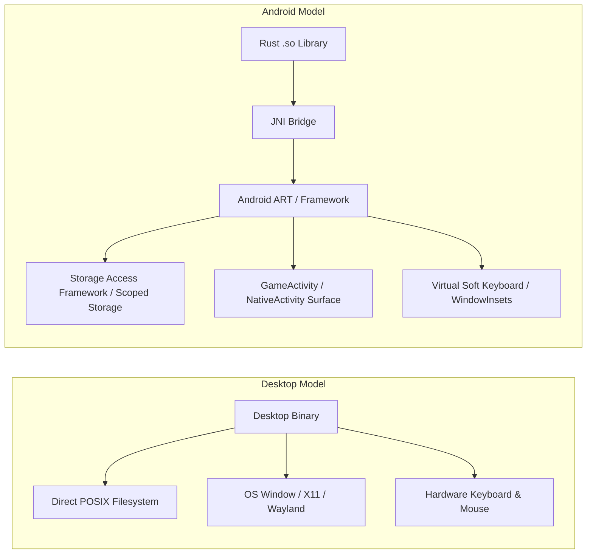

# Android Fundamentals & Platform Architecture Guide for Rust/egui Developers

This guide provides a foundational overview of the Android operating system, its security and storage architecture, native execution pipelines, and graphics models for developers coming from desktop Rust, `egui`, and `winit` environments.

If concepts like `AndroidManifest.xml`, Storage Access Framework (SAF), Scoped Storage, `AMediaCodec`, NDK, JNI, or GameActivity feel unfamiliar, this document explains why they exist, how they work in the **ArtCraft Android** ecosystem, and connects you to official documentation from Google and the Rust-mobile team.

---

## Table of Contents

- [1. Desktop vs. Android: The Mental Model Shift](#1-desktop-vs-android-the-mental-model-shift)
- [2. Android Platform Architecture & App Anatomy](#2-android-platform-architecture--app-anatomy)
  - [2.1 The Application Package (APK)](#21-the-application-package-apk)
  - [2.2 Activities & Window Lifecycle](#22-activities--window-lifecycle)
  - [2.3 The Manifest (`AndroidManifest.xml`)](#23-the-manifest-androidmanifestxml)
  - [2.4 Package Visibility & `<queries>`](#24-package-visibility--queries)
- [3. Permissions & The Storage Model (Scoped Storage & SAF)](#3-permissions--the-storage-model-scoped-storage--saf)
  - [3.1 Sandboxing & Scoped Storage](#31-sandboxing--scoped-storage)
  - [3.2 Why Desktop File Dialogs Fail](#32-why-desktop-file-dialogs-fail)
  - [3.3 Storage Access Framework (SAF) & Content URIs](#33-storage-access-framework-saf--content-uris)
- [4. Native Development Kit (NDK), JNI & Rust on Android](#4-native-development-kit-ndk-jni--rust-on-android)
  - [4.1 What the Android NDK Does](#41-what-the-android-ndk-does)
  - [4.2 Java Native Interface (JNI)](#42-java-native-interface-jni)
  - [4.3 NativeActivity vs. GameActivity](#43-nativeactivity-vs-gameactivity)
  - [4.4 Toolchain: `cargo-ndk` & `android-activity`](#44-toolchain-cargo-ndk--android-activity)
- [5. Mobile GPU, Graphics & Hardware Acceleration](#5-mobile-gpu-graphics--hardware-acceleration)
  - [5.1 Mobile Tile-Based GPUs vs. Desktop GPUs](#51-mobile-tile-based-gpus-vs-desktop-gpus)
  - [5.2 OpenGL ES, Vulkan & WGPU](#52-opengl-es-vulkan--wgpu)
  - [5.3 Hardware-Accelerated Video Decoding via NDK `AMediaCodec`](#53-hardware-accelerated-video-decoding-via-ndk-amediacodec)
- [6. Input Systems: Touch, Styluses & Virtual Keyboard (IME)](#6-input-systems-touch-styluses--virtual-keyboard-ime)
  - [6.1 Touch Gestures & Pointer Simulation](#61-touch-gestures--pointer-simulation)
  - [6.2 The Virtual Keyboard (IME) Problem](#62-the-virtual-keyboard-ime-problem)
  - [6.3 Window Insets & Edge-to-Edge Display](#63-window-insets--edge-to-edge-display)
- [7. Recommended Learning Progression & Resource Index](#7-recommended-learning-progression--resource-index)

---

## 1. Desktop vs. Android: The Mental Model Shift

On desktop operating systems (Linux, Windows, macOS), applications typically operate under the following assumptions:
1. **Direct POSIX File System Access:** A process can read and write any path on the disk that user permissions allow (e.g. `/home/user/document.txt`, `C:\Users\...`).
2. **Synchronous File Dialogs:** Libraries like `rfd` or `native-dialog` spawn synchronous native dialogs that block until a path string is returned.
3. **Continuous Window Execution:** The application owns an OS window, continuously polling mouse and physical keyboard events without interruption.
4. **Physical Keyboards:** Keys like `Ctrl`, `Alt`, and `Shift` are hardware modifier states that change atomically.
5. **Direct Process Execution:** Processes can spawn child processes (`std::process::Command`, CLI tools, compilers) at will.

On **Android**, every single one of these assumptions breaks:
* Arbitrary POSIX filesystem access is blocked by kernel-level **Scoped Storage** sandboxing.
* Native dialogs cannot block a native thread; file selection must happen asynchronously through system **Intents**.
* Android can pause, stop, or kill the activity when backgrounded or when orientation changes.
* Soft virtual keyboards (IME) are separate apps that slide over your UI and produce composed text rather than raw key events.
* Spawning arbitrary child binaries is forbidden by Android security policies (SELinux / `W^X` restrictions).

---

## 2. Android Platform Architecture & App Anatomy

### 2.1 The Application Package (APK)
An Android application is distributed as an **APK** (`.apk`), which is a digitally signed ZIP archive with a specific internal structure:
* `AndroidManifest.xml` (binary XML format): Metadata describing the app.
* `classes.dex`: Compiled Dalvik/ART bytecode executed by the Android runtime.
* `lib/<abi>/`: Native shared libraries (`.so`). For 64-bit ARM Android devices, libraries live under `lib/arm64-v8a/lib<name>.so`.
* `res/`: Compiled application resources (icons, themes, layouts, strings).
* `assets/`: Raw uncompressed files accessible via the Android Asset Manager.

### 2.2 Activities & Window Lifecycle
An **Activity** is the single focused task or screen a user interacts with. Activities do not have an infinite loop in `main()`; instead, the Android OS invokes lifecycle callbacks:
* `onCreate()`: Activity is initialized.
* `onStart()` / `onResume()`: Window becomes visible and gains user focus.
* `onPause()` / `onStop()`: User switches to another app or the screen turns off.
* `onDestroy()`: Activity is torn down to reclaim memory.

### 2.3 The Manifest (`AndroidManifest.xml`)
Every application must declare its configuration in `AndroidManifest.xml`. Key elements include:
* `<manifest package="...">`: The unique identifier (e.g. `com.artcraft.photocraft` or `app.concat.editor`).
* `<uses-permission android:name="...">`: Declares capabilities the app requests (e.g. `INTERNET`, `READ_EXTERNAL_STORAGE`).
* `<application>`: Top-level configuration defining the app's display name (`android:label`), icon (`android:icon`), and theme (`android:theme`).
* `<activity>`: Declares each window. Native Rust apps configure `android:name="android.app.NativeActivity"` or a custom Java subclass, along with `android:configChanges` to prevent the OS from restarting the app when rotating the screen or opening a keyboard.
* `<intent-filter>`: Specifies what actions open the activity. A launcher app must declare `android.intent.action.MAIN` and `android.intent.category.LAUNCHER`.

### 2.4 Package Visibility & `<queries>`
Starting in Android 11 (API level 30), Android restricts apps from seeing what other applications are installed on the device to protect user privacy.
* If an app calls `PackageManager.getInstalledPackages()` or queries another app's package name without declaring it, Android returns an empty result or reports the app is not installed.
* To allow the **ArtCraft Android Launcher** to check whether ported apps (e.g., `app.bramble.keydeck`, `com.artcraft.wordcraft`) are installed, the launcher's manifest must declare those package IDs inside a `<queries>` block.

### Official Documentation
* [Android App Architecture Fundamentals](https://developer.android.com/guide/components/fundamentals)
* [The Android App Manifest](https://developer.android.com/guide/topics/manifest/manifest-intro)
* [Package Visibility Filtering in Android 11+](https://developer.android.com/training/package-visibility)
* [Activity Lifecycle Guide](https://developer.android.com/guide/components/activities/activity-lifecycle)

---

## 3. Permissions & The Storage Model (Scoped Storage & SAF)

### 3.1 Sandboxing & Scoped Storage
On Android 10+ (API 29+), Android enforces **Scoped Storage**:
* **App-Private Storage:** Every app has its own isolated directories (`context.getFilesDir()`, `context.getCacheDir()`, and `/sdcard/Android/data/<package>/`). An app can read and write here using standard Rust `std::fs` operations without asking for any permissions. No other app can read these files.
* **Shared Storage:** Directories like `/sdcard/Documents/`, `/sdcard/Download/`, or external USB drives cannot be accessed via raw paths like `std::fs::File::open("/sdcard/Download/myfile.png")`.

### 3.2 Why Desktop File Dialogs Fail
Desktop dialog crates like `rfd` (Rust File Dialog) or `native-dialog` expect to call desktop OS APIs (like GTK/KDE file pickers on Linux or Win32 common dialogs on Windows) and return a synchronous `PathBuf`. 
On Android:
1. There is no desktop dialog service.
2. The UI thread cannot be blocked waiting for user interaction without triggering an Application Not Responding (ANR) crash.
3. Accessing the selected file requires persistent permission grants managed by Android's `ContentResolver`.

### 3.3 Storage Access Framework (SAF) & Content URIs
The **Storage Access Framework (SAF)** is Android's document provider system:
1. **Triggering:** The app sends an Intent (`Intent.ACTION_OPEN_DOCUMENT` or `Intent.ACTION_CREATE_DOCUMENT`).
2. **User Selection:** The Android system file picker opens outside the app. The user chooses a file from local storage, an SD card, Google Drive, or Nextcloud.
3. **Content URI:** Android returns a `content://` URI (e.g. `content://com.android.providers.media.documents/document/image%3A1024`), **not a filesystem path**.
4. **Data Transfer:** The application uses JNI to call `ContentResolver.openInputStream(uri)` or `openOutputStream(uri)`.
5. **The ArtCraft SAF Bridge:** In ArtCraft Android, `saf.rs` and `SafActivity.java` bridge this gap: when a file is picked, Java streams the bytes into a temporary staging file in the app's cache directory and hands the path to Rust. When the user saves, Rust writes to the staging file, and Java streams the bytes back into the user's `content://` destination.

### Official Documentation
* [Data & Storage Overview](https://developer.android.com/training/data-storage)
* [Access Documents via Storage Access Framework (SAF)](https://developer.android.com/guide/topics/providers/document-provider)
* [Permissions Overview](https://developer.android.com/guide/topics/permissions/overview)

---

## 4. Native Development Kit (NDK), JNI & Rust on Android

### 4.1 What the Android NDK Does
The **Android NDK (Native Development Kit)** provides the toolchain, C runtime (Bionic libc), and header files to compile C, C++, and Rust code directly into ARM64 shared libraries (`.so`). Unlike desktop Linux which uses glibc or musl, Android uses **Bionic**, which has different system call conventions, thread handling, and dynamic linker semantics.

### 4.2 Java Native Interface (JNI)
Android's core system services (window managers, audio servers, storage resolvers, clipboards) are exposed as Java/Kotlin APIs on the Android Runtime (ART). 
* **JNI** is the foreign function interface enabling C/Rust to interact with Java.
* In Rust, the `jni` crate allows attaching to the JVM (`JavaVM`), finding classes (`env.find_class`), creating objects, and invoking methods across the boundary.

### 4.3 NativeActivity vs. GameActivity
Standard Android applications construct their UI using Android Views or Jetpack Compose in Kotlin. Immediate-mode GUI frameworks (like `egui`) render an entire custom scene every frame into a single GPU framebuffer.
* **`NativeActivity`:** A built-in Android class that passes input events and window surfaces (`ANativeWindow`) directly to native code via callbacks (`android_main`).
* **`GameActivity`:** A modern Android Jetpack component (part of the Android Game Development Kit / AGDK). It solves several limitations of legacy NativeActivity, offering better virtual keyboard (IME) integration, dynamic display refresh rates, and modern insets handling.

### 4.4 Toolchain: `cargo-ndk` & `android-activity`
* **`cargo-ndk`:** A Cargo plugin that sets compiler flags, target sysroots, and linker configurations so `cargo build --target aarch64-linux-android` links against the appropriate Android NDK API level.
* **`android-activity`:** Maintained by the `rust-mobile` team, this crate abstracts `NativeActivity` and `GameActivity` into a unified Rust event loop (`AndroidApp`), translating Android lifecycle events into standard `winit` window events.

### Official Documentation
* [Android NDK Getting Started](https://developer.android.com/ndk/guides)
* [GameActivity Overview & Architecture](https://developer.android.com/games/agdk/game-activity)
* [Android JNI Tips & Best Practices](https://developer.android.com/training/articles/perf-jni)
* [rust-mobile `android-activity` Repository](https://github.com/rust-mobile/android-activity)
* [cargo-ndk Repository](https://github.com/bbqsrc/cargo-ndk)

---

## 5. Mobile GPU, Graphics & Hardware Acceleration

### 5.1 Mobile Tile-Based GPUs vs. Desktop GPUs
Desktop GPUs (discrete PCIe cards from NVIDIA or AMD) use **Immediate-Mode Rendering (IMR)** with massive memory bandwidth and high power budgets.
Mobile GPUs (Qualcomm Adreno, ARM Mali, Imagination PowerVR) use **Tile-Based Deferred Rendering (TBDR)**:
* The screen is split into small 16×16 or 32×32 pixel tiles.
* Geometry is binned, and visible pixels are shaded inside fast on-chip SRAM before being written to main system RAM.
* Large full-screen texture copies or un-clamped depth buffer allocations can quickly saturate mobile memory bandwidth and trigger thermal throttling.

### 5.2 OpenGL ES, Vulkan & WGPU
* **OpenGL ES (GLES):** The traditional graphics standard for mobile. In `eframe`, using the `glow` backend renders via OpenGL ES 3.0+.
* **Vulkan:** A low-level, explicit graphics API supported on Android 7.0+ (API 24+). Vulkan reduces driver CPU overhead and allows multi-threaded command buffer generation.
* **`wgpu`:** The portable WebGPU implementation in Rust. On Android, `wgpu` automatically maps to the device's native Vulkan backend, with fallback to OpenGL ES if Vulkan is unavailable or driver bugs are detected.

### 5.3 Hardware-Accelerated Video Decoding via NDK `AMediaCodec`
In timeline video editors (like **FilmCraft** and **PicassoSuite**), decoding 4K video using CPU software libraries (plain FFmpeg) causes extreme CPU usage, thermal throttling, and dropped frames.
* Android exposes hardware video decoders through **`AMediaCodec`** (in `<media/NdkMediaCodec.h>`).
* Dedicated silicon decodes H.264, HEVC/H.265, VP9, or AV1 video streams into hardware buffers.
* Direct memory buffers can then be uploaded directly to egui (`TextureHandle`) or Vulkan textures without costly CPU colorspace conversions (`libswscale`).

### Official Documentation
* [Android Graphics Architecture & SurfaceFlinger](https://source.android.com/docs/core/graphics/architecture)
* [Vulkan on Android Guide](https://developer.android.com/ndk/guides/graphics)
* [NDK `AMediaCodec` API Reference](https://developer.android.com/ndk/reference/group/media)
* [wgpu Documentation](https://wgpu.rs/)

---

## 6. Input Systems: Touch, Styluses & Virtual Keyboard (IME)

### 6.1 Touch Gestures & Pointer Simulation
* **No Hover:** Unlike a desktop mouse, a finger has no hover position until it touches the screen.
* **Multi-Touch:** Desktop `winit` primarily assumes a single cursor. Touch requires synthesizing pinch-to-zoom, two-finger pan, and rotation gestures into `egui::RawInput`.
* **Styluses:** Android devices (like Samsung Galaxy tabs with S-Pen) deliver precision stylus coordinates, tilt, and pressure levels through `AInputEvent`.

### 6.2 The Virtual Keyboard (IME) Problem
Virtual keyboards are **not** hardware keyboards:
* They are separate system services (Input Method Editors / IMEs).
* They emit text updates asynchronously (predictive text, autocorrect, composing spans) rather than simple keydown/keyup events.
* In `adapters/<app>/src/lib.rs`, ArtCraft hooks into `android-activity`'s IME bridge: when an egui `TextEdit` gains focus, the shell calls `app.show_soft_input(false)` and polls the text buffer at 16 ms intervals to push Backspace/Text/Enter events into egui's input queue.

### 6.3 Window Insets & Edge-to-Edge Display
Modern Android versions (Android 15+) draw applications **edge-to-edge**, extending the window beneath the system status bar, gesture navigation bar, and soft keyboard:
* If an application ignores insets, the virtual keyboard will cover the editor or canvas.
* ArtCraft shells listen to keyboard height changes (`imeInsetBottom`) and dynamically shrink egui's viewport rect so UI widgets stay visible above the keyboard.

### Official Documentation
* [Input Devices on Android](https://developer.android.com/develop/ui/views/touch-and-input/input-devices)
* [Edge-to-Edge Display & Window Insets Guide](https://developer.android.com/develop/ui/views/layout/edge-to-edge)
* [NDK Input Event Handling](https://developer.android.com/ndk/guides/input)

---

## 7. Recommended Learning Progression & Resource Index

If you are new to Android platform engineering, work through the concepts in this order:

| Stage | Focus Area | Key Concepts | Key Links |
| :--- | :--- | :--- | :--- |
| **Week 1** | **Android App Anatomy & Manifest** | Activities, APK structure, permissions, package queries | [App Fundamentals](https://developer.android.com/guide/components/fundamentals) · [App Manifest](https://developer.android.com/guide/topics/manifest/manifest-intro) |
| **Week 2** | **Scoped Storage & Permissions** | App-private files, SAF document pickers, Content URIs | [Storage Overview](https://developer.android.com/training/data-storage) · [SAF Guide](https://developer.android.com/guide/topics/providers/document-provider) |
| **Week 3** | **NDK, JNI & Rust Cross-Compilation** | `cargo-ndk`, GameActivity, `android-activity`, JNI calls | [NDK Guide](https://developer.android.com/ndk/guides) · [JNI Tips](https://developer.android.com/training/articles/perf-jni) · [cargo-ndk](https://github.com/bbqsrc/cargo-ndk) |
| **Week 4** | **Graphics, IME & Viewports** | Vulkan/GLES, Window insets, soft keyboard handling | [Graphics Architecture](https://source.android.com/docs/core/graphics/architecture) · [Edge-to-Edge & Insets](https://developer.android.com/develop/ui/views/layout/edge-to-edge) |

---

> [!TIP]
> **Real-World Examples in ArtCraft Android:**
> * For Storage Access Framework (SAF) JNI bridges: inspect [`adapters/papercraft/src/lib.rs`](../adapters/papercraft/src/lib.rs) and [`adapters/photocraft/src/lib.rs`](../adapters/photocraft/src/lib.rs).
> * For Termux IPC command execution: inspect [`adapters/coimanide/`](../adapters/coimanide/).
> * For Hardware-Accelerated Video: inspect [`docs/FILMCRAFT_OPTIMIZATION_ROADMAP.md`](FILMCRAFT_OPTIMIZATION_ROADMAP.md).
