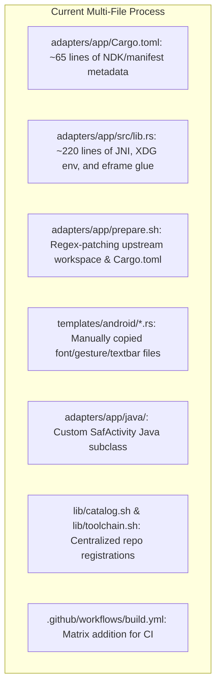
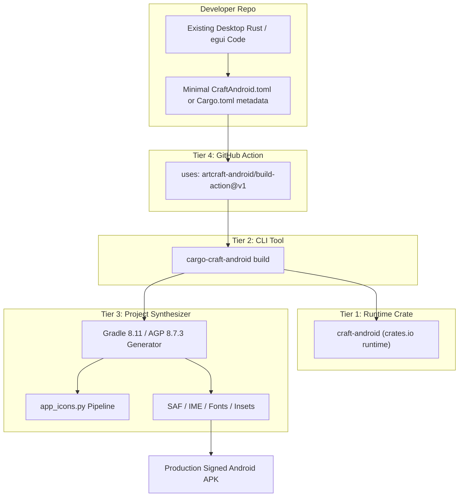
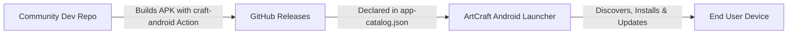

# Craft-Android: A Generalized Framework for Porting Desktop Rust/egui Apps to Android
**Architectural Blueprint, Feasibility Study, and Implementation Roadmap**

*Date: November 2026*  
*Author: ArtCraft Android Architecture & Tooling Team*

---

## Executive Summary

The **ArtCraft Android** project has accomplished something rare in the Rust mobile ecosystem: successfully porting **48 complex desktop GUI applications** (written in Rust using `egui`, `eframe`, and `winit`) to native 64-bit ARM Android. To achieve this without altering upstream codebases, the project engineered custom runtime bridges for:
* Storage Access Framework (SAF) document streaming across JNI
* Native GameActivity Input Method Editor (IME) soft-keyboard polling
* Touch gesture synthesis (multi-touch zoom, two-finger pan, inertial scrolling)
* Physical modifier key chord tracking (`Ctrl`, `Alt`, `Shift`)
* Dynamic system font discovery across `/system/fonts` and `/product/fonts`
* Gradle 8.11 / AGP 8.7.3 project synthesis directly from Cargo metadata
* High-density screen scaling, window insets, and immersive sticky fullscreen

### The Opportunity
Currently, porting a new app requires writing and maintaining **5 to 8 separate files** across multiple directories, shell scripts, Python hooks, and Cargo manifests (`adapters/<app>/`). 

However, **over 90% of the code across our 24+ community adapters is identical boilerplate**. 

By extracting and generalizing these battle-tested components into an open-source framework—tentatively named **`craft-android`**—we can empower any developer in the wider Rust/egui community to:
1. **Build an Android APK directly from their own GitHub repository** via a turnkey GitHub Action.
2. **Eliminate boilerplate** by replacing hundreds of lines of adapter code with a single declarative configuration or a lightweight runtime crate.
3. **Decentralize CI and maintenance**, allowing upstream authors to own and publish their own Android releases while seamlessly indexing them into the ArtCraft Launcher.

---

## 1. Analysis of Current Porting Friction & Pain Points

To port a standalone community app today (such as PaperCraft, Ferrite, or SubCraft), developers must navigate several pain points:



### Key Friction Points
1. **High Cognitive Overhead:** Developers must understand Android NDK ABI targets (`aarch64-linux-android`), Bionic libc nuances, JNI pointer lifetimes, GameActivity lifecycle quirks, Scoped Storage rules, and Android Manifest XML schemas.
2. **Boilerplate Duplication:** Every adapter in `adapters/` duplicates the same `install_persist_env()`, `device_is_high_density()`, `apply_immersive_fullscreen()`, and `raw_input_hook()` logic.
3. **Fragile Staging Scripts (`prepare.sh`):** Modifying upstream checkouts using inline Python regexes (to inject `[workspace]` members, add `[lib]` targets for binary-only crates, or stub out `rfd`/`termios`) requires significant shell scripting expertise.
4. **Template Drift:** When core template bridges (e.g. `system_fonts.rs` or `touch_gestures.rs`) are improved, keeping dozens of in-tree adapters up-to-date requires manual synchronization.
5. **Centralized Repository Coupling:** Developers cannot easily produce an Android build inside their own upstream repository—they must either submit an in-tree adapter to `MostafaXS1/artcraft-android` or reinvent the entire NDK/Gradle/SAF toolchain from scratch.

---

## 2. The Vision: The `craft-android` Generalized Framework

We can generalize ArtCraft Android's architecture into a **4-tier framework** modeled after successful modern developer tools like **Tauri** (for web apps on desktop/mobile) and **Trunk** (for Rust WASM).



---

## 3. Detailed Architectural Components

### Tier 1: The Runtime Crate (`craft-android`)
Published on `crates.io`, this crate provides the runtime bridge that turns any desktop `eframe::App` into an Android-ready application.

#### What it encapsules:
* **The Entrypoint Macro:** Replaces 200 lines of `android_main` with a clean entrypoint:
  ```rust
  // Inside the developer's main.rs or lib.rs:
  #[craft_android::main]
  fn main() {
      craft_android::run("MyApp", |cc| Box::new(MyApp::new(cc)));
  }
  ```
* **Integrated Platform Services:**
  * Automatically sets up `XDG_CONFIG_HOME`, `XDG_DATA_HOME`, and `TMPDIR` inside app-private or media storage.
  * Automatically injects fallback system fonts (`/system/fonts`) on the first frame.
  * Automatically routes touch gestures (pinch-to-zoom, pan) to `egui::RawInput`.
  * Automatically detects high-DPI displays and configures sensible default zoom factors.
  * Automatically monitors keyboard insets (`WindowInsetsCompat`) and resizes egui's viewport when the IME appears.
* **Universal File Dialog Abstraction (`craft_android::dialog`):**
  Instead of having desktop apps break on Android due to `rfd`, the crate provides a unified dialog API:
  ```rust
  // On desktop: invokes rfd or native-dialog
  // On Android: invokes the JNI Storage Access Framework (SAF) bridge
  craft_android::dialog::open_file()
      .add_filter("Image", &["png", "jpg"])
      .pick_file(|result| {
          if let Some(path) = result {
              // Load document
          }
      });
  ```

---

### Tier 2: Declarative Configuration (`[package.metadata.craft]`)

Instead of writing custom `prepare.sh` scripts and manifests, developers define their mobile configuration directly in their existing `Cargo.toml` (or a standalone `CraftAndroid.toml`):

```toml
[package.metadata.craft]
package = "com.example.myapp"
label = "My App"
icon = "assets/icon.png"
version_code = 100

[package.metadata.craft.permissions]
internet = true
storage = "saf" # "saf" (Scoped Storage picker) or "internal"

[package.metadata.craft.display]
orientation = "sensorLandscape" # "unspecified", "portrait", "sensorLandscape"
fullscreen = true
zoom_factor = 0.85

[package.metadata.craft.associations]
mime_types = ["image/png", "image/jpeg"]
extensions = ["png", "jpg"]
```

---

### Tier 3: The Developer CLI (`cargo-craft-android`)

```mermaid
flowchart LR
    Dev[Developer runs 'cargo craft android build'] --> Inspect[1. Inspect Cargo.toml & Assets]
    Inspect --> Harness[2. Synthesize In-Memory cdylib Harness]
    Harness --> Icons[3. Rasterize Adaptive Mipmaps via Pillow]
    Icons --> Gradle[4. Generate Gradle 8.11 / AGP 8.7.3 Project]
    Gradle --> NDK[5. cargo-ndk: Compile aarch64 .so with Bionic libc]
    NDK --> Strip[6. llvm-strip: Strip Debug Symbols]
    Strip --> Pack[7. Gradle: Assemble & Sign APK]
    Pack --> APK[Output: dist/myapp-1.0.0-android-arm64.apk]
```

The framework is invoked through a native Cargo subcommand (`cargo craft android <command>` or `cargo craft-android <command>`). By following standard Cargo subcommand conventions, developers do not need to learn a separate toolchain or install external build systems—they compile Android APKs directly through `cargo`.



---

#### 1. Checking & Auto-Fixing Environment (`cargo craft android doctor`)

Before building, developers can run `doctor` to inspect their local toolchains. It validates the Android SDK, NDK, JDK, Rust targets, and ADB connections:

```bash
# Standard diagnostic check
cargo craft android doctor

# Automatically install missing Rust targets (e.g. rustup target add aarch64-linux-android)
cargo craft android doctor --fix
```

##### Example Terminal Output:
```text
$ cargo craft android doctor

[✓] Rust Toolchain: rustc 1.85.0 (stable-x86_64-unknown-linux-gnu)
[✓] Rust Target: aarch64-linux-android (installed)
[!] Rust Target: x86_64-linux-android (missing, needed for x86_64 emulator)
    ↳ Run `rustup target add x86_64-linux-android` or rerun with `--fix`
[✓] Android SDK: Platform 35 found (/opt/android-sdk)
[✓] Android NDK: r27c found (/opt/android-sdk/ndk/27.2.12479018)
[✓] Java Runtime: OpenJDK 21.0.5 (/usr/lib/jvm/java-21-openjdk)
[✓] Compiler Cache: sccache 0.8.2 found (active)
[✓] ADB Connection: 1 physical device attached
    ↳ Samsung SM-X810 (Galaxy Tab S9, Android 14, API 34, arm64-v8a)
```

---

#### 2. Interactive Project Initialization (`cargo craft android init`)

Runs an interactive wizard inside an existing desktop Rust/egui crate. It detects whether the crate is a library or binary, scans for desktop icons, and configures the `Cargo.toml` manifest:

```bash
# Interactive setup wizard
cargo craft android init

# Or non-interactive scripted initialization:
cargo craft android init \
    --package "com.example.papercraft" \
    --name "PaperCraft" \
    --icon "assets/icon.png" \
    --orientation "sensorLandscape" \
    --storage "saf"
```

##### Interactive Wizard Walkthrough:
```text
$ cargo craft android init

? Application Name: PaperCraft
? Android Application ID (reverse-domain): com.example.papercraft
? Detected icon at 'assets/icon.png'. Use this as launcher icon? [Y/n]: y
? Window Orientation:
  > Sensor Landscape (recommended for creative canvas apps)
    Portrait
    Unspecified (auto-rotate)
? Document Storage Model:
  > Storage Access Framework (SAF - Scoped Storage document picker)
    App-Private Sandboxed Storage only
? Enable fallback system fonts for CJK, Arabic, and Emoji? [Y/n]: y

[✓] Generated [package.metadata.craft] in Cargo.toml
[✓] Setup complete! You can now run `cargo craft android build` or `cargo craft android run`.
```

---

#### 3. Building APKs (`cargo craft android build`)

The core command compiles the Rust codebase into ARM64 native shared libraries, generates the Android build scaffolding, and produces signed `.apk` or `.aab` (Android App Bundle) artifacts.

##### Common Command Workflows:

```bash
# -------------------------------------------------------------------------
# A. Daily Development Builds (Fast, unoptimized, incremental)
# -------------------------------------------------------------------------
cargo craft android build
# Equivalent to: cargo craft android build --debug

# -------------------------------------------------------------------------
# B. Release Builds (Optimized, stripped, production-ready)
# -------------------------------------------------------------------------
cargo craft android build --release

# -------------------------------------------------------------------------
# C. Multi-Architecture Builds (Fat APK or separate APKs per ABI)
# -------------------------------------------------------------------------
# Build for modern 64-bit ARM devices (default):
cargo craft android build --release --target aarch64-linux-android

# Build for x86_64 desktop emulators:
cargo craft android build --debug --target x86_64-linux-android

# Build a multi-ABI bundle covering all Android architectures:
cargo craft android build --release --target aarch64-linux-android,armv7-linux-androideabi,x86_64-linux-android

# -------------------------------------------------------------------------
# D. Google Play Store App Bundle (.aab)
# -------------------------------------------------------------------------
cargo craft android build --release --format aab

# -------------------------------------------------------------------------
# E. Forwarding Standard Cargo Flags
# -------------------------------------------------------------------------
# Forward custom feature flags:
cargo craft android build --release --features "mcp,gpu-compute" --no-default-features

# Build a specific crate inside a multi-crate Cargo workspace:
cargo craft android build --release -p myapp-desktop

# Pass custom profile:
cargo craft android build --profile release-lto

# -------------------------------------------------------------------------
# F. Code Signing Configurations
# -------------------------------------------------------------------------
# 1. Sign using an explicit Java Keystore:
cargo craft android build --release \
    --keystore /path/to/release.jks \
    --ks-pass env:ANDROID_KEYSTORE_PASSWORD \
    --ks-key-alias my-release-key

# 2. Sign using a debug keystore (default when no keystore is specified):
cargo craft android build --release --debug-signing

# -------------------------------------------------------------------------
# G. Custom Output Destination
# -------------------------------------------------------------------------
cargo craft android build --release --out-dir dist/
```

##### Detailed Terminal Execution Log:
```text
$ cargo craft android build --release --out-dir dist/

  [1/6] Workspace Inspection
        • Target crate: `papercraft` v0.4.0 (binary crate)
        • Synthesis: Generating transient cdylib launch harness in `.craft-android/`
        • Mode: Release (codegen-units = 16, lto = "off", debug = false)

  [2/6] Asset & Icon Pipeline
        • Reading master artwork from `assets/icon.png` (1024x1024 PNG)
        • Rasterizing adaptive mipmaps with Lanczos resampling:
          ↳ res/mipmap-mdpi/ic_launcher.png (48x48)
          ↳ res/mipmap-hdpi/ic_launcher.png (72x72)
          ↳ res/mipmap-xhdpi/ic_launcher.png (96x96)
          ↳ res/mipmap-xxhdpi/ic_launcher.png (144x144)
          ↳ res/mipmap-xxxhdpi/ic_launcher.png (192x192)

  [3/6] Project Scaffolding
        • Generating AndroidManifest.xml (package: com.example.papercraft, targetSdk: 35)
        • Injecting Storage Access Framework (SAF) document bridge
        • Generating Gradle 8.11.1 / AGP 8.7.3 wrapper in `.craft-android/gradle/`

  [4/6] Native Cross-Compilation (cargo-ndk)
        • Target: aarch64-linux-android (API level 29+)
        • Compiling 184 crates...
          Running sccache rustc --crate-name papercraft ...
        • Linking target/aarch64-linux-android/release/libpapercraft_android.so
        • Stripping debug symbols (llvm-strip): 21.4 MB -> 9.2 MB

  [5/6] Gradle APK Packaging
        • Running `./gradlew :app:packageRelease`
        • Packaging classes.dex, assets, and lib/arm64-v8a/
        • Signing APK with local keystore (`release-key`)
        • Aligning zip entries (zipalign 4-byte alignment verified)

  [6/6] Integrity Verification
        • Minimum size check (> 1 MB): 9.6 MB [PASS]
        • ZIP archive structure check (unzip -tq): 412 entries [PASS]

[✓] Build complete in 18.4s!
    Output: dist/papercraft-0.4.0-android-arm64.apk
    SHA-256: e3b0c44298fc1c149afbf4c8996fb92427ae41e4649b934ca495991b7852b855
```

---

#### 4. Device Deployment, Testing & Live Debugging (`cargo craft android run`)

Deploys the compiled APK to an attached hardware device (via USB/Wi-Fi ADB) or running emulator, launches the main activity, and streams colorized, filtered application logs:

```bash
# -------------------------------------------------------------------------
# A. Build, Install, Launch and Follow Logcat
# -------------------------------------------------------------------------
cargo craft android run --follow-log

# -------------------------------------------------------------------------
# B. Target a Specific Device (when multiple are connected)
# -------------------------------------------------------------------------
# List available devices:
cargo craft android devices

# Deploy to specific device ID or emulator:
cargo craft android run --device emulator-5554
cargo craft android run --device RFCX101XYZ # (Galaxy Tab S9)

# -------------------------------------------------------------------------
# C. Clear App Data Before Running (Clean State Testing)
# -------------------------------------------------------------------------
cargo craft android run --clean-data
```

##### Live Runtime Logcat Streaming:
When `--follow-log` is active, the CLI automatically demangles Rust panic backtraces using `ndk-stack` and filters out noisy Android OS system daemon logs:

```text
$ cargo craft android run --release --follow-log

[✓] Found target device: Samsung Galaxy Tab S9 (Wi-Fi ADB: 192.168.1.120:5555)
[✓] Installing dist/papercraft-0.4.0-android-arm64.apk (9.6 MB)... [Success]
[✓] Starting Activity: com.example.papercraft/.CraftActivity...
[✓] Streaming application logs (Ctrl+C to stop):

  14:10:02.110 [INFO]  com.example.papercraft: ARTCRAFT_ANDROID_SHELL_V1 initialized
  14:10:02.114 [INFO]  com.example.papercraft: System font environment mounted:
                       ↳ Registered fallback font: Noto Sans CJK JP (U+4E00..U+9FFF)
                       ↳ Registered fallback font: Noto Color Emoji (U+1F600..U+1F64F)
  14:10:02.125 [INFO]  com.example.papercraft: Storage Access Framework JNI bridge connected
  14:10:02.140 [INFO]  com.example.papercraft: Screen DPI density: 2.75x -> auto-tuned zoom factor: 0.80
  14:10:02.152 [INFO]  com.example.papercraft: Surface created: Vulkan surface 2560x1600 (Format: Rgba8Unorm)
  14:10:08.312 [DEBUG] com.example.papercraft: Multi-touch gesture: 2 pointers active -> pinch-zoom factor: 1.15
  14:10:14.004 [INFO]  com.example.papercraft: SAF: ACTION_OPEN_DOCUMENT completed:
                       ↳ Staged URI to cache: /data/data/com.example.papercraft/cache/drawing.paper
```

---

#### 5. Native Debugging with LLDB (`cargo craft android lldb`)

For complex C/Rust memory issues, shader crashes, or native panics, the CLI can automatically attach the Android NDK `lldb-server` directly to the running Rust process on the device:

```bash
cargo craft android lldb
```
It starts `gdbserver` / `lldb-server` on the device via ADB, forwards the debugging socket, sets up symbol search paths for `libpapercraft_android.so`, and drops the developer into an interactive LLDB prompt with full Rust symbol demangling.

---

#### 6. Cleaning Build Scaffolding (`cargo craft android clean`)

Removes intermediate Gradle artifacts, transient Android project scaffolding, and `.craft-android/` staging trees without wiping your primary Rust `target/` cache:

```bash
cargo craft android clean
```

---

---

### Tier 4: The Turnkey GitHub Action & CI Workflows

Tier 4 enables open-source maintainers to **produce Android APKs straight from their existing GitHub repositories** without managing an Android NDK toolchain locally.

The composite GitHub Action (`artcraft-android/build-action`) encapsulates:
* JDK 21 and Android SDK Platform 35 provisioning.
* Cached NDK r27+ bootstrapping.
* Rust toolchain with the `aarch64-linux-android` target.
* Multi-layer `sccache` and Cargo registry caching to reduce CI runtime to ~3–5 minutes.
* Executing `cargo craft android build`.
* Binary integrity verification (`size > 1MB` and `unzip -tq`).

Here are practical, copy-pasteable GitHub Actions workflow templates for different development scenarios:

#### Workflow Example 1: Automated GitHub Releases on Git Tag (`.github/workflows/android-release.yml`)
When you tag a release (`git tag v1.0.0 && git push origin v1.0.0`), this workflow compiles the Android APK, signs it with your secret keystore, and attaches the `.apk` directly to the published GitHub Release:

```yaml
name: Android Release Build

on:
  push:
    tags:
      - 'v*'
  workflow_dispatch:

permissions:
  contents: write

jobs:
  build-android:
    name: Build & Publish Android APK
    runs-on: ubuntu-latest
    steps:
      - name: Checkout Code
        uses: actions/checkout@v4

      - name: Build Android APK
        uses: artcraft-android/build-action@v1
        id: craft
        with:
          package: com.example.myapp
          app_name: MyApp
          icon: assets/icon.png
          mode: release
          signing_keystore: ${{ secrets.ANDROID_KEYSTORE_BASE64 }}
          keystore_password: ${{ secrets.ANDROID_KEYSTORE_PASSWORD }}
          key_alias: release-key

      - name: Verify APK Output
        run: |
          echo "Built APK at: ${{ steps.craft.outputs.apk_path }}"
          echo "File size: $(stat -c%s ${{ steps.craft.outputs.apk_path }}) bytes"
          echo "SHA-256: ${{ steps.craft.outputs.sha256 }}"

      - name: Attach APK to GitHub Release
        uses: softprops/action-gh-release@v2
        if: startsWith(github.ref, 'refs/tags/')
        with:
          files: ${{ steps.craft.outputs.apk_path }}
          draft: false
          prerelease: false
        env:
          GITHUB_TOKEN: ${{ secrets.GITHUB_TOKEN }}
```

---

#### Workflow Example 2: Pull Request Verification & Artifact Upload (`.github/workflows/android-ci.yml`)
Runs on every Pull Request or commit to `main`. Compiles a debug APK to guarantee that recent desktop code changes didn't introduce incompatible dependencies or break Android cross-compilation:

```yaml
name: Android CI

on:
  pull_request:
    branches: [main, master]
  push:
    branches: [main, master]

jobs:
  verify-android-build:
    name: Verify Android Cross-Compilation
    runs-on: ubuntu-latest
    steps:
      - name: Checkout Code
        uses: actions/checkout@v4

      - name: Build Debug APK
        uses: artcraft-android/build-action@v1
        id: craft_debug
        with:
          package: com.example.myapp
          app_name: MyApp
          icon: assets/icon.png
          mode: debug # Fast unoptimized build for CI validation

      - name: Upload Test APK Artifact
        uses: actions/upload-artifact@v4
        with:
          name: myapp-debug-apk
          path: ${{ steps.craft_debug.outputs.apk_path }}
          retention-days: 7
```

---

#### Workflow Example 3: Multi-Architecture Build Matrix (ARM64, ARM32, x86_64)
For applications that need to support older 32-bit devices or Android x86_64 PC emulators alongside standard 64-bit ARM devices:

```yaml
name: Android Multi-Arch Build

on:
  push:
    tags: ['v*']

jobs:
  build-arch-matrix:
    name: Build APK (${{ matrix.target }})
    runs-on: ubuntu-latest
    strategy:
      fail-fast: false
      matrix:
        include:
          - target: aarch64-linux-android
            arch: arm64-v8a
          - target: armv7-linux-androideabi
            arch: armeabi-v7a
          - target: x86_64-linux-android
            arch: x86_64
    steps:
      - uses: actions/checkout@v4
      - name: Build APK for ${{ matrix.arch }}
        uses: artcraft-android/build-action@v1
        id: craft
        with:
          package: com.example.myapp
          app_name: MyApp
          icon: assets/icon.png
          target: ${{ matrix.target }}
          mode: release
          signing_keystore: ${{ secrets.ANDROID_KEYSTORE_BASE64 }}
          keystore_password: ${{ secrets.ANDROID_KEYSTORE_PASSWORD }}

      - name: Upload Target APK to Release
        uses: softprops/action-gh-release@v2
        with:
          files: ${{ steps.craft.outputs.apk_path }}
        env:
          GITHUB_TOKEN: ${{ secrets.GITHUB_TOKEN }}
```

---

#### Workflow Example 4: Direct CLI Scripting in GitHub Actions
For power users who prefer not to use a black-box Action and want full control using native `cargo` commands in their own CI scripts:

```yaml
name: Custom Scripted Android Build

on: [workflow_dispatch]

jobs:
  custom-build:
    runs-on: ubuntu-latest
    steps:
      - uses: actions/checkout@v4

      # 1. Setup toolchains
      - uses: dtolnay/rust-toolchain@stable
        with:
          targets: aarch64-linux-android
      - uses: actions/setup-java@v4
        with:
          distribution: 'temurin'
          java-version: '21'
      - uses: android-actions/setup-android@v3

      # 2. Install cargo-ndk and cargo-craft-android
      - name: Install Tools
        run: |
          cargo install cargo-ndk
          cargo install cargo-craft-android

      # 3. Build APK using standard Cargo command
      - name: Build Release APK
        env:
          ANDROID_KEYSTORE_PASSWORD: ${{ secrets.ANDROID_KEYSTORE_PASSWORD }}
        run: |
          echo "${{ secrets.ANDROID_KEYSTORE_BASE64 }}" | base64 -d > release.jks
          cargo craft android build \
            --release \
            --keystore release.jks \
            --ks-pass env:ANDROID_KEYSTORE_PASSWORD \
            --out-dir output/
          rm -f release.jks

      - name: Upload Output
        uses: actions/upload-artifact@v4
        with:
          name: release-apk
          path: output/*.apk
```

---

#### Action Input & Output Reference Table

| Parameter | Type | Required | Default | Description |
| :--- | :--- | :--- | :--- | :--- |
| **Inputs** | | | | |
| `package` | string | **Yes** | — | Unique Android application ID (e.g. `com.example.myapp`). |
| `app_name` | string | **Yes** | — | Display title for the Android launcher icon (e.g. `MyApp`). |
| `icon` | path | **Yes** | — | Path to source 1024×1024 PNG or SVG artwork to rasterize into adaptive icons. |
| `mode` | string | No | `release` | Compilation profile: `release` (optimized & stripped) or `debug` (unoptimized). |
| `target` | string | No | `aarch64-linux-android` | Android target architecture triple (`aarch64-linux-android`, `x86_64-linux-android`, etc.). |
| `features` | string | No | `""` | Comma-separated Cargo features to activate during compilation. |
| `signing_keystore` | string | No | `""` | Base64-encoded Java Keystore (`.jks`) for release signing. (Uses debug key if omitted). |
| `keystore_password`| string | No | `""` | Password protecting the signing keystore. |
| `key_alias` | string | No | `""` | Alias identifier for the private signing key in the keystore. |
| `output_dir` | path | No | `output/` | Destination folder for the compiled `.apk`. |
| **Outputs** | | | | |
| `apk_path` | path | — | — | Absolute file path to the verified generated APK. |
| `apk_name` | string | — | — | Filename of the generated APK (e.g. `myapp-1.0.0-android-arm64.apk`). |
| `sha256` | string | — | — | SHA-256 checksum string of the final compiled APK. |

---

## 4. How Existing ArtCraft Android Assets Map to the Framework

ArtCraft Android has already written the core logic needed for this framework. Here is how our existing repository components map to the proposed framework:

| Existing ArtCraft Component | Proposed Framework Destination | Purpose in Generalized Framework |
| :--- | :--- | :--- |
| `lib/android_project.py` | `cargo-craft-android::gradle` | Generates modern Gradle 8.11 / AGP 8.7.3 project files from TOML metadata. |
| `lib/app_icons.py` | `cargo-craft-android::icons` | Headless Pillow-based adaptive icon generation for all Android screen densities. |
| `lib/file_associations.py` | `cargo-craft-android::manifest` | Generates Android `<intent-filter>` blocks for system document associations. |
| `templates/android/system_fonts.rs` | `craft-android::fonts` | Shared runtime font scanner for `/system/fonts` and CJK/Emoji glyph fallbacks. |
| `templates/android/touch_gestures.rs` | `craft-android::gestures` | Multi-touch gesture translator (pinch zoom, two-finger pan, inertial physics). |
| `templates/android/mobile_text_bar.rs`| `craft-android::ui::text_bar`| Floating cut/copy/paste selection toolbar for mobile touchscreens. |
| `adapters/photocraft/java/SafActivity.java`| `craft-android-aar` | Universal precompiled Android library (`.aar`) containing the SAF picker bridge. |
| `.github/workflows/build.yml` | `artcraft-android/build-action` | Action workflow logic packaging toolchain setup, caching, and signing. |

---

## 5. Benefits for the ArtCraft Android Ecosystem

Generalizing our architecture into this framework provides major strategic advantages for the ArtCraft project:



1. **Drastic Reduction in Repository Maintenance:**
   * Instead of maintaining 24 in-tree `adapters/<app>/` with custom `prepare.sh` scripts, upstream apps can build their own APKs using the action.
   * Upstream breaking changes are fixed directly by app authors rather than breaking the ArtCraft monorepo CI.
2. **Reduced CI Minutes & Infrastructure Costs:**
   * Currently, our central GitHub Actions matrix must build 40+ apps on every release.
   * Community apps distributed via the Launcher catalog build on their own repository runner quotas; ArtCraft CI only needs to build the core Storytold suite and the launcher.
3. **Ecosystem Growth & Adoption:**
   * Making `craft-android` the de-facto standard for running Rust `egui` apps on Android establishes ArtCraft as the leading authority in Rust mobile GUI engineering.
   * Community authors who use the framework will naturally list their apps in the ArtCraft Android Launcher to gain mobile distribution.

---

## 6. Implementation Roadmap

### Phase 1: Prototype the Runtime Crate (`craft-android`)
* Consolidate `system_fonts.rs`, `touch_gestures.rs`, `mobile_text_bar.rs`, and the SAF JNI bridge into a single Rust crate.
* Provide a unified `#[craft_android::main]` attribute macro or runner function (`craft_android::run()`).
* Test the crate on an existing community app (e.g. `papercraft`).

### Phase 2: Standalone CLI Tool (`cargo-craft-android`)
* Port the Python logic in `lib/android_project.py` and `lib/app_icons.py` into a Rust CLI (using `image` and `minijinja` / `tera` templates).
* Implement `cargo craft-android build`, verifying it can generate the Gradle project and compile an APK in one command.

### Phase 3: The GitHub Action (`artcraft-android/build-action`)
* Create a dedicated GitHub Action repository (`MostafaXS1/artcraft-android-action` or under an organization).
* Package NDK bootstrapping, caching, building, and signing into a single composite Action.
* Publish an example workflow demonstrating zero-config APK generation.

### Phase 4: Pilot Migration of 3 Community Apps
* Pilot the framework with 3 diverse applications:
  1. A simple single-window editor (e.g. **Ferrite**).
  2. An infinite-canvas design app (e.g. **PaperCraft**).
  3. A 3D model visualizer (e.g. **SubCraft**).
* Update `launcher/apps/artcraft-launcher-android/app-catalog.json` to track their upstream release tags.

---

## 7. Developer Experience Comparison

### Today (Manual Multi-File Adapter)
* ❌ Create `adapters/<app>/Cargo.toml` (~65 lines)
* ❌ Create `adapters/<app>/src/lib.rs` (~220 lines)
* ❌ Write `adapters/<app>/prepare.sh` with custom Python regex patching (~60 lines)
* ❌ Write `SafActivity.java` JNI bridge (~80 lines)
* ❌ Register in `lib/catalog.sh`, `lib/toolchain.sh`, and `.github/workflows/build.yml`
* ❌ Centralized build tied to ArtCraft Android CI

### Future (With `craft-android` Framework)
* ✅ Add 10 lines of declarative config to `Cargo.toml`:
  ```toml
  [package.metadata.craft]
  package = "com.example.myapp"
  label = "My App"
  icon = "assets/icon.png"
  ```
* ✅ Add 1 standard GitHub Actions file (`.github/workflows/android.yml`):
  ```yaml
  - uses: artcraft-android/build-action@v1
  ```
* ✅ Fully automated APK builds, releases, and updates hosted directly on the developer's GitHub repository.
