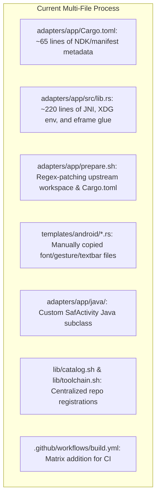
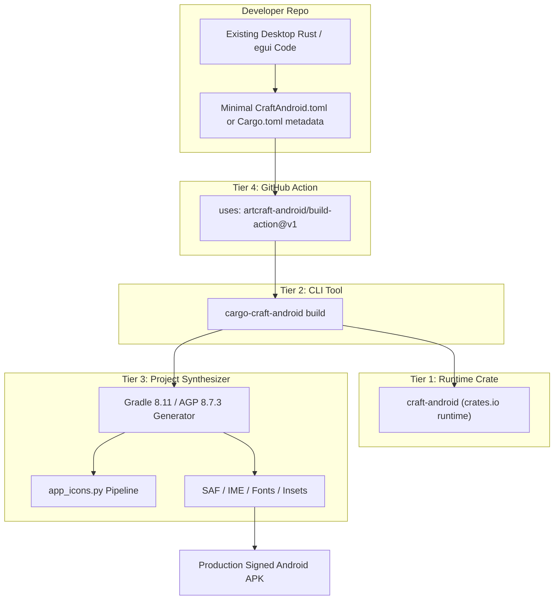
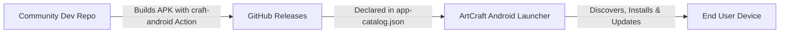

# Craft-Android: A Generalized Framework for Porting Desktop Rust/egui Apps to Android
**Architectural Blueprint, Feasibility Study, and Implementation Roadmap**

*Date: November 2026*  
*Author: ArtCraft Android Architecture & Tooling Team*

---

## Executive Summary

The **ArtCraft Android** project has accomplished something rare in the Rust mobile ecosystem: successfully porting **48 complex desktop GUI applications** (written in Rust using `egui`, `eframe`, and `winit`) to native 64-bit ARM Android. To achieve this without altering upstream codebases, the project engineered custom runtime bridges for:
* Storage Access Framework (SAF) document streaming across JNI
* Native GameActivity Input Method Editor (IME) soft-keyboard polling
* Touch gesture synthesis (multi-touch zoom, two-finger pan, inertial scrolling)
* Physical modifier key chord tracking (`Ctrl`, `Alt`, `Shift`)
* Dynamic system font discovery across `/system/fonts` and `/product/fonts`
* Gradle 8.11 / AGP 8.7.3 project synthesis directly from Cargo metadata
* High-density screen scaling, window insets, and immersive sticky fullscreen

### The Opportunity
Currently, porting a new app requires writing and maintaining **5 to 8 separate files** across multiple directories, shell scripts, Python hooks, and Cargo manifests (`adapters/<app>/`). 

However, **over 90% of the code across our 24+ community adapters is identical boilerplate**. 

By extracting and generalizing these battle-tested components into an open-source framework—tentatively named **`craft-android`**—we can empower any developer in the wider Rust/egui community to:
1. **Build an Android APK directly from their own GitHub repository** via a turnkey GitHub Action.
2. **Eliminate boilerplate** by replacing hundreds of lines of adapter code with a single declarative configuration or a lightweight runtime crate.
3. **Decentralize CI and maintenance**, allowing upstream authors to own and publish their own Android releases while seamlessly indexing them into the ArtCraft Launcher.

---

## 1. Analysis of Current Porting Friction & Pain Points

To port a standalone community app today (such as PaperCraft, Ferrite, or SubCraft), developers must navigate several pain points:



### Key Friction Points
1. **High Cognitive Overhead:** Developers must understand Android NDK ABI targets (`aarch64-linux-android`), Bionic libc nuances, JNI pointer lifetimes, GameActivity lifecycle quirks, Scoped Storage rules, and Android Manifest XML schemas.
2. **Boilerplate Duplication:** Every adapter in `adapters/` duplicates the same `install_persist_env()`, `device_is_high_density()`, `apply_immersive_fullscreen()`, and `raw_input_hook()` logic.
3. **Fragile Staging Scripts (`prepare.sh`):** Modifying upstream checkouts using inline Python regexes (to inject `[workspace]` members, add `[lib]` targets for binary-only crates, or stub out `rfd`/`termios`) requires significant shell scripting expertise.
4. **Template Drift:** When core template bridges (e.g. `system_fonts.rs` or `touch_gestures.rs`) are improved, keeping dozens of in-tree adapters up-to-date requires manual synchronization.
5. **Centralized Repository Coupling:** Developers cannot easily produce an Android build inside their own upstream repository—they must either submit an in-tree adapter to `MostafaXS1/artcraft-android` or reinvent the entire NDK/Gradle/SAF toolchain from scratch.

---

## 2. The Vision: The `craft-android` Generalized Framework

We can generalize ArtCraft Android's architecture into a **4-tier framework** modeled after successful modern developer tools like **Tauri** (for web apps on desktop/mobile) and **Trunk** (for Rust WASM).



---

## 3. Detailed Architectural Components

### Tier 1: The Runtime Crate (`craft-android`)
Published on `crates.io`, this crate provides the runtime bridge that turns any desktop `eframe::App` into an Android-ready application.

#### What it encapsules:
* **The Entrypoint Macro:** Replaces 200 lines of `android_main` with a clean entrypoint:
  ```rust
  // Inside the developer's main.rs or lib.rs:
  #[craft_android::main]
  fn main() {
      craft_android::run("MyApp", |cc| Box::new(MyApp::new(cc)));
  }
  ```
* **Integrated Platform Services:**
  * Automatically sets up `XDG_CONFIG_HOME`, `XDG_DATA_HOME`, and `TMPDIR` inside app-private or media storage.
  * Automatically injects fallback system fonts (`/system/fonts`) on the first frame.
  * Automatically routes touch gestures (pinch-to-zoom, pan) to `egui::RawInput`.
  * Automatically detects high-DPI displays and configures sensible default zoom factors.
  * Automatically monitors keyboard insets (`WindowInsetsCompat`) and resizes egui's viewport when the IME appears.
* **Universal File Dialog Abstraction (`craft_android::dialog`):**
  Instead of having desktop apps break on Android due to `rfd`, the crate provides a unified dialog API:
  ```rust
  // On desktop: invokes rfd or native-dialog
  // On Android: invokes the JNI Storage Access Framework (SAF) bridge
  craft_android::dialog::open_file()
      .add_filter("Image", &["png", "jpg"])
      .pick_file(|result| {
          if let Some(path) = result {
              // Load document
          }
      });
  ```

---

### Tier 2: Declarative Configuration (`[package.metadata.craft]`)

Instead of writing custom `prepare.sh` scripts and manifests, developers define their mobile configuration directly in their existing `Cargo.toml` (or a standalone `CraftAndroid.toml`):

```toml
[package.metadata.craft]
package = "com.example.myapp"
label = "My App"
icon = "assets/icon.png"
version_code = 100

[package.metadata.craft.permissions]
internet = true
storage = "saf" # "saf" (Scoped Storage picker) or "internal"

[package.metadata.craft.display]
orientation = "sensorLandscape" # "unspecified", "portrait", "sensorLandscape"
fullscreen = true
zoom_factor = 0.85

[package.metadata.craft.associations]
mime_types = ["image/png", "image/jpeg"]
extensions = ["png", "jpg"]
```

---

### Tier 3: The CLI (`cargo-craft-android`)

A standalone Cargo subcommand (distributed via `cargo install cargo-craft-android` or pre-built binaries).

#### Key Commands:
1. **`cargo craft-android init`**:
   * Inspects the project `Cargo.toml`.
   * Detects whether the crate is a library or binary.
   * Generates a starter `[package.metadata.craft]` configuration.
2. **`cargo craft-android build [--release]`**:
   * **Zero-Code Harness Generation:** If the upstream crate is binary-only, the CLI automatically synthesizes an in-memory `.so` launcher crate without touching the upstream files on disk.
   * **Asset Pipeline:** Resizes `icon = "assets/icon.png"` into Android adaptive mipmap layers using the existing `lib/app_icons.py` engine.
   * **Gradle Project Synthesis:** Leverages our existing `lib/android_project.py` logic to generate the Gradle wrapper, `AndroidManifest.xml`, and `themes.xml`.
   * **Compilation:** Invokes `cargo-ndk` targeting `aarch64-linux-android`.
   * **Packaging:** Invokes Gradle to produce the final `.apk`.
3. **`cargo craft-android run`**:
   * Compiles the APK, installs it to an attached device or emulator via `adb install -r`, launches the activity, and streams filtered logcat logs.

---

### Tier 4: The Turnkey GitHub Action (`artcraft-android/build-action`)

This solves the user's primary request: **"enable people to create Android ports for their Rust/egui apps straight from their github repo"**.

Upstream maintainers drop a single workflow file into `.github/workflows/android.yml`:

```yaml
name: Android Release

on:
  push:
    tags: ['v*']
  workflow_dispatch:

jobs:
  build-apk:
    runs-on: ubuntu-latest
    steps:
      - name: Checkout Repository
        uses: actions/checkout@v4

      - name: Build Android APK with Craft-Android
        uses: artcraft-android/build-action@v1
        with:
          package: com.example.myapp
          app_name: MyApp
          icon: assets/icon.png
          signing_keystore: ${{ secrets.ANDROID_KEYSTORE_BASE64 }}
          keystore_password: ${{ secrets.ANDROID_KEYSTORE_PASSWORD }}

      - name: Upload APK Release Asset
        uses: softprops/action-gh-release@v2
        with:
          files: output/*.apk
```

#### What the GitHub Action Does Automatically:
1. Sets up the host environment (JDK 17/21, Android SDK platform 35, NDK r27+, Rust `aarch64-linux-android` target, and `cargo-ndk`).
2. Restores sccache and Cargo registry caches.
3. Automatically synthesizes the Android launch harness, icon layers, and Gradle wrapper.
4. Compiles and packages the release APK.
5. Verifies APK integrity (`size > 1MB` and `unzip -tq`).
6. Signs the APK with the developer's keystore (or a generated debug key for test runs).
7. Outputs the compiled `.apk` to `output/<AppName>-<Version>-android-arm64.apk`.

---

## 4. How Existing ArtCraft Android Assets Map to the Framework

ArtCraft Android has already written the core logic needed for this framework. Here is how our existing repository components map to the proposed framework:

| Existing ArtCraft Component | Proposed Framework Destination | Purpose in Generalized Framework |
| :--- | :--- | :--- |
| `lib/android_project.py` | `cargo-craft-android::gradle` | Generates modern Gradle 8.11 / AGP 8.7.3 project files from TOML metadata. |
| `lib/app_icons.py` | `cargo-craft-android::icons` | Headless Pillow-based adaptive icon generation for all Android screen densities. |
| `lib/file_associations.py` | `cargo-craft-android::manifest` | Generates Android `<intent-filter>` blocks for system document associations. |
| `templates/android/system_fonts.rs` | `craft-android::fonts` | Shared runtime font scanner for `/system/fonts` and CJK/Emoji glyph fallbacks. |
| `templates/android/touch_gestures.rs` | `craft-android::gestures` | Multi-touch gesture translator (pinch zoom, two-finger pan, inertial physics). |
| `templates/android/mobile_text_bar.rs`| `craft-android::ui::text_bar`| Floating cut/copy/paste selection toolbar for mobile touchscreens. |
| `adapters/photocraft/java/SafActivity.java`| `craft-android-aar` | Universal precompiled Android library (`.aar`) containing the SAF picker bridge. |
| `.github/workflows/build.yml` | `artcraft-android/build-action` | Action workflow logic packaging toolchain setup, caching, and signing. |

---

## 5. Benefits for the ArtCraft Android Ecosystem

Generalizing our architecture into this framework provides major strategic advantages for the ArtCraft project:



1. **Drastic Reduction in Repository Maintenance:**
   * Instead of maintaining 24 in-tree `adapters/<app>/` with custom `prepare.sh` scripts, upstream apps can build their own APKs using the action.
   * Upstream breaking changes are fixed directly by app authors rather than breaking the ArtCraft monorepo CI.
2. **Reduced CI Minutes & Infrastructure Costs:**
   * Currently, our central GitHub Actions matrix must build 40+ apps on every release.
   * Community apps distributed via the Launcher catalog build on their own repository runner quotas; ArtCraft CI only needs to build the core Storytold suite and the launcher.
3. **Ecosystem Growth & Adoption:**
   * Making `craft-android` the de-facto standard for running Rust `egui` apps on Android establishes ArtCraft as the leading authority in Rust mobile GUI engineering.
   * Community authors who use the framework will naturally list their apps in the ArtCraft Android Launcher to gain mobile distribution.

---

## 6. Implementation Roadmap

### Phase 1: Prototype the Runtime Crate (`craft-android`)
* Consolidate `system_fonts.rs`, `touch_gestures.rs`, `mobile_text_bar.rs`, and the SAF JNI bridge into a single Rust crate.
* Provide a unified `#[craft_android::main]` attribute macro or runner function (`craft_android::run()`).
* Test the crate on an existing community app (e.g. `papercraft`).

### Phase 2: Standalone CLI Tool (`cargo-craft-android`)
* Port the Python logic in `lib/android_project.py` and `lib/app_icons.py` into a Rust CLI (using `image` and `minijinja` / `tera` templates).
* Implement `cargo craft-android build`, verifying it can generate the Gradle project and compile an APK in one command.

### Phase 3: The GitHub Action (`artcraft-android/build-action`)
* Create a dedicated GitHub Action repository (`MostafaXS1/artcraft-android-action` or under an organization).
* Package NDK bootstrapping, caching, building, and signing into a single composite Action.
* Publish an example workflow demonstrating zero-config APK generation.

### Phase 4: Pilot Migration of 3 Community Apps
* Pilot the framework with 3 diverse applications:
  1. A simple single-window editor (e.g. **Ferrite**).
  2. An infinite-canvas design app (e.g. **PaperCraft**).
  3. A 3D model visualizer (e.g. **SubCraft**).
* Update `launcher/apps/artcraft-launcher-android/app-catalog.json` to track their upstream release tags.

---

## 7. Developer Experience Comparison

### Today (Manual Multi-File Adapter)
* ❌ Create `adapters/<app>/Cargo.toml` (~65 lines)
* ❌ Create `adapters/<app>/src/lib.rs` (~220 lines)
* ❌ Write `adapters/<app>/prepare.sh` with custom Python regex patching (~60 lines)
* ❌ Write `SafActivity.java` JNI bridge (~80 lines)
* ❌ Register in `lib/catalog.sh`, `lib/toolchain.sh`, and `.github/workflows/build.yml`
* ❌ Centralized build tied to ArtCraft Android CI

### Future (With `craft-android` Framework)
* ✅ Add 10 lines of declarative config to `Cargo.toml`:
  ```toml
  [package.metadata.craft]
  package = "com.example.myapp"
  label = "My App"
  icon = "assets/icon.png"
  ```
* ✅ Add 1 standard GitHub Actions file (`.github/workflows/android.yml`):
  ```yaml
  - uses: artcraft-android/build-action@v1
  ```
* ✅ Fully automated APK builds, releases, and updates hosted directly on the developer's GitHub repository.
