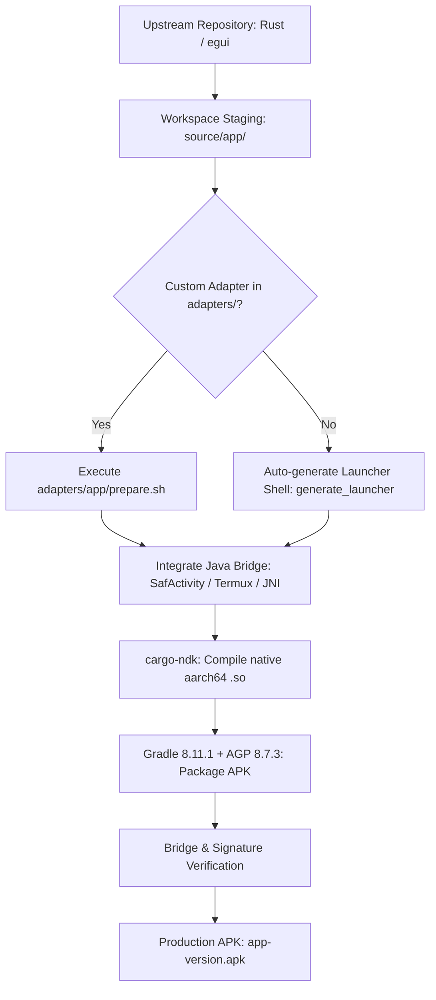
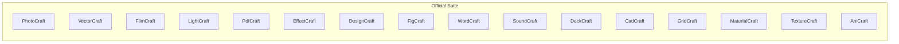
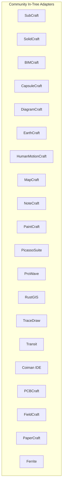
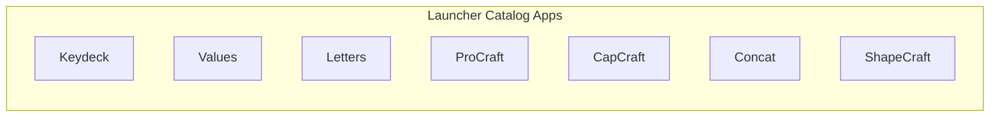
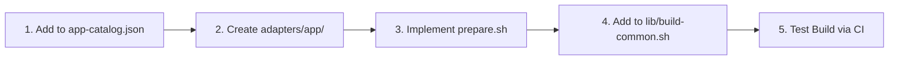

# ArtCraft Android Porting Guide & Architecture

This comprehensive guide details the technical architecture, runtime bridges, and step-by-step processes used to port every desktop creative and productivity application in the **ArtCraft Android** ecosystem to native Android (`aarch64-linux-android`).

---

## 1. Porting Philosophy & Core Architecture

The ArtCraft Android porting system is designed around a strict principle: **zero unsolicited modifications to upstream application logic**.

Desktop creative applications written in Rust (using immediate-mode GUI frameworks like `egui` and windowing libraries like `winit`) assume desktop semantics: direct POSIX/Win32 file access, persistent menus, multi-windowing, physical keyboards with modifier chords (`Ctrl`, `Alt`, `Shift`), and desktop audio/video pipelines. 

On Android, these assumptions break:
1. **Scoped Storage:** Android 10+ restricts arbitrary file-system access; apps must use the Storage Access Framework (SAF) or app-private directories.
2. **GameActivity / NativeActivity:** Pure native Rust binaries cannot directly display Android UI widgets or dialogs without a JNI bridge to the JVM.
3. **Windowing & Touch:** Android `winit` discards physical modifier states (`KeyEvent.metaState`) and touch interactions lack native inertial scrolling physics.
4. **Soft Keyboard (IME):** Android virtual keyboards cover the screen and require active input connection handling rather than desktop text events.
5. **System Fonts:** Devices ship heterogeneous fonts in `/system/fonts` and `/product/fonts` rather than standard desktop font registries.

To resolve these platform differences without altering upstream code, ArtCraft Android employs an **Adaptation & Bridge Pipeline**:



---

## 2. Shared Platform Bridges

Every ported application leverages one or more shared runtime bridges implemented across Rust, Java, and NDK:

### 2.1 Storage Access Framework (SAF) Document Bridge
* **Files:** `SafActivity.java`, `src/saf.rs`, `adapters/<app>/java/`
* **Mechanism:** 
  - Standard file dialogs (`rfd`, `native-dialog`) fail or hang on Android. The SAF bridge provides an asynchronous JNI protocol.
  - When the user triggers "Open" or "Save", the Rust shell calls `saf::open_file()` or `saf::save_file()`.
  - Java launches `Intent.ACTION_OPEN_DOCUMENT` or `Intent.ACTION_CREATE_DOCUMENT`.
  - When the user selects a file in the Android document provider, the activity acquires persistent URI permissions (`takePersistableUriPermission`), copies the content to a temporary staging path in `context.getCacheDir()` (or app-private external storage), and passes the path back across JNI to Rust.
  - On save, Rust writes to the staged file, and Java streams the bytes into the user's selected URI via `ContentResolver.openOutputStream()`.

### 2.2 Native GameActivity IME Soft Keyboard
* **Files:** `lib/ime.sh`, `android-activity` GameActivity
* **Mechanism:**
  - Standard desktop apps expect continuous character events. On mobile, `android-activity` provides native GameActivity IME events.
  - The Rust shell intercepts `egui::Output::ime` state. When a text field gains focus, it triggers `app.show_soft_input(false)` and configures `app.set_ime_editor_info()`.
  - An input debounce loop polls `app.text_input_state().text` at 16 ms intervals (to avoid winit sleep stalls), synthesizing backspace, text insertion, and enter key events into `raw.events`.
  - On focus loss, `app.hide_soft_input(false)` cleanly dismisses the virtual keyboard.

### 2.3 Physical Modifier Key Synthesis (Ctrl/Alt/Shift Chords)
* **Files:** `lib/topbar_modifiers.sh`, `adapters/`
* **Mechanism:**
  - Android `winit` 0.30 receives raw physical `KeyEvent` codes for `ControlLeft`, `AltLeft`, `ShiftLeft`, but discards `ModifiersChanged`.
  - ArtCraft shells maintain a bitflag tracker in `modifiers`. When modifier key events arrive, the shell patches `raw.events` so shortcut chords (e.g. `Ctrl+Z`, `Ctrl+S`, `Ctrl+Shift+P`) resolve correctly in desktop keybinding tables.
  - On devices without hardware keyboards, an optional on-screen modifier bar provides virtual toggle buttons for Shift, Ctrl, and Alt.

### 2.4 Universal System Font Fallbacks
* **Files:** `templates/android/system_fonts.rs`
* **Mechanism:**
  - Upstream apps bundle English or Latin-centric fonts. On Android, CJK, Arabic, Cyrillic, and emoji glyphs rely on system-installed typefaces.
  - At startup (`android_main`), `system_fonts::install_font_env()` scans `/system/fonts` and `/product/fonts`, dynamically registering fallback font definitions with the `egui::FontDefinitions` engine at lowest priority.

### 2.5 Android Print Framework Integration
* **Files:** `lib/android_project.py`, `PdfPrintAdapter.java`
* **Mechanism:**
  - Document editors (WordCraft, DesignCraft, GridCraft) integrate with Android's native `PrintManager`.
  - The Rust engine exports a standard PDF buffer; Java loads the buffer into `PrintDocumentAdapter` (`PdfPrintAdapter`), presenting the Android system print dialog for wireless printing or PDF saving.

---

## 3. Official Storytold Suite Applications (16 Apps)

All 16 official Storytold applications are compiled directly from upstream source repositories.



### 1. PhotoCraft (`photocraft`)
* **Upstream:** [storytold/photocraft](https://github.com/storytold/photocraft)
* **Port Type:** Custom Adapter (`adapters/photocraft`)
* **Process & Integration Steps:**
  1. `prepare.sh` stages `adapters/photocraft` into `source/photocraft/apps/photocraft-android/`.
  2. Injects `PhotoCraftActivity.java` (subclassing `GameActivity`) with immersive full-screen sticky mode and custom SAF document pickers.
  3. Registers image MIME filters (`image/png`, `image/jpeg`, `image/webp`, `image/tiff`) in `AndroidManifest.xml`.
  4. Patches winit touch event listeners to preserve high-precision stylus and pointer pressure data for painting brushes.
  5. Compiles with `cargo-ndk` targeting `arm64-v8a` against Android API 29+ (`minSdk=29`, `targetSdk=36`).

### 2. VectorCraft (`vectorcraft`)
* **Upstream:** [storytold/vectorcraft](https://github.com/storytold/vectorcraft)
* **Port Type:** Custom Adapter (`adapters/vectorcraft`)
* **Process & Integration Steps:**
  1. Stages custom adapter with `VectorCraftActivity.java`.
  2. Implements vector path drawing touch listeners with sub-pixel bezier smoothing.
  3. Integrates SAF import/export for `.svg`, `.pdf`, and custom `.vector` project files.
  4. Patches shortcut chord table to handle multi-touch vertex manipulation and modifier synthesis (`Shift` for aspect lock, `Ctrl` for duplication).

### 3. FilmCraft (`filmcraft`)
* **Upstream:** [storytold/filmcraft](https://github.com/storytold/filmcraft)
* **Port Type:** Generated Launcher Shell + NDK MediaCodec Hardware Acceleration
* **Process & Integration Steps:**
  1. Generated via `lib/build-common.sh` with custom `lib/ffmpeg_android.sh` build scripts.
  2. Bridges Android NDK `AMediaCodec` for zero-copy hardware H.264/HEVC decoding into Vulkan textures (see `FILMCRAFT_OPTIMIZATION_ROADMAP.md`).
  3. Locks screen orientation to landscape (`android:screenOrientation="sensorLandscape"`).
  4. Allocates dedicated high-priority audio mixing threads using Android AAudio / cpal.

### 4. LightCraft (`lightcraft`)
* **Upstream:** [storytold/lightcraft](https://github.com/storytold/lightcraft)
* **Port Type:** Generated Launcher Shell
* **Process & Integration Steps:**
  1. Configures multi-threaded raw image decoding pipelines via `libraw-rs` and `rayon`.
  2. Employs `android:largeHeap="true"` in the Android manifest to handle 50+ megapixel camera RAW files without OOM crashes.
  3. Integrates SAF directory tree pickers (`ACTION_OPEN_DOCUMENT_TREE`) to scan SD card photo libraries.

### 5. PdfCraft (`pdfcraft`)
* **Upstream:** [storytold/pdfcraft](https://github.com/storytold/pdfcraft) (formerly *PrintCraft*)
* **Port Type:** Generated Launcher Shell
* **Process & Integration Steps:**
  1. Bundles the native PDFium/Hayro rendering engine compiled for `aarch64-linux-android`.
  2. Hooks document intent filters for `application/pdf`.
  3. Implements dual-page touch zoom, annotation drawing, and password encryption bridges.

### 6. EffectCraft (`effectcraft`)
* **Upstream:** [storytold/effectcraft](https://github.com/storytold/effectcraft)
* **Port Type:** Generated Launcher Shell
* **Process & Integration Steps:**
  1. Binds GPU compute shaders via `wgpu` with GLES/Vulkan fallback configurations to avoid Mali/Adreno driver crashes.
  2. Connects SAF image loaders with real-time shader preview viewports.

### 7. DesignCraft (`designcraft`)
* **Upstream:** [storytold/designcraft](https://github.com/storytold/designcraft)
* **Port Type:** Generated Launcher Shell + Printing Bridge
* **Process & Integration Steps:**
  1. Generates layout canvas shell with multi-page pagination.
  2. Connects to `PdfPrintAdapter.java` via JNI for instant document printing and vector export.
  3. Incorporates system font fallbacks so editorial typography matches system-installed typefaces.

### 8. FigCraft (`figcraft`)
* **Upstream:** [storytold/figcraft](https://github.com/storytold/figcraft)
* **Port Type:** Generated Launcher Shell
* **Process & Integration Steps:**
  1. Adapts whiteboarding and wireframing canvas for multi-touch pinch-to-zoom and two-finger pan gestures.
  2. Supports pressure-sensitive active styluses (S-Pen, USI pens) for rapid wireframe sketches.

### 9. WordCraft (`wordcraft`)
* **Upstream:** [storytold/wordcraft](https://github.com/storytold/wordcraft)
* **Port Type:** Generated Launcher Shell + Typing Optimization
* **Process & Integration Steps:**
  1. Integrates typing latency optimizations (`perf/wordcraft-typing-opt`) with debounced paragraph re-layout.
  2. Bridges GameActivity IME soft keyboard for autocomplete, predictive text, and multi-lingual input.
  3. Registers `.docx`, `.odt`, `.txt`, and `.markdown` document associations.

### 10. SoundCraft (`soundcraft`)
* **Upstream:** [storytold/soundcraft](https://github.com/storytold/soundcraft)
* **Port Type:** Generated Launcher Shell
* **Process & Integration Steps:**
  1. Configures low-latency Android audio backend using `cpal` over Oboe / AAudio.
  2. Implements real-time lock-free ringbuffers to prevent underruns on Android audio threads.
  3. Registers audio format associations (`audio/wav`, `audio/mpeg`, `audio/flac`).

### 11. DeckCraft (`deckcraft`)
* **Upstream:** [storytold/deckcraft](https://github.com/storytold/deckcraft)
* **Port Type:** Generated Launcher Shell
* **Process & Integration Steps:**
  1. Adds presenter mode supporting external Android display projection (via USB-C HDMI / Miracast).
  2. Integrates swipe gestures for slide transitions and Bluetooth presentation clicker keycodes.

### 12. CadCraft (`cadcraft`)
* **Upstream:** [storytold/cadcraft](https://github.com/storytold/cadcraft)
* **Port Type:** Generated Launcher Shell
* **Process & Integration Steps:**
  1. Generates 3D spatial index for CAD wireframe drawing.
  2. Optimizes depth buffers and touch orbiting controls for 3D engineering models.

### 13. GridCraft (`gridcraft`)
* **Upstream:** [storytold/gridcraft](https://github.com/storytold/gridcraft)
* **Port Type:** Generated Launcher Shell
* **Process & Integration Steps:**
  1. Embeds fast table virtualization for spreadsheets with 100,000+ cells.
  2. Implements native formula editing bar connected to the Android IME.
  3. Connects `PdfPrintAdapter` for spreadsheet table report printing.

### 14. MaterialCraft (`materialcraft`)
* **Upstream:** [storytold/materialcraft](https://github.com/storytold/materialcraft)
* **Port Type:** Generated Launcher Shell
* **Process & Integration Steps:**
  1. Ported with procedural shader compilation pipelines for PBR texture previewing.
  2. Binds texture export directly into SAF document streams.

### 15. TextureCraft (`texturecraft`)
* **Upstream:** [storytold/texturecraft](https://github.com/storytold/texturecraft)
* **Port Type:** Generated Launcher Shell
* **Process & Integration Steps:**
  1. Implements 3D mesh UV coordinate raycasting for direct model texture painting.
  2. Translates touch pen pressure into dynamic brush size and opacity.

### 16. AniCraft (`anicraft`)
* **Upstream:** [storytold/AniCraft](https://github.com/storytold/AniCraft)
* **Port Type:** Custom Adapter (`adapters/anicraft`)
* **Process & Integration Steps:**
  1. Bundles pre-compiled mobile FFmpeg libraries (`libavcodec`, `libavformat`, `libavutil`, `libswscale`) via `lib/ffmpeg_android.sh`.
  2. Implements frame-by-frame onion-skin canvas with hardware-accelerated playback.
  3. Connects video rendering pipeline to encode animations into `.mp4` and `.gif` files stored via SAF.

---

## 4. Community Applications with In-Tree Adapters (20 Apps)

Community applications feature custom in-tree adapters located under `adapters/<app>/`.



### 17. SubCraft (`subcraft`)
* **Upstream:** [Aalzard/subcraft](https://github.com/Aalzard/subcraft)
* **Adapter:** `adapters/subcraft`
* **Process:**
  - Implements an inlined SAF bridge (`adapters/subcraft/src/saf.rs`) and custom file delivery (`lib/subcraft.sh`).
  - Replaces upstream desktop `rfd` dialogs with asynchronous Android document channels.
  - Supports loading 3D `.obj` and `.gltf` models and saving painted 2D texture maps.

### 18. SolidCraft (`solidcraft`)
* **Upstream:** [tangency-labs/solidcraft](https://github.com/tangency-labs/solidcraft)
* **Adapter:** `adapters/solidcraft`
* **Process:**
  - Parametric 3D CAD system compiled with multi-threaded geometric kernel.
  - Replaces desktop file dialogs with SAF tree access for `.solid` workspaces.
  - Configures dedicated manifest namespace (`io.tangencylabs.solidcraft`).

### 19. BIMCraft (`bimcraft`)
* **Upstream:** [IPedrax/BIMCraft](https://github.com/IPedrax/BIMCraft)
* **Adapter:** `adapters/bimcraft`
* **Process:**
  - Architectural BIM visualizer supporting `.ifc` files.
  - Custom memory allocator parameters to parse large building geometry models without exceeding mobile memory limits.

### 20. CapsuleCraft (`capsulecraft`)
* **Upstream:** [kostyk348/CapsuleCraft](https://github.com/kostyk348/CapsuleCraft)
* **Adapter:** `adapters/capsulecraft`
* **Process:**
  - Local-first email archive viewer and note-taker.
  - Connects SAF file picker to parse `.eml` MIME messages and extract email attachments into temporary cache folders.

### 21. DiagramCraft (`diagramcraft`)
* **Upstream:** [baradhili/DiagramCraft](https://github.com/baradhili/DiagramCraft)
* **Adapter:** `adapters/diagramcraft`
* **Process:**
  - Diagramming tool ported with touch stencil palettes.
  - Custom touch gesture handlers allow dragging shapes from the stencil drawer onto the diagram canvas.

### 22. EarthCraft (`earthcraft`)
* **Upstream:** [therichronicles/EarthCraft](https://github.com/therichronicles/EarthCraft)
* **Adapter:** `adapters/earthcraft`
* **Process:**
  - 3D globe visualization.
  - Connects tile download caches to Android internal storage and tunes wgpu mipmapping for mobile GPU architectures.

### 23. HumanMotionCraft (`humanmotioncraft`)
* **Upstream:** [YalKouassi/HumanMotionCraft](https://github.com/YalKouassi/HumanMotionCraft)
* **Adapter:** `adapters/humanmotioncraft`
* **Process:**
  - Humanoid skeletal posing and animation.
  - Implements touch handles for inverse kinematics (IK) joints with 3D touch rotation gizmos.

### 24. MapCraft (`mapcraft`)
* **Upstream:** [bearlikelion/MapCraft](https://github.com/bearlikelion/MapCraft)
* **Adapter:** `adapters/mapcraft`
* **Process:**
  - 3D brush-based level editor.
  - Integrates touch orbiting and surface painting tools; exports quake-compatible map formats via SAF.

### 25. NoteCraft (`notecraft`)
* **Upstream:** [AlienTechSoftware/notecraft](https://github.com/AlienTechSoftware/notecraft)
* **Adapter:** `adapters/notecraft`
* **Process:**
  - Markdown notes manager.
  - Binds `ACTION_OPEN_DOCUMENT_TREE` to mount a full directory of markdown files as a navigable note notebook.

### 26. PaintCraft (`paintcraft`)
* **Upstream:** [replicraft/PaintCraft](https://github.com/replicraft/PaintCraft)
* **Adapter:** `adapters/paintcraft`
* **Process:**
  - Digital canvas sketching.
  - Direct touch coordinate interpolation with low-latency stylus prediction.

### 27. PicassoSuite (`picassosuite`)
* **Upstream:** [fabox-os/Picasso-Suite](https://github.com/fabox-os/Picasso-Suite)
* **Adapter:** `adapters/picassosuite`
* **Process:**
  - Resolve-style multi-page video editor.
  - Bridges video clip imports through SAF and maps cut/edit actions to multi-touch timeline widgets.

### 28. ProWave (`prowave`)
* **Upstream:** [fabox-os/Pro-Wave](https://github.com/fabox-os/Pro-Wave)
* **Adapter:** `adapters/prowave`
* **Process:**
  - Logic Pro-style DAW in pure Rust.
  - Connects audio engine to Android AAudio/cpal with 64-bit audio summing.
  - Tunes piano roll and mixer panels for tablet touch screens.

### 29. RustGIS (`rustgis`)
* **Upstream:** [opengeos/RustGIS](https://github.com/opengeos/RustGIS)
* **Adapter:** `adapters/rustgis`
* **Process:**
  - GIS vector and raster data explorer.
  - Implements coordinate transforms and large GeoTIFF / Shapefile reading through scoped file streams.

### 30. TraceDraw (`tracedraw`)
* **Upstream:** [tracedraw/tracedraw](https://github.com/tracedraw/tracedraw)
* **Adapter:** `adapters/tracedraw`
* **Process:**
  - Vector bezier tracing application.
  - Implements precision pen tool anchor points with magnifier loupe on touch drag.

### 31. Transit (`transit`)
* **Upstream:** [transit-audio/transit](https://github.com/transit-audio/transit)
* **Adapter:** `adapters/transit`
* **Process:**
  - Audio recording and track sequencer.
  - Maps multi-track audio buffers to Android low-latency audio devices.

### 32. Coiman IDE (`coimanide`) — Advanced Port with Termux Bridge
* **Upstream:** [ManuelCoimbra/coiman-ide](https://github.com/ManuelCoimbra/coiman-ide)
* **Adapter:** `adapters/coimanide`
* **Specialized Architecture:**
  1. **Binary to Library Transformation (`prepare.sh`):** Upstream Coiman IDE is a binary crate with an embedded PTY. `prepare.sh` generates `src/lib.rs`, replaces the desktop pty and `trash` crates with stubs, and switches the windowing harness to wgpu/NativeActivity.
  2. **Termux Broker IPC Bridge (`TermuxBroker.java`):** Android forbids executing third-party binaries directly. Coiman routes command executions (git, cargo, rust-analyzer, python, lldb) through Termux's `RUN_COMMAND` intent service.
  3. **Shared Unix Domain Emulation:** Requests are staged in `/sdcard/Documents/CoimanTermux/`, where C-shims (`libcoiman_termux_shim.so` and `libcoiman_termux_shell.so`) marshal stdin/stdout/stderr across regular files and FIFOs.
  4. **Dynamic Keyboard Inset Resizing:** Android 15 edge-to-edge mode draws the soft keyboard over the window. `CoimanActivity` caches keyboard insets (`imeInsetBottom`) and dynamically resizes egui's viewport so the terminal and editor remain visible above the keyboard.
  5. **Theme Staging:** Bundles 23 VS Code themes into Android assets, extracting them on first launch into the user's config folder.

### 33. PCBCraft (`pcbcraft`)
* **Upstream:** [tangency-labs/pcbcraft](https://github.com/tangency-labs/pcbcraft)
* **Adapter:** `adapters/pcbcraft`
* **Package:** `io.tangencylabs.pcbcraft`
* **Process:**
  - Printed circuit board design and schematic layout application.
  - Bundles vendored custom `egui-wgpu` to avoid flock collisions and upstream dependency mismatches during CI cross-compilation.
  - Integrates SAF document bridge for loading `.pcb` and Gerber files and saving project layouts.
  - Configures dedicated manifest namespace (`io.tangencylabs.pcbcraft`).

### 34. FieldCraft (`fieldcraft`)
* **Upstream:** [tangency-labs/fieldcraft](https://github.com/tangency-labs/fieldcraft)
* **Adapter:** `adapters/fieldcraft`
* **Package:** `io.tangencylabs.fieldcraft`
* **Process:**
  - Finite element analysis (FEA) and multiphysics simulation engine.
  - Registers GPU simulation crates (`fieldcraft-lbm-gpu`, `fieldcraft-mesh-gpu`), `register_picture_drawer()`, and sets a 24-bit depth buffer to prevent black screens when rendering 3D field meshes.
  - Clamps WGPU texture dimensions to 8192 for mobile GPU hardware compatibility.
  - Bundles vendored `egui.tar.gz` and registers SAF storage migration to `Android/media`.

### 35. PaperCraft (`papercraft`)
* **Upstream:** [slyim/papercraft](https://github.com/slyim/papercraft)
* **Adapter:** `adapters/papercraft`
* **Package:** `com.artcraft.papercraft`
* **Process:**
  - Local vector design and infinite canvas built in Rust and egui.
  - Integrates multi-touch gestures including two-finger pinch zoom, panning, and canvas rotation.
  - Hooks SAF file picker for importing SVG assets and exporting canvas designs.

### 36. Ferrite (`ferrite`)
* **Upstream:** [OlaProeis/Ferrite](https://github.com/OlaProeis/Ferrite)
* **Adapter:** `adapters/ferrite`
* **Package:** `com.artcraft.ferrite`
* **Process:**
  - Fast, lightweight text editor optimized for Markdown and JSON editing.
  - Includes a custom `termios` shim (`vendor/termios`) to satisfy terminal I/O requirements in the mobile environment.
  - Connects native GameActivity IME soft keyboard handling with text selection, clipboard paste bridges, and dynamic viewport resize on keyboard display.

---

## 5. Community Applications Distributed via Launcher Catalog (7 Apps)

These standalone open-source applications are compiled and distributed from their respective project repositories and indexed directly within the ArtCraft Android Launcher (`launcher/apps/artcraft-launcher-android/app-catalog.json`).



### 37. Keydeck (`keydeck`)
* **Repository:** [bramble-apps/bramble-office](https://github.com/bramble-apps/bramble-office)
* **Asset Pattern:** `Keydeck*apk`
* **Package:** `app.bramble.keydeck`
* **Process:** Indexed via GitHub Releases; launcher tracks upstream release tags, downloads pre-built ARM64 APKs, and verifies package identity via Android `PackageManager`.

### 38. Values (`values`)
* **Repository:** [bramble-apps/bramble-office](https://github.com/bramble-apps/bramble-office)
* **Asset Pattern:** `Values*apk`
* **Package:** `app.bramble.values`
* **Process:** Spreadsheet engine tracked via Bramble Office releases.

### 39. Letters (`letters`)
* **Repository:** [bramble-apps/bramble-office](https://github.com/bramble-apps/bramble-office)
* **Asset Pattern:** `Letters*apk`
* **Package:** `app.bramble.letters`
* **Process:** Document layout engine tracked via Bramble Office releases.

### 40. ProCraft (`procraft`)
* **Repository:** [artcraft-android/procraft](https://github.com/artcraft-android/procraft)
* **Asset Pattern:** `procraft-*-android-arm64.apk`
* **Package:** `io.github.artcraftandroid.procraft`
* **Process:** Dedicated Android port repository built with Kotlin/Compose frontend and Rust brush engine; indexed for seamless updates.

### 41. CapCraft (`capcraft`)
* **Repository:** [artcraft-android/capcraft-android](https://github.com/artcraft-android/capcraft-android)
* **Asset Pattern:** `capcraft-android-*.apk`
* **Package:** `io.github.artcraftandroid.capcraft`
* **Process:** Mobile video editor reimplementation built with Jetpack Compose and Rust core engine; indexed via GitHub Releases.

### 42. Concat (`concat`)
* **Repository:** [jub0t/Concat](https://github.com/jub0t/Concat)
* **Asset Pattern:** `Concat-*-android-arm64.apk`
* **Package:** `org.standalones.concat`
* **Process:** Scriptable video editor tracked via upstream release tags.

### 43. ShapeCraft (`shapecraft`)
* **Repository:** [jackharvest/shapecraft](https://github.com/jackharvest/shapecraft)
* **Asset Pattern:** `shapecraft-*-android-arm64.apk`
* **Package:** `com.jackharvest.shapecraft`
* **Process:** Direct-modeling 3D CAD engine tracked via upstream release tags.

---

## 6. The ArtCraft Android Launcher (`launcher`)

* **Upstream:** [storytold/craft-launcher](https://github.com/storytold/craft-launcher)
* **Android Implementation:** `launcher/apps/artcraft-launcher-android/`
* **Architecture & Process:**
  1. **GameActivity Harness:** Wraps the egui desktop launcher in an Android `GameActivity` (`AndroidHost`).
  2. **Package Manager Bridge (`Bridge.java`):** Uses JNI to communicate with Android's `PackageManager`, querying installed packages across the 43 declared `<queries>` entries.
  3. **Release Resolver & Downloader:** Queries the GitHub Releases API (with rate-limit caching), resolves APK assets matching target glob patterns or the shared builder repo (`MostafaXS1/artcraft-android`), and streams downloads with SHA-256 integrity verification.
  4. **Package Installation Intent:** Dispatches `Intent.ACTION_INSTALL_PACKAGE` / `FileProvider` intents to prompt the Android system installer when an update or install is initiated.
  5. **Automated Catalog Generator (`generate_catalog.py`):** Compiles `app-catalog.json` into static Rust lookup tables (`src/catalog.rs`) and updates `<queries>` in `AndroidManifest.xml` during the build.

---

## 7. Step-by-Step Guide: How to Port a New Application

Follow these steps to add a new application to the ArtCraft Android ecosystem:



### Step 1: Register in `app-catalog.json`
Add the application entry to `launcher/apps/artcraft-launcher-android/app-catalog.json`:
```json
{
  "id": "myapp",
  "name": "MyApp",
  "tagline": "Description of app",
  "color": [100, 150, 200],
  "repo": "owner/myapp",
  "publisher": "Author Name",
  "site": "https://myapp.site",
  "discord": "https://discord.gg/inviteCode"
}
```
Run `bash launcher/apps/artcraft-launcher-android/generate-catalog.sh` to update `catalog.rs` and the manifest queries.

### Step 2: Create Adapter Scaffold
Create `adapters/myapp/`:
- `adapters/myapp/Cargo.toml`: Declare `[package.metadata.android]` with package id `com.artcraft.myapp`.
- `adapters/myapp/src/lib.rs`: Implement the `android_main` entrypoint with eframe and SAF integration.
- `adapters/myapp/prepare.sh`: Shell script to clone or stage upstream crates and apply platform patches.

### Step 3: Register in Build Script & CI Matrix
1. Add the app ID to `SAF_APPS` in `lib/build-common.sh`.
2. Add the app ID to `ALL_APPS` in `.github/workflows/build.yml`.

### Step 4: Verify via CI
Push the branch with a selective commit directive to test the build on CI without building all apps:
```bash
git commit -m "feat(ports): add myapp port [build: myapp, launcher]"
git push origin <branch>
```
Review the resulting GitHub Actions run to verify APK compilation, packaging, and asset verification.
