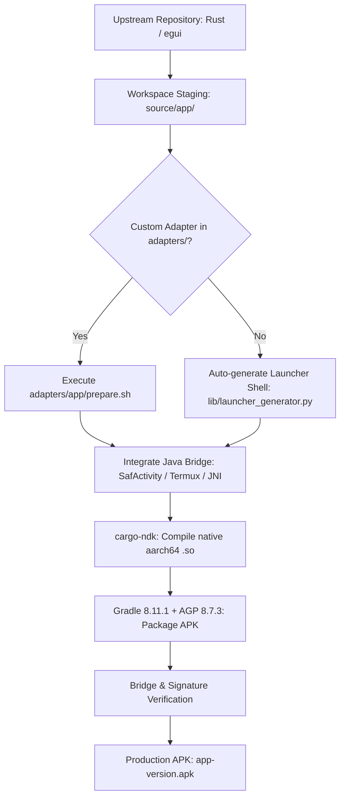
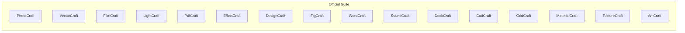
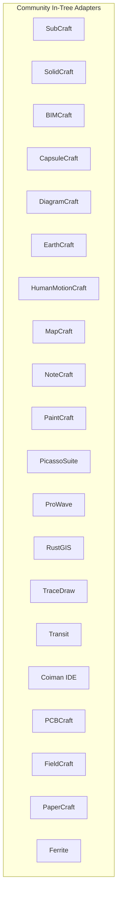
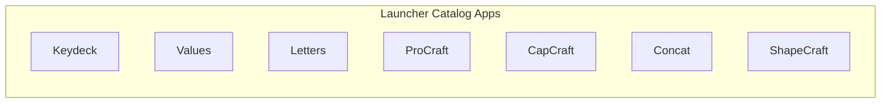
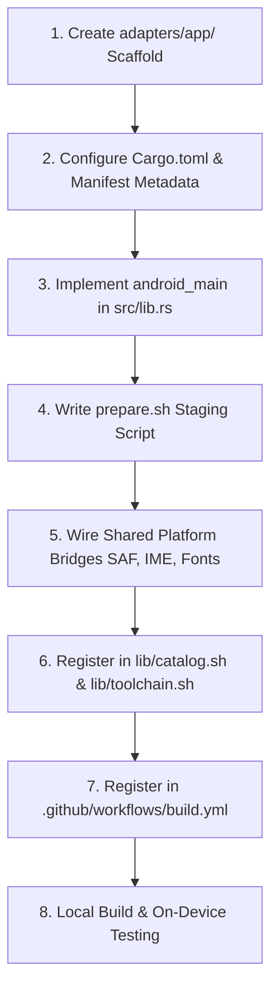
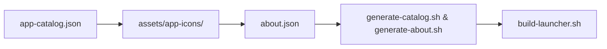

# ArtCraft Android Porting Guide & Architecture

This comprehensive guide details the technical architecture, runtime bridges, and step-by-step processes used to port every desktop creative and productivity application in the **ArtCraft Android** ecosystem to native Android (`aarch64-linux-android`).

> [!TIP]
> **Quick Navigation:**
> - If you are **new to Android platform concepts** (Manifest, Scoped Storage/SAF, NDK, JNI, Vulkan, IME), read [**Section 10: Core Android Concepts & Learning Guide**](#10-core-android-concepts--learning-guide-for-rust-developers) or the dedicated [**`docs/android-fundamentals.md`**](android-fundamentals.md).
> - If you want to **port a desktop Rust/egui application to Android**, jump straight to [**Section 7: In-Tree Porting of Rust/egui Applications**](#7-step-by-step-guide-in-tree-porting-of-rustegui-applications).
> - If you maintain an **externally built Android app and want it listed in the Launcher**, jump straight to [**Section 8: Adding Community-Distributed Applications to the Launcher**](#8-adding-community-distributed-applications-to-the-launcher).
> - For our architectural roadmap to turn this porting system into a generalized framework (`cargo-craft-android` & GitHub Action), see [**`docs/framework-proposal.md`**](framework-proposal.md).

---

## Table of Contents

- [1. Porting Philosophy & Core Architecture](#1-porting-philosophy--core-architecture)
- [2. Shared Platform Bridges](#2-shared-platform-bridges)
  - [2.1 Storage Access Framework (SAF) Document Bridge](#21-storage-access-framework-saf-document-bridge)
  - [2.2 Native GameActivity IME Soft Keyboard](#22-native-gameactivity-ime-soft-keyboard)
  - [2.3 Physical Modifier Key Synthesis (Ctrl/Alt/Shift Chords)](#23-physical-modifier-key-synthesis-ctrlaltshift-chords)
  - [2.4 Universal System Font Fallbacks](#24-universal-system-font-fallbacks)
  - [2.5 Android Print Framework Integration](#25-android-print-framework-integration)
- [3. Official Storytold Suite Applications (16 Apps)](#3-official-storytold-suite-applications-16-apps)
- [4. Community Applications with In-Tree Adapters (20 Apps)](#4-community-applications-with-in-tree-adapters-20-apps)
- [5. Community Applications Distributed via Launcher Catalog (7 Apps)](#5-community-applications-distributed-via-launcher-catalog-7-apps)
- [6. The ArtCraft Android Launcher (`launcher`)](#6-the-artcraft-android-launcher-launcher)
- [7. Step-by-Step Guide: In-Tree Porting of Rust/egui Applications](#7-step-by-step-guide-in-tree-porting-of-rustegui-applications)
  - [7.1 Porting Models: Auto-Generator vs. Custom In-Tree Adapter](#71-porting-models-auto-generator-vs-custom-in-tree-adapter)
  - [7.2 Directory Structure of an Adapter](#72-directory-structure-of-an-adapter)
  - [7.3 Step 1: Configure `adapters/<app>/Cargo.toml`](#73-step-1-configure-adaptersappcargotoml)
  - [7.4 Step 2: Implement Native Entrypoint (`adapters/<app>/src/lib.rs`)](#74-step-2-implement-native-entrypoint-adaptersappsrclibrs)
  - [7.5 Step 3: Implement Staging Script (`adapters/<app>/prepare.sh`)](#75-step-3-implement-staging-script-adaptersapppreparesh)
  - [7.6 Step 4: Register in Build Toolchain & CI](#76-step-4-register-in-build-toolchain--ci)
  - [7.7 Step 5: Build Locally and Test](#77-step-5-build-locally-and-test)
- [8. Adding Community-Distributed Applications to the Launcher](#8-adding-community-distributed-applications-to-the-launcher)
  - [8.1 Model & Prerequisites](#81-model--prerequisites)
  - [8.2 Step 1: Register in `app-catalog.json`](#82-step-1-register-in-app-catalogjson)
  - [8.3 Step 2: Add 128px App Icon](#83-step-2-add-128px-app-icon)
  - [8.4 Step 3: Add Detail Page in `about.json`](#84-step-3-add-detail-page-in-aboutjson)
  - [8.5 Step 4: Run Code Generators & Update Manifest Queries](#85-step-4-run-code-generators--update-manifest-queries)
  - [8.6 Step 5: Build and Test the Launcher](#86-step-5-build-and-test-the-launcher)
- [9. Community Submission, Security Audits & Best Practices](#9-community-submission-security-audits--best-practices)
- [10. Core Android Concepts & Learning Guide for Rust Developers](#10-core-android-concepts--learning-guide-for-rust-developers)

---

## 1. Porting Philosophy & Core Architecture

The ArtCraft Android porting system is designed around a strict principle: **zero unsolicited modifications to upstream application logic**.

Desktop creative applications written in Rust (using immediate-mode GUI frameworks like `egui` and windowing libraries like `winit`) assume desktop semantics: direct POSIX/Win32 file access, persistent menus, multi-windowing, physical keyboards with modifier chords (`Ctrl`, `Alt`, `Shift`), and desktop audio/video pipelines. 

On Android, these assumptions break:
1. **Scoped Storage:** Android 10+ restricts arbitrary file-system access; apps must use the Storage Access Framework (SAF) or app-private directories.
2. **GameActivity / NativeActivity:** Pure native Rust binaries cannot directly display Android UI widgets or dialogs without a JNI bridge to the JVM.
3. **Windowing & Touch:** Android `winit` discards physical modifier states (`KeyEvent.metaState`) and touch interactions lack native inertial scrolling physics.
4. **Soft Keyboard (IME):** Android virtual keyboards cover the screen and require active input connection handling rather than desktop text events.
5. **System Fonts:** Devices ship heterogeneous fonts in `/system/fonts` and `/product/fonts` rather than standard desktop font registries.

To resolve these platform differences without altering upstream code, ArtCraft Android employs an **Adaptation & Bridge Pipeline**:



---

## 2. Shared Platform Bridges

Every ported application leverages one or more shared runtime bridges implemented across Rust, Java, and NDK:

### 2.1 Storage Access Framework (SAF) Document Bridge
* **Files:** `SafActivity.java`, `src/saf.rs`, `adapters/<app>/java/`
* **Mechanism:** 
  - Standard file dialogs (`rfd`, `native-dialog`) fail or hang on Android. The SAF bridge provides an asynchronous JNI protocol.
  - When the user triggers "Open" or "Save", the Rust shell calls `saf::open_file()` or `saf::save_file()`.
  - Java launches `Intent.ACTION_OPEN_DOCUMENT` or `Intent.ACTION_CREATE_DOCUMENT`.
  - When the user selects a file in the Android document provider, the activity acquires persistent URI permissions (`takePersistableUriPermission`), copies the content to a temporary staging path in `context.getCacheDir()` (or app-private external storage), and passes the path back across JNI to Rust.
  - On save, Rust writes to the staged file, and Java streams the bytes into the user's selected URI via `ContentResolver.openOutputStream()`.

### 2.2 Native GameActivity IME Soft Keyboard
* **Files:** `lib/ime.sh`, `android-activity` GameActivity
* **Mechanism:**
  - Standard desktop apps expect continuous character events. On mobile, `android-activity` provides native GameActivity IME events.
  - The Rust shell intercepts `egui::Output::ime` state. When a text field gains focus, it triggers `app.show_soft_input(false)` and configures `app.set_ime_editor_info()`.
  - An input debounce loop polls `app.text_input_state().text` at 16 ms intervals (to avoid winit sleep stalls), synthesizing backspace, text insertion, and enter key events into `raw.events`.
  - On focus loss, `app.hide_soft_input(false)` cleanly dismisses the virtual keyboard.

### 2.3 Physical Modifier Key Synthesis (Ctrl/Alt/Shift Chords)
* **Files:** `lib/topbar_modifiers.sh`, `adapters/`
* **Mechanism:**
  - Android `winit` 0.30 receives raw physical `KeyEvent` codes for `ControlLeft`, `AltLeft`, `ShiftLeft`, but discards `ModifiersChanged`.
  - ArtCraft shells maintain a bitflag tracker in `modifiers`. When modifier key events arrive, the shell patches `raw.events` so shortcut chords (e.g. `Ctrl+Z`, `Ctrl+S`, `Ctrl+Shift+P`) resolve correctly in desktop keybinding tables.
  - On devices without hardware keyboards, an optional on-screen modifier bar provides virtual toggle buttons for Shift, Ctrl, and Alt.

### 2.4 Universal System Font Fallbacks
* **Files:** `templates/android/system_fonts.rs`
* **Mechanism:**
  - Upstream apps bundle English or Latin-centric fonts. On Android, CJK, Arabic, Cyrillic, and emoji glyphs rely on system-installed typefaces.
  - At startup (`android_main`), `system_fonts::install_font_env()` scans `/system/fonts` and `/product/fonts`, dynamically registering fallback font definitions with the `egui::FontDefinitions` engine at lowest priority.

### 2.5 Android Print Framework Integration
* **Files:** `lib/android_project.py`, `PdfPrintAdapter.java`
* **Mechanism:**
  - Document editors (WordCraft, DesignCraft, GridCraft) integrate with Android's native `PrintManager`.
  - The Rust engine exports a standard PDF buffer; Java loads the buffer into `PrintDocumentAdapter` (`PdfPrintAdapter`), presenting the Android system print dialog for wireless printing or PDF saving.

---

## 3. Official Storytold Suite Applications (16 Apps)

All 16 official Storytold applications are compiled directly from upstream source repositories.



### 1. PhotoCraft (`photocraft`)
* **Upstream:** [storytold/photocraft](https://github.com/storytold/photocraft)
* **Port Type:** Custom Adapter (`adapters/photocraft`)
* **Process & Integration Steps:**
  1. `prepare.sh` stages `adapters/photocraft` into `source/photocraft/apps/photocraft-android/`.
  2. Injects `PhotoCraftActivity.java` (subclassing `GameActivity`) with immersive full-screen sticky mode and custom SAF document pickers.
  3. Registers image MIME filters (`image/png`, `image/jpeg`, `image/webp`, `image/tiff`) in `AndroidManifest.xml`.
  4. Patches winit touch event listeners to preserve high-precision stylus and pointer pressure data for painting brushes.
  5. Compiles with `cargo-ndk` targeting `arm64-v8a` against Android API 29+ (`minSdk=29`, `targetSdk=36`).

### 2. VectorCraft (`vectorcraft`)
* **Upstream:** [storytold/vectorcraft](https://github.com/storytold/vectorcraft)
* **Port Type:** Custom Adapter (`adapters/vectorcraft`)
* **Process & Integration Steps:**
  1. Stages custom adapter with `VectorCraftActivity.java`.
  2. Implements vector path drawing touch listeners with sub-pixel bezier smoothing.
  3. Integrates SAF import/export for `.svg`, `.pdf`, and custom `.vector` project files.
  4. Patches shortcut chord table to handle multi-touch vertex manipulation and modifier synthesis (`Shift` for aspect lock, `Ctrl` for duplication).

### 3. FilmCraft (`filmcraft`)
* **Upstream:** [storytold/filmcraft](https://github.com/storytold/filmcraft)
* **Port Type:** Generated Launcher Shell + NDK MediaCodec Hardware Acceleration
* **Process & Integration Steps:**
  1. Generated via `lib/build-common.sh` with custom `lib/ffmpeg_android.sh` build scripts.
  2. Bridges Android NDK `AMediaCodec` for zero-copy hardware H.264/HEVC decoding into Vulkan textures (see `FILMCRAFT_OPTIMIZATION_ROADMAP.md`).
  3. Locks screen orientation to landscape (`android:screenOrientation="sensorLandscape"`).
  4. Allocates dedicated high-priority audio mixing threads using Android AAudio / cpal.

### 4. LightCraft (`lightcraft`)
* **Upstream:** [storytold/lightcraft](https://github.com/storytold/lightcraft)
* **Port Type:** Generated Launcher Shell
* **Process & Integration Steps:**
  1. Configures multi-threaded raw image decoding pipelines via `libraw-rs` and `rayon`.
  2. Employs `android:largeHeap="true"` in the Android manifest to handle 50+ megapixel camera RAW files without OOM crashes.
  3. Integrates SAF directory tree pickers (`ACTION_OPEN_DOCUMENT_TREE`) to scan SD card photo libraries.

### 5. PdfCraft (`pdfcraft`)
* **Upstream:** [storytold/pdfcraft](https://github.com/storytold/pdfcraft) (formerly *PrintCraft*)
* **Port Type:** Generated Launcher Shell
* **Process & Integration Steps:**
  1. Bundles the native PDFium/Hayro rendering engine compiled for `aarch64-linux-android`.
  2. Hooks document intent filters for `application/pdf`.
  3. Implements dual-page touch zoom, annotation drawing, and password encryption bridges.

### 6. EffectCraft (`effectcraft`)
* **Upstream:** [storytold/effectcraft](https://github.com/storytold/effectcraft)
* **Port Type:** Generated Launcher Shell
* **Process & Integration Steps:**
  1. Binds GPU compute shaders via `wgpu` with GLES/Vulkan fallback configurations to avoid Mali/Adreno driver crashes.
  2. Connects SAF image loaders with real-time shader preview viewports.

### 7. DesignCraft (`designcraft`)
* **Upstream:** [storytold/designcraft](https://github.com/storytold/designcraft)
* **Port Type:** Generated Launcher Shell + Printing Bridge
* **Process & Integration Steps:**
  1. Generates layout canvas shell with multi-page pagination.
  2. Connects to `PdfPrintAdapter.java` via JNI for instant document printing and vector export.
  3. Incorporates system font fallbacks so editorial typography matches system-installed typefaces.

### 8. FigCraft (`figcraft`)
* **Upstream:** [storytold/figcraft](https://github.com/storytold/figcraft)
* **Port Type:** Generated Launcher Shell
* **Process & Integration Steps:**
  1. Adapts whiteboarding and wireframing canvas for multi-touch pinch-to-zoom and two-finger pan gestures.
  2. Supports pressure-sensitive active styluses (S-Pen, USI pens) for rapid wireframe sketches.

### 9. WordCraft (`wordcraft`)
* **Upstream:** [storytold/wordcraft](https://github.com/storytold/wordcraft)
* **Port Type:** Generated Launcher Shell + Typing Optimization
* **Process & Integration Steps:**
  1. Integrates typing latency optimizations (`perf/wordcraft-typing-opt`) with debounced paragraph re-layout.
  2. Bridges GameActivity IME soft keyboard for autocomplete, predictive text, and multi-lingual input.
  3. Registers `.docx`, `.odt`, `.txt`, and `.markdown` document associations.

### 10. SoundCraft (`soundcraft`)
* **Upstream:** [storytold/soundcraft](https://github.com/storytold/soundcraft)
* **Port Type:** Generated Launcher Shell
* **Process & Integration Steps:**
  1. Configures low-latency Android audio backend using `cpal` over Oboe / AAudio.
  2. Implements real-time lock-free ringbuffers to prevent underruns on Android audio threads.
  3. Registers audio format associations (`audio/wav`, `audio/mpeg`, `audio/flac`).

### 11. DeckCraft (`deckcraft`)
* **Upstream:** [storytold/deckcraft](https://github.com/storytold/deckcraft)
* **Port Type:** Generated Launcher Shell
* **Process & Integration Steps:**
  1. Adds presenter mode supporting external Android display projection (via USB-C HDMI / Miracast).
  2. Integrates swipe gestures for slide transitions and Bluetooth presentation clicker keycodes.

### 12. CadCraft (`cadcraft`)
* **Upstream:** [storytold/cadcraft](https://github.com/storytold/cadcraft)
* **Port Type:** Generated Launcher Shell
* **Process & Integration Steps:**
  1. Generates 3D spatial index for CAD wireframe drawing.
  2. Optimizes depth buffers and touch orbiting controls for 3D engineering models.

### 13. GridCraft (`gridcraft`)
* **Upstream:** [storytold/gridcraft](https://github.com/storytold/gridcraft)
* **Port Type:** Generated Launcher Shell
* **Process & Integration Steps:**
  1. Embeds fast table virtualization for spreadsheets with 100,000+ cells.
  2. Implements native formula editing bar connected to the Android IME.
  3. Connects `PdfPrintAdapter` for spreadsheet table report printing.

### 14. MaterialCraft (`materialcraft`)
* **Upstream:** [storytold/materialcraft](https://github.com/storytold/materialcraft)
* **Port Type:** Generated Launcher Shell
* **Process & Integration Steps:**
  1. Ported with procedural shader compilation pipelines for PBR texture previewing.
  2. Binds texture export directly into SAF document streams.

### 15. TextureCraft (`texturecraft`)
* **Upstream:** [storytold/texturecraft](https://github.com/storytold/texturecraft)
* **Port Type:** Generated Launcher Shell
* **Process & Integration Steps:**
  1. Implements 3D mesh UV coordinate raycasting for direct model texture painting.
  2. Translates touch pen pressure into dynamic brush size and opacity.

### 16. AniCraft (`anicraft`)
* **Upstream:** [storytold/AniCraft](https://github.com/storytold/AniCraft)
* **Port Type:** Custom Adapter (`adapters/anicraft`)
* **Process & Integration Steps:**
  1. Bundles pre-compiled mobile FFmpeg libraries (`libavcodec`, `libavformat`, `libavutil`, `libswscale`) via `lib/ffmpeg_android.sh`.
  2. Implements frame-by-frame onion-skin canvas with hardware-accelerated playback.
  3. Connects video rendering pipeline to encode animations into `.mp4` and `.gif` files stored via SAF.

---

## 4. Community Applications with In-Tree Adapters (20 Apps)

Community applications feature custom in-tree adapters located under `adapters/<app>/`.



### 17. SubCraft (`subcraft`)
* **Upstream:** [Aalzard/subcraft](https://github.com/Aalzard/subcraft)
* **Adapter:** `adapters/subcraft`
* **Process:**
  - Implements an inlined SAF bridge (`adapters/subcraft/src/saf.rs`) and custom file delivery (`lib/subcraft.sh`).
  - Replaces upstream desktop `rfd` dialogs with asynchronous Android document channels.
  - Supports loading 3D `.obj` and `.gltf` models and saving painted 2D texture maps.

### 18. SolidCraft (`solidcraft`)
* **Upstream:** [tangency-labs/solidcraft](https://github.com/tangency-labs/solidcraft)
* **Adapter:** `adapters/solidcraft`
* **Process:**
  - Parametric 3D CAD system compiled with multi-threaded geometric kernel.
  - Replaces desktop file dialogs with SAF tree access for `.solid` workspaces.
  - Configures dedicated manifest namespace (`io.tangencylabs.solidcraft`).

### 19. BIMCraft (`bimcraft`)
* **Upstream:** [IPedrax/BIMCraft](https://github.com/IPedrax/BIMCraft)
* **Adapter:** `adapters/bimcraft`
* **Process:**
  - Architectural BIM visualizer supporting `.ifc` files.
  - Custom memory allocator parameters to parse large building geometry models without exceeding mobile memory limits.

### 20. CapsuleCraft (`capsulecraft`)
* **Upstream:** [kostyk348/CapsuleCraft](https://github.com/kostyk348/CapsuleCraft)
* **Adapter:** `adapters/capsulecraft`
* **Process:**
  - Local-first email archive viewer and note-taker.
  - Connects SAF file picker to parse `.eml` MIME messages and extract email attachments into temporary cache folders.

### 21. DiagramCraft (`diagramcraft`)
* **Upstream:** [baradhili/DiagramCraft](https://github.com/baradhili/DiagramCraft)
* **Adapter:** `adapters/diagramcraft`
* **Process:**
  - Diagramming tool ported with touch stencil palettes.
  - Custom touch gesture handlers allow dragging shapes from the stencil drawer onto the diagram canvas.

### 22. EarthCraft (`earthcraft`)
* **Upstream:** [therichronicles/EarthCraft](https://github.com/therichronicles/EarthCraft)
* **Adapter:** `adapters/earthcraft`
* **Process:**
  - 3D globe visualization.
  - Connects tile download caches to Android internal storage and tunes wgpu mipmapping for mobile GPU architectures.

### 23. HumanMotionCraft (`humanmotioncraft`)
* **Upstream:** [YalKouassi/HumanMotionCraft](https://github.com/YalKouassi/HumanMotionCraft)
* **Adapter:** `adapters/humanmotioncraft`
* **Process:**
  - Humanoid skeletal posing and animation.
  - Implements touch handles for inverse kinematics (IK) joints with 3D touch rotation gizmos.

### 24. MapCraft (`mapcraft`)
* **Upstream:** [bearlikelion/MapCraft](https://github.com/bearlikelion/MapCraft)
* **Adapter:** `adapters/mapcraft`
* **Process:**
  - 3D brush-based level editor.
  - Integrates touch orbiting and surface painting tools; exports quake-compatible map formats via SAF.

### 25. NoteCraft (`notecraft`)
* **Upstream:** [AlienTechSoftware/notecraft](https://github.com/AlienTechSoftware/notecraft)
* **Adapter:** `adapters/notecraft`
* **Process:**
  - Markdown notes manager.
  - Binds `ACTION_OPEN_DOCUMENT_TREE` to mount a full directory of markdown files as a navigable note notebook.

### 26. PaintCraft (`paintcraft`)
* **Upstream:** [replicraft/PaintCraft](https://github.com/replicraft/PaintCraft)
* **Adapter:** `adapters/paintcraft`
* **Process:**
  - Digital canvas sketching.
  - Direct touch coordinate interpolation with low-latency stylus prediction.

### 27. PicassoSuite (`picassosuite`)
* **Upstream:** [fabox-os/Picasso-Suite](https://github.com/fabox-os/Picasso-Suite)
* **Adapter:** `adapters/picassosuite`
* **Process:**
  - Resolve-style multi-page video editor.
  - Bridges video clip imports through SAF and maps cut/edit actions to multi-touch timeline widgets.

### 28. ProWave (`prowave`)
* **Upstream:** [fabox-os/Pro-Wave](https://github.com/fabox-os/Pro-Wave)
* **Adapter:** `adapters/prowave`
* **Process:**
  - Logic Pro-style DAW in pure Rust.
  - Connects audio engine to Android AAudio/cpal with 64-bit audio summing.
  - Tunes piano roll and mixer panels for tablet touch screens.

### 29. RustGIS (`rustgis`)
* **Upstream:** [opengeos/RustGIS](https://github.com/opengeos/RustGIS)
* **Adapter:** `adapters/rustgis`
* **Process:**
  - GIS vector and raster data explorer.
  - Implements coordinate transforms and large GeoTIFF / Shapefile reading through scoped file streams.

### 30. TraceDraw (`tracedraw`)
* **Upstream:** [tracedraw/tracedraw](https://github.com/tracedraw/tracedraw)
* **Adapter:** `adapters/tracedraw`
* **Process:**
  - Vector bezier tracing application.
  - Implements precision pen tool anchor points with magnifier loupe on touch drag.

### 31. Transit (`transit`)
* **Upstream:** [transit-audio/transit](https://github.com/transit-audio/transit)
* **Adapter:** `adapters/transit`
* **Process:**
  - Audio recording and track sequencer.
  - Maps multi-track audio buffers to Android low-latency audio devices.

### 32. Coiman IDE (`coimanide`) — Advanced Port with Termux Bridge
* **Upstream:** [ManuelCoimbra/coiman-ide](https://github.com/ManuelCoimbra/coiman-ide)
* **Adapter:** `adapters/coimanide`
* **Specialized Architecture:**
  1. **Binary to Library Transformation (`prepare.sh`):** Upstream Coiman IDE is a binary crate with an embedded PTY. `prepare.sh` generates `src/lib.rs`, replaces the desktop pty and `trash` crates with stubs, and switches the windowing harness to wgpu/NativeActivity.
  2. **Termux Broker IPC Bridge (`TermuxBroker.java`):** Android forbids executing third-party binaries directly. Coiman routes command executions (git, cargo, rust-analyzer, python, lldb) through Termux's `RUN_COMMAND` intent service.
  3. **Shared Unix Domain Emulation:** Requests are staged in `/sdcard/Documents/CoimanTermux/`, where C-shims (`libcoiman_termux_shim.so` and `libcoiman_termux_shell.so`) marshal stdin/stdout/stderr across regular files and FIFOs.
  4. **Dynamic Keyboard Inset Resizing:** Android 15 edge-to-edge mode draws the soft keyboard over the window. `CoimanActivity` caches keyboard insets (`imeInsetBottom`) and dynamically resizes egui's viewport so the terminal and editor remain visible above the keyboard.
  5. **Theme Staging:** Bundles 23 VS Code themes into Android assets, extracting them on first launch into the user's config folder.

### 33. PCBCraft (`pcbcraft`)
* **Upstream:** [tangency-labs/pcbcraft](https://github.com/tangency-labs/pcbcraft)
* **Adapter:** `adapters/pcbcraft`
* **Package:** `io.tangencylabs.pcbcraft`
* **Process:**
  - Printed circuit board design and schematic layout application.
  - Bundles vendored custom `egui-wgpu` to avoid flock collisions and upstream dependency mismatches during CI cross-compilation.
  - Integrates SAF document bridge for loading `.pcb` and Gerber files and saving project layouts.
  - Configures dedicated manifest namespace (`io.tangencylabs.pcbcraft`).

### 34. FieldCraft (`fieldcraft`)
* **Upstream:** [tangency-labs/fieldcraft](https://github.com/tangency-labs/fieldcraft)
* **Adapter:** `adapters/fieldcraft`
* **Package:** `io.tangencylabs.fieldcraft`
* **Process:**
  - Finite element analysis (FEA) and multiphysics simulation engine.
  - Registers GPU simulation crates (`fieldcraft-lbm-gpu`, `fieldcraft-mesh-gpu`), `register_picture_drawer()`, and sets a 24-bit depth buffer to prevent black screens when rendering 3D field meshes.
  - Clamps WGPU texture dimensions to 8192 for mobile GPU hardware compatibility.
  - Bundles vendored `egui.tar.gz` and registers SAF storage migration to `Android/media`.

### 35. PaperCraft (`papercraft`)
* **Upstream:** [slyim/papercraft](https://github.com/slyim/papercraft)
* **Adapter:** `adapters/papercraft`
* **Package:** `com.artcraft.papercraft`
* **Process:**
  - Local vector design and infinite canvas built in Rust and egui.
  - Integrates multi-touch gestures including two-finger pinch zoom, panning, and canvas rotation.
  - Hooks SAF file picker for importing SVG assets and exporting canvas designs.

### 36. Ferrite (`ferrite`)
* **Upstream:** [OlaProeis/Ferrite](https://github.com/OlaProeis/Ferrite)
* **Adapter:** `adapters/ferrite`
* **Package:** `com.artcraft.ferrite`
* **Process:**
  - Fast, lightweight text editor optimized for Markdown and JSON editing.
  - Includes a custom `termios` shim (`vendor/termios`) to satisfy terminal I/O requirements in the mobile environment.
  - Connects native GameActivity IME soft keyboard handling with text selection, clipboard paste bridges, and dynamic viewport resize on keyboard display.

---

## 5. Community Applications Distributed via Launcher Catalog (7 Apps)

These standalone open-source applications are compiled and distributed from their respective project repositories and indexed directly within the ArtCraft Android Launcher (`launcher/apps/artcraft-launcher-android/app-catalog.json`).



### 37. Keydeck (`keydeck`)
* **Repository:** [bramble-apps/bramble-office](https://github.com/bramble-apps/bramble-office)
* **Asset Pattern:** `Keydeck*apk`
* **Package:** `app.bramble.keydeck`
* **Process:** Indexed via GitHub Releases; launcher tracks upstream release tags, downloads pre-built ARM64 APKs, and verifies package identity via Android `PackageManager`.

### 38. Values (`values`)
* **Repository:** [bramble-apps/bramble-office](https://github.com/bramble-apps/bramble-office)
* **Asset Pattern:** `Values*apk`
* **Package:** `app.bramble.values`
* **Process:** Spreadsheet engine tracked via Bramble Office releases.

### 39. Letters (`letters`)
* **Repository:** [bramble-apps/bramble-office](https://github.com/bramble-apps/bramble-office)
* **Asset Pattern:** `Letters*apk`
* **Package:** `app.bramble.letters`
* **Process:** Document layout engine tracked via Bramble Office releases.

### 40. ProCraft (`procraft`)
* **Repository:** [artcraft-android/procraft](https://github.com/artcraft-android/procraft)
* **Asset Pattern:** `procraft-*-android-arm64.apk`
* **Package:** `io.github.artcraftandroid.procraft`
* **Process:** Dedicated Android port repository built with Kotlin/Compose frontend and Rust brush engine; indexed for seamless updates.

### 41. CapCraft (`capcraft`)
* **Repository:** [artcraft-android/capcraft-android](https://github.com/artcraft-android/capcraft-android)
* **Asset Pattern:** `capcraft-android-*.apk`
* **Package:** `io.github.artcraftandroid.capcraft`
* **Process:** Mobile video editor reimplementation built with Jetpack Compose and Rust core engine; indexed via GitHub Releases.

### 42. Concat (`concat`)
* **Repository:** [jub0t/Concat](https://github.com/jub0t/Concat)
* **Asset Pattern:** `Concat-*-android-arm64.apk`
* **Package:** `org.standalones.concat`
* **Process:** Scriptable video editor tracked via upstream release tags.

### 43. ShapeCraft (`shapecraft`)
* **Repository:** [jackharvest/shapecraft](https://github.com/jackharvest/shapecraft)
* **Asset Pattern:** `shapecraft-*-android-arm64.apk`
* **Package:** `com.jackharvest.shapecraft`
* **Process:** Direct-modeling 3D CAD engine tracked via upstream release tags.

---

## 6. The ArtCraft Android Launcher (`launcher`)

* **Upstream:** [storytold/craft-launcher](https://github.com/storytold/craft-launcher)
* **Android Implementation:** `launcher/apps/artcraft-launcher-android/`
* **Architecture & Process:**
  1. **GameActivity Harness:** Wraps the egui desktop launcher in an Android `GameActivity` (`AndroidHost`).
  2. **Package Manager Bridge (`Bridge.java`):** Uses JNI to communicate with Android's `PackageManager`, querying installed packages across the 43 declared `<queries>` entries.
  3. **Release Resolver & Downloader:** Queries the GitHub Releases API (with rate-limit caching), resolves APK assets matching target glob patterns or the shared builder repo (`MostafaXS1/artcraft-android`), and streams downloads with SHA-256 integrity verification.
  4. **Package Installation Intent:** Dispatches `Intent.ACTION_INSTALL_PACKAGE` / `FileProvider` intents to prompt the Android system installer when an update or install is initiated.
  5. **Automated Catalog Generator (`generate_catalog.py`):** Compiles `app-catalog.json` into static Rust lookup tables (`src/catalog.rs`) and updates `<queries>` in `AndroidManifest.xml` during the build.

---

## 7. Step-by-Step Guide: In-Tree Porting of Rust/egui Applications

Follow these steps to port a new Rust and immediate-mode GUI (`egui` / `eframe`) application to Android using the ArtCraft Android adapter build system:



### 7.1 Porting Models: Auto-Generator vs. Custom In-Tree Adapter

ArtCraft Android supports two porting models:
* **Model A: Automatic Generator (Zero Code):**
  If the application conforms to the standard Storytold / Craft workspace structure (`crates/engine`, `crates/ui-egui`, a public `*App` type, `Session::new()`, and `Services::default()`), `lib/launcher_generator.py` will automatically generate `apps/<app>-android`, synthesize the entrypoint, and package the app without an in-tree adapter.
* **Model B: Custom In-Tree Adapter (`adapters/<app>/`):**
  Most standalone community Rust/egui applications (e.g. PaperCraft, Ferrite, SubCraft, Coiman IDE, SolidCraft) have custom constructors, window loops, or require specific runtime bridges. Custom adapters reside in `adapters/<app>/` so that deleting or re-fetching the upstream source checkout does not overwrite your integration.

---

### 7.2 Directory Structure of an Adapter

Create a directory under `adapters/<app>/` with the following structure:

```
adapters/<app>/
├── Cargo.toml       # Android cdylib manifest & [package.metadata.android]
├── prepare.sh       # Staging script to patch workspace and inject shared templates
├── src/
│   ├── lib.rs       # android_main entrypoint & eframe application wrapper
│   └── saf.rs       # (Optional) Storage Access Framework bridge
├── java/            # (Optional) Java Activity subclasses (SafActivity, fullscreen, etc.)
└── res/             # (Optional) Drawables, styles, and Android resources
```

---

### 7.3 Step 1: Configure `adapters/<app>/Cargo.toml`

The adapter manifest must declare `crate-type = ["cdylib"]`, pull in `android-activity`, `eframe`, `egui`, `jni`, and configure `[package.metadata.android]`:

```toml
[package]
name = "myapp-android"
version = "0.1.0"
edition = "2024"
license = "MIT"

[lib]
crate-type = ["cdylib"]

[dependencies]
myapp = { path = "../.." }
eframe = { version = "0.36", default-features = false, features = ["glow", "persistence"] }
egui = "0.36"
egui-winit = "0.36"
jni = "0.22"
log = "0.4"
serde = { version = "1", features = ["derive"] }
serde_json = "1"

[target.'cfg(target_os = "android")'.dependencies]
android-activity = { version = "0.6", default-features = false, features = ["native-activity"] }
android_logger = "0.15"

[package.metadata.android]
package = "com.artcraft.myapp"
apk_name = "myapp-0.1.0"
build_targets = ["aarch64-linux-android"]
resources = "res"
java_sources = "java" # Set if using custom Java activities (e.g. for SAF)

[package.metadata.android.sdk]
min_sdk_version = 28
target_sdk_version = 35

[[package.metadata.android.uses_permission]]
name = "android.permission.READ_EXTERNAL_STORAGE"
max_sdk_version = 32

[[package.metadata.android.uses_permission]]
name = "android.permission.INTERNET"

[package.metadata.android.application]
label = "MyApp"
theme = "@style/Theme.Artcraft"
icon = "@mipmap/ic_launcher"

[[package.metadata.android.application.activity]]
name = ".MyAppActivity" # Or "android.app.NativeActivity" if no Java subclass
config_changes = "orientation|keyboard|keyboardHidden|navigation|screenSize|screenLayout|smallestScreenSize|density|layoutDirection|uiMode|fontScale|locale"
window_soft_input_mode = "stateAlwaysHidden|adjustResize"
label = "MyApp"
launch_mode = "singleTask"
orientation = "unspecified"
exported = true
intent_filter = [{ actions = ["android.intent.action.MAIN"], categories = ["android.intent.category.LAUNCHER"] }]

[[package.metadata.android.application.activity.meta_data]]
name = "android.app.lib_name"
value = "myapp_android"
```

> [!IMPORTANT]
> The launcher intent filter must be declared **inline** (`intent_filter = [{ ... }]`), as `cargo-apk2` does not add one automatically and rejects non-inlined intent filter tables.

#### Manifest Field Breakdown & Reference

##### 1. Crate & Dynamic Library Configuration
* **`name` / `version` / `edition` / `license`**: Standard Cargo crate identity. The crate name dictates the output filename: `myapp-android` compiles to `libmyapp_android.so`.
* **`crate-type = ["cdylib"]`**: **Critical requirement for Android.** Desktop Rust compiles to standalone binaries (`bin`). Android cannot execute arbitrary native binaries directly; it requires a C-compatible dynamic shared library (`.so`) that the Android runtime (ART/JVM) can load via `dlopen()` or `System.loadLibrary()`.

##### 2. Dependencies & Runtime Bridges
* **`myapp = { path = "../.." }`**: The relative path to the upstream desktop application crate being ported.
* **`eframe`**: The official framework wrapper for `egui`:
  * `glow`: Enables the OpenGL ES 3.0+ rendering backend on Android (avoiding desktop-only OpenGL assumptions).
  * `persistence`: Enables saving and restoring app state (canvas layouts, settings) across app launches.
* **`jni`**: Java Native Interface bindings allowing Rust to invoke Android platform APIs (display metrics, clipboard, Storage Access Framework document streams).
* **`android-activity`**: The official `rust-mobile` event loop bridge. It hooks into Android's `NativeActivity` (or `GameActivity`), initializes the window surface, and provides the `android_main(app: AndroidApp)` entrypoint.
* **`android_logger`**: Redirects standard Rust logging macros (`log::info!`, `log::error!`) directly into the Android system log buffer (`logcat`).

##### 3. Android Package Metadata (`[package.metadata.android]`)
* **`package = "com.artcraft.myapp"`**: The **Application ID** (reverse-domain notation). Uniquely identifies the app across the entire Android operating system and package manager.
* **`apk_name = "myapp-0.1.0"`**: The base filename stem of the generated APK (e.g. `output/myapp-0.1.0.apk`).
* **`build_targets = ["aarch64-linux-android"]`**: CPU architectures to cross-compile for. `aarch64-linux-android` targets 64-bit ARM devices (standard for modern Android phones and tablets).
* **`resources = "res"`**: Path to the folder containing Android resources (XML layout files, themes, colors, and mipmap icons in `res/`).
* **`java_sources = "java"`**: Path to custom Java/Kotlin source code (such as `SafActivity.java`). When declared, the build system automatically selects `cargo-apk2` to compile Java sources into `classes.dex` and package them into the APK.

##### 4. Android SDK Levels (`[package.metadata.android.sdk]`)
* **`min_sdk_version = 28`**: Minimum Android OS version required to install the APK. API 28 corresponds to **Android 9.0 (Pie)**. Devices running older versions will refuse installation.
* **`target_sdk_version = 35`**: The Android version the application was tested against (API 35 = **Android 15**). Tells Android to enable modern platform behaviors, Scoped Storage rules, and edge-to-edge layout enforcement.

##### 5. Permissions (`[[package.metadata.android.uses_permission]]`)
* **`name`**: The Android system permission string requested in `AndroidManifest.xml`.
* **`max_sdk_version = 32`**: Restricts the permission request to Android 12L (API 32) and older. On Android 13+ (API 33+), general storage permissions are deprecated in favor of Scoped Storage and granular media permissions, so modern OS versions will not prompt for it.
* **`android.permission.INTERNET`**: Grants network socket access for release checking and asset downloads.

##### 6. Application Branding & Theme (`[package.metadata.android.application]`)
* **`label = "MyApp"`**: The human-readable application name displayed on the Android home screen launcher and in system settings.
* **`theme = "@style/Theme.Artcraft"`**: References the XML style defined in `res/values/styles.xml` (removes the default Android title bar, configures window background colors, and sets up fullscreen display).
* **`icon = "@mipmap/ic_launcher"`**: The launcher icon resource path inside `res/mipmap/`.

##### 7. Activity Configuration (`[[package.metadata.android.application.activity]]`)
* **`name = ".MyAppActivity"`**: The Activity class. Use your custom Java subclass (e.g. for SAF or fullscreen hooks) or `"android.app.NativeActivity"` if running pure native code without Java sources.
* **`config_changes`**: **Critical for native Rust games and desktop apps.** By default, Android kills and restarts the entire activity whenever the screen is rotated, a hardware keyboard is attached, or the theme changes. Declaring these flags tells Android: *"Do not restart my process; let my native code handle these events dynamically."*
* **`window_soft_input_mode = "stateAlwaysHidden|adjustResize"`**:
  * `stateAlwaysHidden`: Prevents the virtual soft keyboard from opening automatically when the app starts.
  * `adjustResize`: Resizes the app window when the keyboard opens so text inputs remain visible above the keyboard.
* **`launch_mode = "singleTask"`**: Prevents Android from creating duplicate instances of the application when launched multiple times.
* **`orientation = "unspecified"`**: Allows the window to adapt to both portrait and landscape orientations (can be set to `"sensorLandscape"` for video editors).
* **`exported = true`**: Allows the Android OS launcher to launch this Activity.
* **`intent_filter`**: Designates this activity as the primary entrypoint shown on the Android home screen (`android.intent.action.MAIN` + `android.intent.category.LAUNCHER`). Must be declared inline (`intent_filter = [{ ... }]`) for `cargo-apk2` compatibility.

##### 8. Native Library Linkage (`[[package.metadata.android.application.activity.meta_data]]`)
* **`name = "android.app.lib_name"`**: A reserved metadata key recognized by `NativeActivity` and `GameActivity`.
* **`value = "myapp_android"`**: The base name of the shared library to load (`libmyapp_android.so`). When starting the activity, Android loads this library via `dlopen()` and invokes the exported `android_main` symbol.

---

### 7.4 Step 2: Implement Native Entrypoint (`adapters/<app>/src/lib.rs`)

The `lib.rs` file provides the `#[no_mangle] pub fn android_main(android_app: AndroidApp)` entrypoint, configures app-private / media paths for persistence, registers fallback system fonts, connects touch gestures and text selection bars, and starts `eframe::run_native`:

```rust
//! Builder-owned Android shell for MyApp.

use android_activity::AndroidApp;
use std::path::{Path, PathBuf};

mod system_fonts;
mod mobile_text_bar;
mod touch_gestures;
#[cfg(feature = "saf")]
mod saf;

struct MyAppAndroid {
    inner: myapp::MyApp,
}

impl eframe::App for MyAppAndroid {
    fn logic(&mut self, ctx: &egui::Context, frame: &mut eframe::Frame) {
        system_fonts::install_system_fonts(ctx);
        self.inner.logic(ctx, frame);
    }

    fn raw_input_hook(&mut self, ctx: &egui::Context, raw_input: &mut egui::RawInput) {
        touch_gestures::process_raw_input(ctx, raw_input);
        mobile_text_bar::process_raw_input(ctx, raw_input);
    }

    fn ui(&mut self, ui: &mut egui::Ui, frame: &mut eframe::Frame) {
        self.inner.ui(ui, frame);
        mobile_text_bar::show_text_bar(ui.ctx());
    }
}

fn install_persist_env(app: &AndroidApp) -> Option<PathBuf> {
    let base = app.external_data_path().or_else(|| app.internal_data_path())?;
    let config = base.join("config");
    let cache = base.join("cache");
    let _ = std::fs::create_dir_all(&config);
    let _ = std::fs::create_dir_all(&cache);
    unsafe {
        std::env::set_var("XDG_CONFIG_HOME", &config);
        std::env::set_var("XDG_CACHE_HOME", &cache);
        std::env::set_var("XDG_DATA_HOME", &base);
    }
    Some(config)
}

#[cfg(target_os = "android")]
#[unsafe(no_mangle)]
fn android_main(android_app: AndroidApp) {
    android_logger::init_once(
        android_logger::Config::default()
            .with_max_level(log::LevelFilter::Info)
            .with_tag("com.artcraft.myapp"),
    );

    // Initialize winit activity pointers and system fonts
    egui_winit::android_activity::set_activity(android_app.activity_as_ptr());
    egui_winit::android_activity::set_vm(android_app.vm_as_ptr());
    install_persist_env(&android_app);
    system_fonts::install_font_env(&android_app);

    let native = eframe::NativeOptions {
        viewport: egui::ViewportBuilder::default().with_title("MyApp"),
        renderer: eframe::Renderer::Glow,
        android_app: Some(android_app.clone()),
        ..Default::default()
    };

    let result = eframe::run_native(
        "MyApp",
        native,
        Box::new(|cc| {
            let inner = myapp::MyApp::new(cc);
            Ok(Box::new(MyAppAndroid { inner }))
        }),
    );

    if let Err(error) = result {
        log::error!("MyApp Android exited with error: {error}");
    }
}
```

#### What Developers Need to Modify in `src/lib.rs`

When implementing the Android shell entrypoint in `src/lib.rs`, adapt the template to your target desktop application using this reference:

##### 1. Upstream Struct Types & Imports
Replace the placeholder `myapp::MyApp` with your upstream crate and application struct:
```rust
// Replace placeholder:
struct MyAppAndroid {
    inner: myapp::MyApp,
}

// With your actual upstream types, for example:
struct PaperCraftAndroid {
    inner: papercraft::app::PaperCraftApp,
    _bridge: Option<saf::Bridge>, // include if using SAF file dialogs
}
```

##### 2. Constructor Call in `eframe::run_native`
Desktop egui applications initialize their state differently. Update the closure passed to `eframe::run_native`:
```rust
Box::new(move |cc| {
    // Standard eframe (CreationContext):
    let inner = myapp::MyApp::new(cc);

    // Or if upstream takes custom parameters (e.g. Ferrite):
    // let inner = FerriteApp::new(cc, false);

    // Or if upstream implements Default:
    // let inner = myapp::MyApp::default();

    Ok(Box::new(MyAppAndroid { inner }))
})
```

##### 3. Identifiers: Logcat Tag & Window Title
Ensure logging and window titles reflect your application:
```rust
// In android_logger::init_once:
.with_tag("com.artcraft.myapp") // Change to your package ID (e.g. "com.artcraft.papercraft")

// In eframe::NativeOptions:
.with_title("MyApp")            // Change to your application title
```

##### 4. Matching the `eframe::App` Trait (`update` vs `logic`/`ui`)
Depending on the architecture of the upstream desktop app, implement either the standard `update` method or the split `logic`/`ui` lifecycle:

* **Standard `eframe` Apps (`update`):**
  Most egui applications implement `update`:
  ```rust
  impl eframe::App for MyAppAndroid {
      fn update(&mut self, ctx: &egui::Context, frame: &mut eframe::Frame) {
          system_fonts::install_system_fonts(ctx);
          self.inner.update(ctx, frame);
          mobile_text_bar::show_text_bar(ctx);
      }

      fn raw_input_hook(&mut self, ctx: &egui::Context, raw_input: &mut egui::RawInput) {
          touch_gestures::process_raw_input(ctx, raw_input);
          mobile_text_bar::process_raw_input(ctx, raw_input);
      }
  }
  ```
* **Split Architecture Apps (`logic` and `ui`):**
  Craft suite apps separate state updates from drawing:
  ```rust
  impl eframe::App for MyAppAndroid {
      fn logic(&mut self, ctx: &egui::Context, frame: &mut eframe::Frame) {
          system_fonts::install_system_fonts(ctx);
          self.inner.logic(ctx, frame);
      }

      fn ui(&mut self, ui: &mut egui::Ui, frame: &mut eframe::Frame) {
          self.inner.ui(ui, frame);
          mobile_text_bar::show_text_bar(ui.ctx());
      }
  }
  ```

##### 5. Screen Density & Display Zoom (High-DPI Devices)
On high-DPI Android phones and tablets, desktop egui widgets often render too large. You can tune the scale factor in the `run_native` closure:
```rust
Box::new(move |cc| {
    // Scale egui elements for tablet/phone viewports (e.g. 75% or 80%):
    cc.egui_ctx.set_zoom_factor(0.80);

    let inner = myapp::MyApp::new(cc);
    Ok(Box::new(MyAppAndroid { inner }))
})
```

##### 6. Storage & Path Persistence (`XDG_*` Directories)
Desktop applications assume standard desktop paths (`~/.config/myapp` or `%APPDATA%`). On Android, `install_persist_env(&android_app)` redirects `XDG_CONFIG_HOME`, `XDG_CACHE_HOME`, and `XDG_DATA_HOME` to app-private or media storage. **Keep this helper function intact** to ensure configurations and caches persist properly without permission denials.

##### 7. Storage Access Framework (SAF) Bridge (Optional)
If your app opens or saves user documents, initialize the SAF bridge before launching `eframe`:
```rust
let bridge = saf::Bridge::new(&android_app);
bridge.request_storage_permission();
let app_bridge = bridge.clone_ref();
```

---

### 7.5 Step 3: Implement Staging Script (`adapters/<app>/prepare.sh`)

`prepare.sh` is executed by the build pipeline before compilation. It stages the adapter into `source/<app>/apps/<app>-android`, updates the workspace `Cargo.toml`, and copies shared runtime templates:

```bash
#!/usr/bin/env bash
set -Eeuo pipefail
APP="${1:-myapp}"
TITLE="${2:-MyApp}"
SRC="${3:-source/myapp}"
ROOT="$(cd -- "$(dirname -- "${BASH_SOURCE[0]}")/../.." && pwd)"
SRC_ABS="$ROOT/$SRC"
ADAPTER="$ROOT/adapters/$APP"
DEST="$SRC_ABS/apps/$APP-android"

# Add adapter crate to the root workspace Cargo.toml
python3 - "$SRC_ABS/Cargo.toml" <<'PY'
from pathlib import Path
import re, sys
p = Path(sys.argv[1])
s = p.read_text()
if "[workspace]" not in s:
    s = '[workspace]\nmembers = [".", "apps/myapp-android"]\n\n' + s
else:
    m = re.search(r'(?ms)^members\s*=\s*\[(.*?)\]', s)
    if m and '"apps/myapp-android"' not in m.group(1):
        inner = m.group(1).rstrip()
        if not inner.endswith(','): inner += ','
        s = s[:m.start(1)] + inner + ' "apps/myapp-android"' + s[m.end(1):]
p.write_text(s)
PY

mkdir -p "$DEST"
cp -a "$ADAPTER/." "$DEST/"
rm -f "$DEST/prepare.sh" "$DEST/README.md"

# Copy shared runtime modules from templates
cp -f "$ROOT/templates/android/system_fonts.rs" "$DEST/src/system_fonts.rs"
cp -f "$ROOT/templates/android/mobile_text_bar.rs" "$DEST/src/mobile_text_bar.rs"
cp -f "$ROOT/templates/android/touch_gestures.rs" "$DEST/src/touch_gestures.rs"

# Generate adaptive Android icons from upstream artwork
python3 "$ROOT/lib/app_icons.py" --src "$SRC_ABS" --app "$APP" --dest "$DEST/res" || true
printf 'Generated by artcraft-android-builder; custom adapter sourced from adapters/%s.\n' "$APP" > "$DEST/.artcraft-android-builder-generated"

# Patch file associations in Cargo.toml
python3 - "$DEST/Cargo.toml" "$ROOT" "$APP" <<'PY'
from pathlib import Path
import sys, tomllib
path, root, app = Path(sys.argv[1]), Path(sys.argv[2]), sys.argv[3]
sys.path.insert(0, str(root / "lib"))
import file_associations
file_associations.patch_cargo_toml(path, app)
PY
echo "Installed $TITLE adapter in $DEST"
```

#### What Developers Need to Modify in `prepare.sh`

`prepare.sh` runs automatically before the build system compiles your app. When adapting this template for a new application, use this reference to know what to modify, what to conditionally patch, and what to leave unchanged:

##### 1. Mandatory Changes (Every Application)
* **Application Identifiers (Lines 3–5):**
  Change the default fallback values for `APP`, `TITLE`, and `SRC` to match your application:
  ```bash
  APP="${1:-myapp}"        # Change to your app CLI id (e.g. "papercraft")
  TITLE="${2:-MyApp}"      # Change to your display title (e.g. "PaperCraft")
  SRC="${3:-source/myapp}" # Change to your source folder (e.g. "source/papercraft")
  ```
* **Workspace Member Path (Python block):**
  Change `"apps/myapp-android"` to match your destination directory:
  ```python
  if "[workspace]" not in s:
      s = '[workspace]\nmembers = [".", "apps/myapp-android"]\n\n' + s
      # Replace 'myapp-android' with your app name, e.g. 'papercraft-android'
  ```

##### 2. Conditional Changes (Handling Upstream Quirks)
Depending on how the upstream desktop application is structured, you may need to add one or more of these common patches inside `prepare.sh`:

* **Case A: Upstream is a Binary-Only Crate (`src/main.rs`):**
  If the root `Cargo.toml` has no `[lib]` entry, your adapter cannot import it as a dependency (`myapp = { path = "../.." }`). Add this check inside the Python script:
  ```python
  if "[lib]" not in s:
      s = s.rstrip() + '\n\n[lib]\nname = "myapp"\npath = "src/lib.rs"\n'
  ```
  *(If upstream lacks `src/lib.rs` entirely, generate a thin `src/lib.rs` that re-exports `pub use crate::app::*` or the main App struct, as done in `adapters/ferrite` and `adapters/coimanide`.)*

* **Case B: Incompatible Desktop Crates (`rfd`, `termios`, `trash`, `pty`):**
  * **File Dialogs:** Older versions of `rfd` (Rust File Dialog) fail to compile on Android. Patch the dependency version to 0.17+:
    ```python
    s = re.sub(r'(?m)^(\s*rfd\s*=\s*)"[^"]+"', r'\1"0.17"', s)
    ```
  * **Desktop Terminal / Shell Crates:** If upstream uses desktop terminal I/O (like `termios`), copy builder shims from `$ROOT/vendor/` and inject a `[patch.crates-io]` table into the root `Cargo.toml`.

* **Case C: Upstream Pins an Incompatible Compiler (`rust-toolchain.toml`):**
  If the upstream repository commits a `rust-toolchain` or `rust-toolchain.toml` file that pins an older compiler or conflicts with the Android target, remove it at the top of the script:
  ```bash
  rm -f "$SRC_ABS/rust-toolchain" "$SRC_ABS/rust-toolchain.toml"
  ```

* **Case D: Choosing Which Shared Templates to Include:**
  The script copies shared modules from `templates/android/`:
  * Keep `system_fonts.rs` for dynamic CJK, Arabic, and emoji font fallbacks.
  * Omit `touch_gestures.rs` if your application already has custom drawing/canvas touch handlers to prevent duplicate gesture event conflicts.
  * Omit `mobile_text_bar.rs` (or copy `mobile_text_bar_disabled.rs`) if the app does not contain text editing fields.

##### 3. What to Leave Untouched (Automatic Builder Tasks)
Do not remove or alter the following standard integration steps:
* **`cp -a "$ADAPTER/." "$DEST/"`**: Stages your custom adapter into the build workspace.
* **`python3 "$ROOT/lib/app_icons.py"`**: Automatically reads upstream desktop artwork or high-resolution icons, resizes them with Lanczos filtering, and creates adaptive Android mipmap icon densities (`res/mipmap-*/`).
* **`printf 'Generated by...' > "$DEST/.artcraft-android-builder-generated"`**: Emits the version marker so the build system knows this directory was generated by ArtCraft and can safely clean or refresh it.
* **`file_associations.patch_cargo_toml`**: Reads your app's supported file types and injects the corresponding Android intent filters into the copied `Cargo.toml` for "Open with..." file manager integration.

---

### 7.6 Step 4: Register in Build Toolchain & CI

1. **Register in `lib/catalog.sh`:**
   Add the app mapping in `resolve_app_catalog()` and add the `-myapp` flag to `print_usage()`:
   ```bash
   myapp)
       TITLE="MyApp"
       REPO="https://github.com/my-org/myapp.git"
       ;;
   ```
2. **Register SAF Bridge in `lib/toolchain.sh` (if applicable):**
   If the application includes Java sources (e.g. `java_sources = "java"` in `Cargo.toml`), add `myapp` to `SAF_APPS` in `lib/toolchain.sh` so the builder uses `cargo-apk2`.
3. **Register in CI Matrix (`.github/workflows/build.yml`):**
   Add `myapp` to the `matrix.app` array under the `build` job.

---

### 7.7 Step 5: Build Locally and Test

Compile and verify the APK locally:

```bash
# Build optimized release APK
bash build.sh -myapp

# Build debug APK for development
bash build-debug.sh -myapp

# Verify APK integrity
unzip -tq output/myapp-*.apk

# Install and inspect logs on-device
adb install -r output/myapp-*.apk
adb logcat | grep -E 'com.artcraft.myapp|system fallback font'
```

---

## 8. Adding Community-Distributed Applications to the Launcher

Community applications that already maintain their own Android builds and publish releases on GitHub (such as *Keydeck*, *Values*, *Letters*, *Concat*, *ShapeCraft*, *ProCraft*, and *CapCraft*) can be integrated directly into the **ArtCraft Android Launcher** without an in-tree adapter.



### 8.1 Model & Prerequisites

* **Upstream APK Releases:** The application's upstream repository must publish tagged GitHub Releases with ARM64 (`arm64-v8a` / `aarch64`) `.apk` assets.
* **Deterministic Package Name:** The app must have a fixed Android application ID (`package`).
* **Predictable Asset Pattern:** The APK file name must follow a consistent pattern (e.g., `MyApp-*-android-arm64.apk`).

---

### 8.2 Step 1: Register in `app-catalog.json`

Add the application to the `"community_apps"` array in [`launcher/apps/artcraft-launcher-android/app-catalog.json`](launcher/apps/artcraft-launcher-android/app-catalog.json):

```json
{
  "id": "myapp",
  "name": "MyApp",
  "tagline": "Short one-line description of the app",
  "color": [50, 120, 220],
  "repo": "author/myapp",
  "publisher": "Author / Team Name",
  "site": "https://myapp.example.com",
  "discord": "https://discord.gg/inviteCode",
  "bundle": null,
  "package": "org.example.myapp",
  "release": {
    "repo": "author/myapp",
    "asset": "MyApp-*-android-arm64.apk"
  },
  "image": "myapp.png"
}
```

* **`"bundle": null`:** Explicitly identifies this entry as an external community distribution, distinct from Storytold suite bundles.
* **`"package"`:** The Android package name (`applicationId`). The launcher queries Android's `PackageManager` with this ID to determine if the app is already installed.
* **`"release.repo"`:** The GitHub `owner/repo` checked by the launcher for the latest release.
* **`"release.asset"`:** A glob pattern (supporting `*` and `?`) matching the release APK asset.
* **`"color"`:** RGB array (`[R, G, B]`) used to tint cards and banners in the launcher UI.

---

### 8.3 Step 2: Add 128px App Icon

1. Place a 128×128 pixel PNG icon at:
   ```
   launcher/assets/app-icons/myapp.png
   ```
2. Register the icon in [`launcher/crates/core/src/catalog.rs`](launcher/crates/core/src/catalog.rs) within `pub fn app_icon_png(id: &str)`:
   ```rust
   pub fn app_icon_png(id: &str) -> Option<&'static [u8]> {
       Some(match id {
           // ...
           "concat" => include_bytes!("../../../assets/app-icons/concat.png"),
           "myapp" => include_bytes!("../../../assets/app-icons/myapp.png"),
           _ => return None,
       })
   }
   ```

---

### 8.4 Step 3: Add Detail Page in `about.json`

Add product information to [`launcher/apps/artcraft-launcher-android/about.json`](launcher/apps/artcraft-launcher-android/about.json) under `"about"`. This data powers the launcher's expanded product page:

```json
{
  "id": "myapp",
  "headline": "A concise headline summarizing the core value.",
  "about": "Full paragraph description explaining the application's capabilities, offline functionality, workflows, and privacy model.",
  "features": [
    {
      "title": "Feature Title 1",
      "text": "Detailed description of the feature."
    },
    {
      "title": "Feature Title 2",
      "text": "Detailed description of the feature."
    }
  ],
  "shots": [],
  "platforms": "Android, Linux, macOS, Windows"
}
```

---

### 8.5 Step 4: Run Code Generators & Update Manifest Queries

Run the generator scripts from the launcher directory:

```bash
# Regenerates src/catalog.rs and updates AndroidManifest.xml <queries>
bash launcher/apps/artcraft-launcher-android/generate-catalog.sh

# Regenerates src/about.rs from about.json
bash launcher/apps/artcraft-launcher-android/generate-about.sh
```

#### Why This Step is Critical
1. **Android 11+ Package Visibility (`<queries>`):** On Android 11+ (API 30+), apps cannot inspect installed packages without declaring them in `<queries>`. `generate_catalog.py` reads every `package` in `app-catalog.json` and updates the `<queries>` block in [`launcher/apps/artcraft-launcher-android/android/app/src/main/AndroidManifest.xml`](launcher/apps/artcraft-launcher-android/android/app/src/main/AndroidManifest.xml).
2. **Release Overrides & Version Parsing:** `generate_catalog.py` synthesizes `RELEASE_OVERRIDES`, `package_for()`, and `asset_matches()` into `src/catalog.rs`.
3. **Packaging Suffix Stripping:** Release file tokens like `-android-arm64` or `-arm64-v8a` are automatically stripped during comparison so the version matches the clean semver tag (e.g. `1.2.0-beta`).

---

### 8.6 Step 5: Build and Test the Launcher

Build the updated launcher APK:

```bash
bash build-launcher.sh
```

The output APK will be placed at `output/Artcraft-launcher.apk`. Install it on an Android device:

```bash
adb install -r output/Artcraft-launcher.apk
```

Open the launcher: your app will appear in the catalog. Tapping "Install" will download the latest APK from the specified GitHub repository and launch the system package installer.

---

## 9. Community Submission, Security Audits & Best Practices

1. **Security Audit:** All external applications and in-tree adapters undergo a mandatory security review before being accepted into official release builds. The audit checks for:
   * Dangerous or excessive Android permissions (e.g., unexpected SMS, background location, or accessibility permissions).
   * Unsafe native code execution, obfuscation, or dynamic remote code loading.
   * Proper Scoped Storage compliance.
2. **Contact & Discord:** Project maintainers wishing to get their open-source creative tools listed or seeking porting assistance must reach out via the unofficial [Artcraft Android Discord](https://discord.gg/J8GhXx8tCD).
3. **Selective CI Directives:** When pushing changes to test a single app, use commit tags to avoid triggering the full 40+ app build matrix:
   ```bash
   git commit -m "feat(ports): add myapp [build: myapp, launcher]"
   ```

---

## 10. Core Android Concepts & Learning Guide for Rust Developers

For a complete deep-dive curriculum, architectural comparisons, and official Google/NDK/Rust-mobile links, see the dedicated companion guide:
👉 [**`docs/android-fundamentals.md` (Android Fundamentals & Platform Architecture Guide)**](android-fundamentals.md)

### Summary of Key Android Concepts

| Concept | What It Is | Why It Matters When Porting Desktop Apps | Official Reference |
| :--- | :--- | :--- | :--- |
| **App Manifest (`AndroidManifest.xml`)** | Identity and capability declaration file for the Android operating system. | Defines the package ID, hardware features, orientation, permissions, and entrypoint activity. | [App Manifest](https://developer.android.com/guide/topics/manifest/manifest-intro) |
| **Package Queries (`<queries>`)** | Android 11+ security declaration allowing an app to discover other installed apps. | The ArtCraft Launcher cannot detect if ported applications are installed on the device without declaring them in `<queries>`. | [Package Visibility](https://developer.android.com/training/package-visibility) |
| **Scoped Storage & SAF** | Android storage sandboxing; direct POSIX file path access to user files is restricted. | Standard desktop file pickers (`rfd`) fail; apps must use the Storage Access Framework (`saf.rs`) to stream content via `ContentResolver`. | [Storage Guide](https://developer.android.com/training/data-storage) · [SAF Guide](https://developer.android.com/guide/topics/providers/document-provider) |
| **Android NDK & JNI** | Native Development Kit compiling C/C++/Rust into ARM64 `.so` libraries, with JNI bridging native and Java runtimes. | Pure native Rust binaries cannot directly display dialogs or access Android OS services without JNI. | [NDK Guides](https://developer.android.com/ndk/guides) · [JNI Tips](https://developer.android.com/training/articles/perf-jni) |
| **`NativeActivity` / `GameActivity`** | Android activity classes that connect OS window surfaces and inputs directly to native code loops. | Allows immediate-mode UI frameworks (`egui`) to render custom frames directly onto the device surface without Android views. | [GameActivity](https://developer.android.com/games/agdk/game-activity) · [android-activity](https://github.com/rust-mobile/android-activity) |
| **Tile-Based GPUs & Vulkan** | Mobile GPUs (Mali, Adreno) use Tile-Based Deferred Rendering (TBDR); APIs include OpenGL ES and Vulkan. | Desktop shader pipelines must be tuned to prevent excessive bandwidth, depth buffer stalls, or thermal throttling. | [Vulkan on Android](https://developer.android.com/ndk/guides/graphics) · [wgpu](https://wgpu.rs/) |
| **Hardware Video (`AMediaCodec`)** | Dedicated mobile video decoding silicon exposed via NDK C APIs. | CPU software decoding (software FFmpeg) causes thermal throttling and battery drain on mobile; video apps use `AMediaCodec`. | [AMediaCodec](https://developer.android.com/ndk/reference/group/media) |
| **Virtual Keyboard (IME) & Insets** | Soft keyboards are independent system services that emit composed text and cover half the display. | The application must handle IME focus, 16 ms input polling, and dynamic viewport resizing to keep widgets visible above the keyboard. | [Window Insets](https://developer.android.com/develop/ui/views/layout/edge-to-edge) · [Touch & Input](https://developer.android.com/develop/ui/views/touch-and-input/input-devices) |
