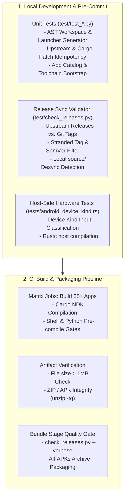

# Tooling & Testing Guide (`docs/tooling-and-testing.md`)

This document details the testing architecture, validation scripts, and developer tooling used in the ArtCraft Android project.

---

## 1. Overview & Verification Architecture

To guarantee stability across 35+ ported applications, decentralized modular build scripts (`lib/`), and vendor patches, the project uses a layered testing and validation architecture:



---

## 2. Upstream Release & Tag Sync Validator (`test/check_releases.py`)

### Purpose & Problem Statement
When building 35+ upstream applications against their latest stable releases, relying solely on raw `git ls-remote --tags` can lead to build failures or building unreleased code:
- **Stranded CI Tags:** Upstream CI pipelines sometimes create a tag on a commit that fails CI and is never officially published as a release (e.g., NoteCraft's unreleased `v0.0.16` tag vs. official `v0.0.15` release).
- **Pre-releases & Release Candidates:** Lexicographical or semver tag sorting might prefer pre-releases over official stable releases (e.g., SolidCraft `v0.45.0-rc.4` vs. `v0.45.0`).
- **Inconsistent Tag Prefixes:** Some repositories use a `v` prefix (e.g., `v1.2.0`), while others use bare versions (e.g., CapsuleCraft `2.12.5`).
- **Main-Branch Repositories:** Some projects lack tags entirely or require tracking `main` (`earthcraft`, `prowave`, `transit`, `rustgis`, `mapcraft`, `anicraft`).

`test/check_releases.py` is an asynchronous, high-concurrency Python validator that interrogates both GitHub's REST API and upstream Git remotes to ensure the build system resolves the exact intended upstream release.

### Key Capabilities
1. **GitHub Releases API Validation:** Queries GitHub's `/releases/latest` endpoint to resolve the official author-published release tag.
2. **SemVer Discrepancy Detection:** Compares the published release against raw Git tags to detect stranded, unreleased, or draft tags.
3. **Local Checkout Audit:** Inspects local checkouts in `source/<app>` to verify if the disk checkout matches upstream.
4. **Main-Branch Tracking:** Validates that repositories configured to build against `main` are properly handled.

### CLI Usage

```bash
# Check all supported apps with detailed diagnostic output
python3 test/check_releases.py -v

# Check specific applications
python3 test/check_releases.py diagramcraft coimanide notecraft

# Output machine-readable JSON (useful for automation and CI)
python3 test/check_releases.py --json

# Strict mode: exits with status code 1 if any tag discrepancies or desyncs are found
python3 test/check_releases.py --strict
```

### Sample Output
```text
================================================================================
ArtCraft Android Upstream Release & Tag Sync Audit
================================================================================
App                  Mode       Resolved Tag         Upstream Ref         Status    
--------------------------------------------------------------------------------
wordcraft            stable     v0.2.1               v0.2.1               OK
solidcraft           stable     v0.45.0              v0.45.0              OK (filtered RC)
notecraft            stable     v0.0.15              v0.0.15              OK (filtered nightly)
diagramcraft         stable     v0.2.18              v0.2.18              OK
coimanide            stable     v0.6.0               v0.6.0               OK
earthcraft           main       main                 main                 OK (branch override)
--------------------------------------------------------------------------------
Audit Summary: 35 apps checked: 35 in sync, 0 desynced, 0 errors.
```

---

## 3. Decentralized Unit Test Suite (`test/`)

As part of the build system decentralization (Issue #73), the monolithic `lib/build-common.sh` script was split into modular, single-responsibility components in `lib/`. The unit test suite validates these components in isolation without requiring a full Android build environment.

Run all unit tests using Python's standard `unittest` discovery:
```bash
python3 -m unittest discover -s test -p 'test_*.py'
```

### Test Module Breakdown

#### 1. Upstream Patch Repair & Idempotency (`test/test_upstream_patches.py`)
- **Target:** `lib/upstream_patches.py`
- **What It Verifies:**
  - Validates that code repairs for temporary upstream regressions are applied cleanly to source files.
  - Verifies fixes for:
    - **DiagramCraft:** Injects `Vec::new()` fallback for `system_dict_dirs()` on `target_os = "android"`.
    - **PhotoCraft:** Missing `export_presets` read initializer in `crates/engine/src/presets/mod.rs`.
    - **CADCraft:** `harfrust` 0.14 and `rstar` 0.12 API compatibility.
    - **WordCraft:** Exhaustive pattern `swap_fields!` struct compatibility.
  - **Strict Idempotency:** Ensures running the patch script repeatedly on an already-patched tree produces zero changes and exits cleanly.

#### 2. NativeActivity & Launcher Generation (`test/test_launcher_generator.py`)
- **Target:** `lib/launcher_generator.py`
- **What It Verifies:**
  - CLI flag handling and error messaging when required parameters are missing.
  - Python AST parsing of upstream workspaces and `Cargo.toml` packages.
  - Generation of Rust `android_main` launcher code implementing GameActivity / NativeActivity glue.
  - Storage Access Framework (SAF) URI mapping and recipe injection.
  - Verification that existing custom app adapters (`adapters/<app>`) are respected and not overwritten.

#### 3. Cargo Patch Management (`test/test_cargo_patches.py`)
- **Target:** `lib/cargo_patches.py`
- **What It Verifies:**
  - Injection of `[patch.crates-io]` tables into upstream `Cargo.toml` files.
  - Stripping desktop-only dependencies and features (e.g., Wayland, X11) from vendored `winit`.
  - Application of `egui-wgpu` and `egui-dock` surface recovery overrides.
  - CLI subcommands: `patch-crates-io`, `resolve-version`, and `install-updater`.

#### 4. App Catalog & Registry (`test/test_catalog.py`)
- **Target:** `lib/catalog.sh`
- **What It Verifies:**
  - Syntax validity under `bash -n`.
  - Mapping of application flags (e.g., `-wordcraft`, `-subcraft`, `-coimanide`) to human-readable titles, Git repository URLs, and source directories.
  - Correct detection of custom Git remotes (e.g., SubCraft, SolidCraft, Coiman IDE, Transit).
  - Main-branch override detection for apps without release tags.
  - Validation that invalid application names trigger appropriate usage errors.

#### 5. Toolchain Bootstrap & Discovery (`test/test_toolchain.py`)
- **Target:** `lib/toolchain.sh`
- **What It Verifies:**
  - Syntax validity under `bash -n`.
  - Path discovery for Android SDK (`ANDROID_HOME`, `ANDROID_SDK_ROOT`) and NDK (`ANDROID_NDK_HOME`, `NDK_HOME`).
  - Java 21 / Temurin bootstrap verification.
  - Application requirement predicates:
    - `needs_saf`: Checks whether an app requires SAF (Storage Access Framework) file management.
    - `needs_apk2`: Checks whether an app requires second-generation packaging (`apk2`).

#### 6. Custom Adapter Static Linter (`test/test_adapters.py`)
- **Target:** `adapters/` (all 23 custom adapters)
- **What It Verifies:**
  - Validates `bash -n` syntax on every adapter's `prepare.sh`.
  - Validates all `adapters/*/Cargo.toml` files with `tomllib`.
  - Extracts and compiles every embedded Python heredoc (`<<'PY'`) to catch syntax, escaping, and indentation errors before CI execution.
  - Verifies Android package naming conventions (`com.artcraft.<app>`).

#### 7. Android Gradle Project & Manifest Generation (`test/test_android_project.py`)
- **Target:** `lib/android_project.py`
- **What It Verifies:**
  - `versionCode` calculation formula: `(2 << 24) | (major << 16) | (minor << 8) | patch`.
  - `AndroidManifest.xml` generation, XML attribute escaping, permissions, queries, and activity filters.
  - Root `build.gradle` single-module configuration, including `useLegacyPackaging` flags.
  - `settings.gradle` repository definitions and `Theme.Artcraft` styling.

#### 8. File Associations & Intent Filter Schemas (`test/test_file_associations.py`)
- **Target:** `lib/file_associations.py`
- **What It Verifies:**
  - Validates that `intent_filter_toml` generates valid, parseable TOML filters for all supported apps.
  - Audits `EXT_MIME` mapping against AOSP `MediaStore` standards (case-sensitive MIME types).
  - Tests `patch_cargo_toml` rewriting and idempotency on Android manifests.

#### 9. Source Tree Completeness & Fallback Checks (`test/test_source.py`)
- **Target:** `lib/source.sh`
- **What It Verifies:**
  - Tests `source_tree_is_complete()` against simulated Git repositories to ensure incomplete checkouts from killed builds or interrupted clones are cleanly detected.
  - Validates Bash syntax of source fetching routines.

---

## 4. Unified Quality Gate Runner (`scripts/test_all.sh`)

To streamline testing across developers and CI runners, `scripts/test_all.sh` provides an all-in-one test runner:

```bash
# Quick mode: runs syntax checks and all 47 unit tests (under 5 seconds)
./scripts/test_all.sh --quick

# Full mode: syntax checks + unit tests + upstream release tag audit
./scripts/test_all.sh

# Strict mode: fails if any upstream release discrepancy is found
./scripts/test_all.sh --strict

# Install as a Git pre-commit hook (runs automatically on git commit)
./scripts/test_all.sh --install-hook
```

---

## 5. Host-Side Platform Hardware Tests (`tests/android_device_kind.rs`)

### Purpose
The Android shell and the vendored `winit` backend categorize pointer events into touch, stylus, and mouse inputs. Because Android-specific backend code cannot be compiled or executed on a standard Linux or macOS desktop host without an Android emulator, `tests/android_device_kind.rs` isolates the pure mathematical classification logic and tests it using `rustc` directly on the host.

### Execution
Compile and run the test on any desktop system:
```bash
rustc --edition 2021 --test tests/android_device_kind.rs -o /tmp/device_kind_test && /tmp/device_kind_test
```

---

## 6. CI Automated Quality Gates (`.github/workflows/build.yml`)

In GitHub Actions, several automated quality gates run across the matrix:

1. **Pre-execution Syntax Checks:**
   - Every modified shell script is checked with `bash -n`.
   - Every modified Python script is checked with `python3 -m py_compile`.
2. **APK Artifact Validation:**
   - Immediately following compilation in each matrix runner, the output APK is inspected:
     - **Size Check:** Verifies the APK size is greater than 1 MB (`[ "$size" -gt 1000000 ]`), preventing truncated or empty outputs from passing.
     - **ZIP Integrity Check:** Runs `unzip -tq "$apk"` to verify archive structure and detect file corruption.
3. **Release Packaging Gate:**
   - The final `bundle` job executes `python3 test/check_releases.py --verbose` before assembling the release archives, ensuring no desynced or unintended upstream refs are bundled.

---

## 7. Developer Workflow & Best Practices

When developing new features, modifying build scripts, or updating adapters:

1. **Run the Quality Gate Runner:**
   ```bash
   ./scripts/test_all.sh --quick
   ```
2. **Run Unit Tests Directly:**
   ```bash
   python3 -m unittest discover -s test -p 'test_*.py'
   ```
3. **Verify Shell & Python Syntax:**
   ```bash
   bash -n lib/*.sh adapters/*/prepare.sh
   python3 -m py_compile lib/*.py test/*.py
   ```
4. **Audit Upstream Release Tags:**
   ```bash
   python3 test/check_releases.py <app-name> -v
   ```
5. **Idempotency Requirement:**
   Any new patch added to `lib/upstream_patches.py` or an adapter's `prepare.sh` must be idempotent: executing the script twice on the same codebase must produce the exact same outcome without throwing errors or generating duplicate blocks.
