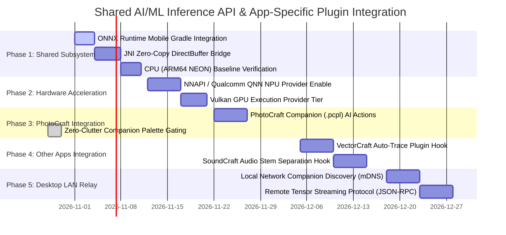

# Architecture Proposal: Shared AI/ML Hardware Inference API for App-Specific Plugin Systems

**Scope:** Suite-Wide (PhotoCraft, VectorCraft, FilmCraft, SoundCraft, LightCraft, and all 14 ArtCraft apps)  
**Status:** Architecture Blueprint & Implementation Roadmap  

---

## 1. Executive Summary

ArtCraft Android is a unified suite of 14 professional creative applications ported from desktop Rust codebases to 64-bit ARM Android devices. Different applications across the suite inherently rely on distinct, domain-specific plugin ecosystems and installation methods:
* **PhotoCraft Companion (`.pcpl`):** Macro packages and neural tools designed specifically for PhotoCraft.
* **Native WebAssembly (`.wasm`):** Sandboxed image filter plugins used natively by PhotoCraft and upstream crates.
* **Audio DSP & Stem Packages:** Specialized multi-track audio models for SoundCraft.
* **Vector & Document Plugins:** Contour tracing, layout analysis, and OCR scripts for VectorCraft, FigCraft, and PdfCraft.

Rather than imposing an artificial "universal plugin file format" across all 14 apps, this architecture takes a **two-layer approach**:
1. **App-Specific Plugin Ingestion (Manual per App):** Each application maintains and evolves its own native or third-party plugin loaders, file extensions, and UI integration according to its creative domain.
2. **Shared AI/ML Hardware Inference API (Unified Backend):** A single, shared neural execution subsystem embedded in the common Android runtime ([`templates/android/`](../templates/android/) and [`lib/build-common.sh`](../lib/build-common.sh)). 

Every app-specific plugin loader manually connects to this shared API, gaining zero-cost access to hardware-accelerated **NPUs (Qualcomm QNN / Android NNAPI)**, **mobile GPUs (Vulkan)**, and **multi-core ARM CPUs (Rayon + ARM NEON)** without duplicating inference logic or modifying upstream desktop crates.

---

## 2. App-Specific Plugin Systems (Integrated Manually)

Each creative app in the ArtCraft suite handles distinct media pipelines and plugin requirements:

```
┌────────────────────────────────────────────────────────────────────────────────────────┐
│                              ArtCraft Creative Applications                            │
├─────────────────────┬─────────────────────┬─────────────────────┬──────────────────────┤
│     PhotoCraft      │     SoundCraft      │     VectorCraft     │ FilmCraft / Effects  │
├─────────────────────┼─────────────────────┼─────────────────────┼──────────────────────┤
│ • .pcpl (Companion) │ • Audio Stem Packs  │ • Vector Trace Ext. │ • Temporal Shaders   │
│ • .wasm (Filters)   │ • Noise DSP Plugins │ • Font/Glyph Models │ • Rotoscoping Nets   │
└──────────┬──────────┴──────────┬──────────┴──────────┬──────────┴──────────┬───────────┘
           │                     │                     │                     │
           └─────────────────────┼─────────────────────┴─────────────────────┘
                                 │
                    Calls Shared Inference API
                   (artcraft_ml::run_inference)
                                 │
                                 ▼
┌────────────────────────────────────────────────────────────────────────────────────────┐
│                       Shared ArtCraft AI/ML Inference Subsystem                        │
│                 (templates/android/SafActivity.java & saf_bridge.rs)                   │
├────────────────────────────────┬───────────────────────────────┬───────────────────────┤
│    Tier 1: Hardware NPU        │     Tier 2: Mobile GPU        │ Tier 3: Multi-Core CPU│
│ (Qualcomm QNN / Android NNAPI) │ (Vulkan Shaders / Execution)  │  (Rayon + ARM64 NEON) │
└────────────────────────────────┴───────────────────────────────┴───────────────────────┘
                                 ▲
                                 │ Network Offload (Models > 500 MB)
┌────────────────────────────────┴───────────────────────────────────────────────────────┐
│                 Optional LAN Desktop Companion (WebSocket / JSON-RPC)                  │
│ • Full Desktop DirectML / CUDA / TensorRT Inference                                    │
│ • Heavy Diffusion (Stable Diffusion / FLUX) and Large Language Models                  │
└────────────────────────────────────────────────────────────────────────────────────────┘
```

### A. PhotoCraft
* **PhotoCraft Companion Packages (`.pcpl`):** Handled manually by PhotoCraft's SAF bridge and adapter. Unpacks into `files/plugins/<id>/`, renders the in-canvas floating Companion Palette, and routes macro command steps (`model.infer`, `tensor.preprocess`) to the shared AI/ML API.
* **WebAssembly Filters (`.wasm`):** Sandboxed byte-level filter plugins loaded directly into PhotoCraft's engine.

### B. SoundCraft (Audio Production)
* **Stem Separation & Speech Isolation:** Audio plugins providing models like Demucs or DeepFilterNet. The plugin provides the `.onnx` graph and audio windowing logic, while passing raw PCM audio buffers to the shared API for real-time NPU tensor processing.

### C. VectorCraft / FigCraft / DesignCraft (Vector & Layout)
* **Auto-Tracing & Semantic Extraction:** Raster-to-Bézier contour plugins (e.g., MobileNet/TraceNet). Passes bitmap layers to the shared API and consumes segmentation polygons to construct native vector paths.

### D. FilmCraft / EffectCraft (Video & Motion)
* **Frame Interpolation & AI Rotoscoping:** Frame-by-frame models (e.g., RIFE, SAM-2). Passes sequential video frame buffers to the NPU/GPU pipeline for temporal matting and motion vector extraction.

### E. PdfCraft / WordCraft (Documents & Publishing)
* **High-Accuracy OCR & Layout Parsing:** Models like PP-OCRv4 or LayoutLM. Converts scanned document pages into structured text, tables, and vector graphics.

---

## 3. Shared AI/ML Hardware Inference API

Rather than having each app ship its own C++ inference binaries, all apps access a unified API exposed by the shared Android template.

### A. Rust Client API (`artcraft-ml`)
Any app adapter or plugin runner calls a standard Rust interface:

```rust
pub struct ModelSession {
    session_id: String,
    input_dims: Vec<usize>,
    output_dims: Vec<usize>,
}

impl ModelSession {
    /// Load an ONNX model into the shared hardware inference engine.
    pub fn load(model_path: &Path, preference: ExecutionPreference) -> Result<Self, MlError>;

    /// Execute inference using zero-copy direct buffers.
    pub fn run(&mut self, input_bytes: &[u8], output_bytes: &mut [u8]) -> Result<(), MlError>;

    /// Release model memory when the plugin or tool is deactivated.
    pub fn unload(self);
}

pub enum ExecutionPreference {
    NpuPreferred,   // Qualcomm QNN / Android NNAPI
    GpuPreferred,   // Vulkan execution provider
    CpuOnly,        // ARM64 NEON with Rayon multi-threading
    LanRelayOnly,   // Force offloading to desktop companion over Wi-Fi
}
```

### B. Java/JNI Shared Subsystem ([`SafActivity.java`](../templates/android/SafActivity.java))
The shared template activity hosts the `OrtEnvironment` and manages model sessions:

```java
public final class SafActivity extends GameActivity {
    private OrtEnvironment ortEnv;
    private final Map<String, OrtSession> activeSessions = new ConcurrentHashMap<>();

    // JNI Entry Point: Loads model with automatic hardware acceleration ladder
    public synchronized boolean mlLoadModel(String sessionId, String modelPath, int preference) {
        try {
            OrtSession.SessionOptions opts = new OrtSession.SessionOptions();
            opts.setOptimizationLevel(OrtSession.SessionOptions.OptLevel.ALL_OPT);

            // Tier 1: NPU (Snapdragon Hexagon via QNN or Android NNAPI)
            if (preference == PREF_NPU || preference == PREF_AUTO) {
                try {
                    opts.addNnapi();
                    Log.i(TAG, "Hardware acceleration: NPU (NNAPI) enabled for " + sessionId);
                    activeSessions.put(sessionId, ortEnv.createSession(modelPath, opts));
                    return true;
                } catch (Exception e) {
                    Log.w(TAG, "NPU unavailable, falling back to GPU: " + e.getMessage());
                }
            }

            // Tier 2: GPU (Vulkan)
            // Tier 3: High-Performance Multi-Core CPU (Rayon-aligned)
            opts.setInterOpNumThreads(Runtime.getRuntime().availableProcessors());
            opts.setIntraOpNumThreads(Runtime.getRuntime().availableProcessors());
            activeSessions.put(sessionId, ortEnv.createSession(modelPath, opts));
            return true;
        } catch (Exception e) {
            Log.error(TAG, "Failed to load model: " + e.getMessage());
            return false;
        }
    }

    // JNI Entry Point: Zero-copy tensor execution via direct ByteBuffers
    public boolean mlRunInference(String sessionId, ByteBuffer inputBuffer, ByteBuffer outputBuffer) {
        OrtSession session = activeSessions.get(sessionId);
        if (session == null) return false;
        // Zero-copy execution wrapping direct memory pointers
        return executeNativeTensor(session, inputBuffer, outputBuffer);
    }
}
```

---

## 4. Multi-Tier Hardware Execution Ladder

```
┌────────────────────────────────────────────────────────┐
│              Hardware Execution Priority               │
├────────────────────────────────────────────────────────┤
│  [Tier 1: Hardware NPU]                                │
│  Qualcomm QNN HTP (Snapdragon 8 Gen 1/2/3/4)           │
│  Android NNAPI (Google Tensor TPU, Dimensity APU)      │
│  Optimal for: INT8 / FP16 quantized models             │
│                     │ (Driver/Op Unsupported)          │
│                     ▼                                  │
│  [Tier 2: Mobile GPU]                                  │
│  Vulkan Execution Provider (Adreno / Mali GPU Shaders) │
│  Optimal for: Heavy floating-point matrix operations   │
│                     │ (Memory/Thermal Limit)           │
│                     ▼                                  │
│  [Tier 3: Multi-Core CPU]                              │
│  ARM64 NEON Vector Extensions + Rayon Worker Pool      │
│  Optimal for: Universal fallback (100% compatibility)  │
└────────────────────────────────────────────────────────┘
```

### LAN Desktop Companion Relay (For Massive Generative Models)
When a plugin requires large-scale generative models (e.g., 10GB+ Stable Diffusion, FLUX, or large LLMs) that exceed mobile memory or thermal budgets:
* The shared API transparently delegates the tensor job over the local network via WebSocket/JSON-RPC to `photocraft-companion` (or equivalent desktop companion server) running on a local PC.
* The desktop runs the model at full DirectML/CUDA GPU speed and streams the result directly back into the Android layer buffer.

---

## 5. Technical Implementation in ArtCraft Android

### A. Shared Build Configuration ([`lib/build-common.sh`](../lib/build-common.sh))
The shared build orchestrator injects ONNX Runtime Mobile into all 14 apps:
```groovy
dependencies {
    // ONNX Runtime Mobile with NNAPI and QNN support
    implementation 'com.microsoft.onnxruntime:onnxruntime-android:1.19.2'
}
```
* **ABI Filtering:** Stripped strictly to `arm64-v8a` to keep final APK sizes minimal.
* **ProGuard / R8 Rules:** Native JNI symbols preserved (`ai.onnxruntime.** { *; }`).

### B. Zero-Copy Tensor Exchange ([`templates/android/saf_bridge.rs`](../templates/android/saf_bridge.rs))
Image layers (4K RGBA) and multi-track audio buffers are passed across JNI without heap allocations:
1. Rust exposes the raw pointer to the image layer or audio buffer.
2. `env.new_direct_byte_buffer(ptr, len)` creates an envelope around the native memory.
3. The Java inference subsystem evaluates the model directly against this buffer.
4. Output is written directly into the canvas destination memory.

---

## 6. Phased Implementation Roadmap



### Milestone Summary

* **Phase 1 (Core Subsystem):** Embed `onnxruntime-android` into [`lib/build-common.sh`](../lib/build-common.sh) and implement the zero-copy JNI direct buffer exchange in [`templates/android/saf_bridge.rs`](../templates/android/saf_bridge.rs).
* **Phase 2 (Hardware Acceleration):** Enable the NPU ladder (`addNnapi()` / QNN) and Vulkan GPU fallback in [`SafActivity.java`](../templates/android/SafActivity.java).
* **Phase 3 (PhotoCraft Integration):** Manually connect PhotoCraft's `.pcpl` companion macro runner to the shared API, enabling local on-device execution of `.onnx` models inside `.pcpl` bundles.
* **Phase 4 (Suite-Wide App Loaders):** Manually connect other app-specific plugins (VectorCraft tracing, SoundCraft stem separation) to the shared API.
* **Phase 5 (Desktop LAN Relay):** Add local Wi-Fi discovery (mDNS) to stream heavy generative models to a local PC running `photocraft-companion`.

---

## 7. Security, Sandboxing, and Thermal Guidelines

1. **Storage Sandboxing:** Model weights and package scripts unpack strictly into private app storage (`/data/user/0/<package>/files/plugins/<plugin_id>/` and `files/models/`). They are isolated from other apps.
2. **Thermal Throttling Guard:** Continuous NPU/GPU workloads on mobile can trigger aggressive hardware thermal throttling. The engine incorporates:
   - Dynamic batch size capping (processing tiles sequentially instead of monolithic tensor allocations).
   - Thermal state listeners (`PowerManager.OnThermalStatusChangedListener`) that throttle processing or switch to low-power CPU cores when the device reports `THERMAL_STATUS_SEVERE`.
3. **Memory Limits:** Mobile models are restricted to a maximum working set of 512 MB RAM per inference pass. Packages exceeding device RAM limits are prompted to offload execution to the Desktop LAN Relay.
