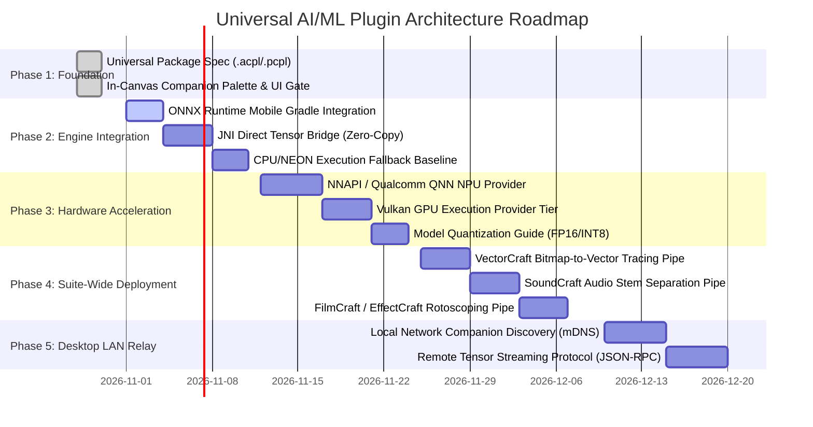

# Universal AI/ML Plugin & Neural Inference Architecture

**Author:** ArtCraft Android Core Team  
**Scope:** Suite-Wide (PhotoCraft, VectorCraft, FilmCraft, SoundCraft, LightCraft, and all 14 ArtCraft apps)  
**Status:** Architecture Blueprint & Implementation Roadmap  

---

## 1. Executive Summary

ArtCraft Android is a unified suite of 14 professional creative applications ported from desktop Rust codebases to 64-bit ARM Android devices. While desktop creative suites rely on platform-specific GPU machine learning APIs (such as Microsoft DirectML for DirectX 12 on Windows), Android devices feature heterogeneous computing architectures composed of **NPUs (Neural Processing Units)**, **mobile GPUs (Vulkan/OpenCL)**, and **multi-core ARM CPUs (NEON SIMD)**.

This document establishes the architecture and implementation roadmap for the **Universal ArtCraft AI/ML Engine**. Instead of building fragmented, app-specific ML solutions or restricting plugins to sandboxed WebAssembly filters, this system provides:
1. A **Universal Plugin Standard (`.acpl` / `.pcpl`)** declaring declarative macros, neural models, and processing pipelines across any app in the suite.
2. A **Multi-Tier Hardware Inference Engine** targeting Android NPUs (Qualcomm QNN / Android NNAPI) with seamless fallback to mobile GPUs (Vulkan) and multi-core CPUs (Rayon + ARM NEON).
3. A **Dual-Mode Execution Model** allowing lightweight and medium models (up to ~500MB) to run entirely offline on-device, while seamlessly offloading heavy generative models (10GB+ diffusion/LLM models) to a local desktop companion over the local network (LAN).
4. Direct integration into ArtCraft’s shared template layer ([`templates/android/`](file:///home/afnan/Documents/Development/ArtCraft%20Android/templates/android/) and [`lib/build-common.sh`](file:///home/afnan/Documents/Development/ArtCraft%20Android/lib/build-common.sh)), granting all 14 applications instant access to hardware AI acceleration without upstream crate modifications.

---

## 2. Cross-App Capability Matrix

The Universal AI/ML Engine is designed to power distinct creative domains across the ArtCraft suite:

| App Category | Applications | Targeted AI/ML Capabilities | Typical Models / Formats |
| :--- | :--- | :--- | :--- |
| **Raster & Photography** | `PhotoCraft`<br>`LightCraft` | • Smart background removal & subject isolation<br>• Content-aware inpainting & generative fill<br>• Super-resolution (Real-ESRGAN / SwinIR)<br>• Neural denoising, sharpening, and color grading | U²-Net, BiRefNet, Real-ESRGAN, DepthAnything (ONNX FP16/INT8) |
| **Vector & Design** | `VectorCraft`<br>`FigCraft`<br>`DesignCraft` | • Bitmap-to-vector auto-tracing<br>• Smart palette generation & semantic coloring<br>• Object classification and layer auto-tagging<br>• Font identification & OCR layout analysis | CLIP-Vision, TraceNet, MobileNetV4, PaddleOCR (ONNX) |
| **Audio Production** | `SoundCraft` | • Real-time stem separation (vocals, bass, drums, melody)<br>• Neural noise / hum reduction & speech isolation<br>• Offline audio transcription (Whisper tiny/base) | Demucs, DeepFilterNet, Whisper ONNX |
| **Video & Motion** | `FilmCraft`<br>`EffectCraft` | • AI rotoscoping & green-screen matting<br>• Video super-resolution & frame interpolation<br>• Monocular depth map generation | RIFE (Frame Interp), SAM-2 (Segment Anything), MiDaS |
| **Documents & Publishing** | `PdfCraft`<br>`WordCraft` | • High-precision OCR (printed & handwritten text)<br>• Document structure and layout parsing<br>• Table and diagram vector extraction | PP-OCRv4, LayoutLMv3 ONNX |

---

## 3. High-Level System Architecture

```
                    ┌────────────────────────────────────────────────────────┐
                    │               ArtCraft Creative Suite                  │
                    │   (PhotoCraft, VectorCraft, FilmCraft, SoundCraft...)   │
                    └───────────────────────────┬────────────────────────────┘
                                                │
                                    SAF Plugin Installation
                                  (.acpl / .pcpl ZIP Bundles)
                                                │
                                                ▼
┌─────────────────────────────────────────────────────────────────────────────────────────────┐
│                       Shared Android Template Layer (SafActivity.java)                       │
├────────────────────────────────────────┬────────────────────────────────────────────────────┤
│ • Canonical ZIP Extraction (Anti-Slip) │ • Model Storage (~/files/plugins/<id>/models/)     │
│ • Manifest Validation (plugin.json)   │ • Memory-Mapped Tensor Buffers (Zero-Copy JNI)     │
└────────────────────────────────────────┴──────────────────────┬─────────────────────────────┘
                                                                │
                                                                ▼
┌─────────────────────────────────────────────────────────────────────────────────────────────┐
│                      Universal Hardware Inference Engine (ONNX Runtime)                     │
├─────────────────────────────────────────────────────────────────────────────────────────────┤
│ Execution Strategy: Priority Ladder with Automatic Graceful Degradation                     │
│                                                                                             │
│  [Tier 1: Hardware NPU]                                                                     │
│  Qualcomm QNN HTP (Snapdragon 8 Gen 1/2/3/4) & Android NNAPI (Pixel TPU / Dimensity APU)   │
│                                     │ (Unsupported op / driver fallback)                    │
│                                     ▼                                                       │
│  [Tier 2: Mobile GPU]                                                                       │
│  Vulkan Execution Provider (Adreno / Mali GPU shaders)                                      │
│                                     │ (Memory limit / driver fallback)                      │
│                                     ▼                                                       │
│  [Tier 3: Multi-Core CPU]                                                                   │
│  ARM64 NEON Vector Extensions + Rayon Worker Pool (Tuned 2MB Stacks)                        │
└─────────────────────────────────────────────────────────────────────────────────────────────┘
                                 ▲
                                 │ Network Offload (Models > 1 GB)
                                 │
┌────────────────────────────────┴────────────────────────────────────────────────────────────┐
│                    Optional LAN Desktop Companion (WebSocket / JSON-RPC)                    │
│ • Full Desktop DirectML / CUDA / TensorRT Inference                                         │
│ • Heavy Diffusion (Stable Diffusion / FLUX) and Large Language Models                        │
└─────────────────────────────────────────────────────────────────────────────────────────────┘
```

---

## 4. Universal Plugin Specification (`.acpl` / `.pcpl`)

A universal plugin package is a standard ZIP archive with the extension `.acpl` (*ArtCraft Package Library*) or `.pcpl` (*PhotoCraft Package Library*).

### Directory Structure
```text
com.artcraft.smart-isolate.acpl/
├── plugin.json             # Universal package manifest
├── icon.png                # Plugin icon (128x128 PNG)
├── models/
│   ├── segmenter.onnx      # Quantized neural model (FP16 or INT8)
│   └── postprocess.wasm    # Optional Wasm tensor transformation
└── assets/
    └── presets.json        # User presets or filter parameters
```

### Manifest Schema (`plugin.json`)
```json
{
  "$schema": "https://artcraft.io/schemas/v1/plugin.json",
  "id": "com.artcraft.smart-isolate",
  "name": "Smart Subject Isolation",
  "version": "1.0.0",
  "author": "ArtCraft AI Lab",
  "description": "One-tap AI background removal and subject segmentation.",
  "target_apps": ["photocraft", "filmcraft", "vectorcraft"],
  "capabilities": ["segmentation", "matting"],
  "min_artcraft_version": "0.16.0",
  
  "models": [
    {
      "id": "u2net_portrait",
      "file": "models/u2net_portrait.onnx",
      "format": "onnx",
      "precision": "fp16",
      "execution_preference": "npu_preferred",
      "input_shape": [1, 3, 512, 512],
      "output_shape": [1, 1, 512, 512]
    }
  ],
  
  "pipeline": [
    {
      "action": "tensor.preprocess_image",
      "params": {
        "source": "$active_layer",
        "resize": [512, 512],
        "normalize": "imagenet"
      },
      "save_as": "$input_tensor"
    },
    {
      "action": "model.infer",
      "model": "u2net_portrait",
      "inputs": { "data": "$input_tensor" },
      "save_as": "$raw_mask"
    },
    {
      "action": "tensor.postprocess_mask",
      "params": {
        "mask": "$raw_mask",
        "threshold": 0.5,
        "feather": 1.5,
        "fit_to": "$active_layer"
      },
      "save_as": "$final_selection"
    },
    {
      "action": "selection.apply_mask",
      "params": {
        "mask": "$final_selection",
        "mode": "new_layer_with_mask"
      }
    }
  ]
}
```

---

## 5. Technical Implementation Details

### A. Shared Android Dependency Injection ([`lib/build-common.sh`](file:///home/afnan/Documents/Development/ArtCraft%20Android/lib/build-common.sh))
The build system injects Microsoft ONNX Runtime Mobile into the Android Gradle build:
```groovy
dependencies {
    // ONNX Runtime Mobile with NNAPI and QNN support
    implementation 'com.microsoft.onnxruntime:onnxruntime-android:1.19.2'
}
```
* **ABI Packaging:** Constrained to `arm64-v8a` to prevent APK bloat from unused 32-bit x86/ARM binaries.
* **ProGuard / R8 Rules:** Preserves native JNI wrappers (`ai.onnxruntime.** { *; }`).

### B. Hardware-Accelerated Session Factory ([`SafActivity.java`](file:///home/afnan/Documents/Development/ArtCraft%20Android/templates/android/SafActivity.java))
The activity initializes an `OrtEnvironment` and configures hardware acceleration with hierarchical fallback:

```java
public OrtSession createOptimizedSession(String modelPath) throws Exception {
    OrtSession.SessionOptions options = new OrtSession.SessionOptions();
    options.setOptimizationLevel(OrtSession.SessionOptions.OptLevel.ALL_OPT);
    
    // Tier 1: Attempt Qualcomm QNN / Android NNAPI (NPU)
    try {
        options.addNnapi();
        Log.i(TAG, "Initialized NPU acceleration via Android NNAPI for: " + modelPath);
        return ortEnvironment.createSession(modelPath, options);
    } catch (Exception e) {
        Log.w(TAG, "NPU initialization failed, falling back to GPU: " + e.getMessage());
    }
    
    // Tier 2: Attempt Vulkan / GPU
    // Tier 3: High-Performance Multi-threaded CPU (Rayon-aligned)
    options.setInterOpNumThreads(Runtime.getRuntime().availableProcessors());
    options.setIntraOpNumThreads(Runtime.getRuntime().availableProcessors());
    return ortEnvironment.createSession(modelPath, options);
}
```

### C. Zero-Copy Tensor Exchange ([`templates/android/saf_bridge.rs`](file:///home/afnan/Documents/Development/ArtCraft%20Android/templates/android/saf_bridge.rs))
Copying high-resolution 4K image layers through JNI causes GC pauses and memory exhaustion. The pipeline uses **Direct Byte Buffers**:
1. Rust allocates pixel memory or provides a direct pointer to the canvas layer bitmap.
2. JNI wraps the raw pointer using `env.new_direct_byte_buffer(ptr, len)`.
3. Java wraps the direct buffer into an `OnnxTensor`.
4. Inference writes output directly into a pre-allocated target buffer, returning control to Rust with zero memory reallocation.

---

## 6. Phased Implementation Roadmap



### Milestone Details

#### Phase 1: Universal Packaging & Foundation (Status: Complete)
- Unified package extraction with zip-slip directory traversal security.
- In-canvas floating companion palette with zero clean-install footprint.
- Declarative macro runner with condition gating (`$has_layer`, `$has_active_selection`).

#### Phase 2: Inference Engine & Zero-Copy Bridge
- Integrate `com.microsoft.onnxruntime:onnxruntime-android` into [`lib/build-common.sh`](file:///home/afnan/Documents/Development/ArtCraft%20Android/lib/build-common.sh).
- Implement JNI `run_tensor_model(model_path, input_buffer, output_buffer)` in [`templates/android/saf_bridge.rs`](file:///home/afnan/Documents/Development/ArtCraft%20Android/templates/android/saf_bridge.rs).
- Validate on-device CPU inference baseline using ARM64 NEON.

#### Phase 3: NPU & GPU Hardware Acceleration
- Wire `addNnapi()` and QNN execution providers in [`SafActivity.java`](file:///home/afnan/Documents/Development/ArtCraft%20Android/templates/android/SafActivity.java).
- Build automated fallback ladder (NPU ➔ GPU ➔ CPU).
- Release INT8 and FP16 model conversion toolchain for third-party plugin developers.

#### Phase 4: Suite-Wide App Adapters
- **PhotoCraft / LightCraft:** Background removal, face retouch, super-resolution.
- **VectorCraft / FigCraft:** High-speed vector contour tracing.
- **SoundCraft:** Dual-stream audio separation (voice/accompaniment).

#### Phase 5: Local Desktop Companion Relay
- Automatic discovery of desktop companions on the local Wi-Fi network via mDNS.
- Secure, token-authenticated WebSocket/JSON-RPC stream for offloading 10GB+ generative models to desktop GPUs (DirectML / CUDA).

---

## 7. Security, Sandboxing, and Thermal Guidelines

1. **Storage Sandboxing:** Model weights and package scripts unpack strictly into private app storage (`/data/user/0/<package>/files/plugins/<plugin_id>/`). They are isolated from other apps.
2. **Thermal Throttling Guard:** Continuous NPU/GPU workloads on mobile can trigger aggressive hardware thermal throttling. The engine incorporates:
   - Dynamic batch size capping (processing tiles sequentially instead of monolithic tensor allocations).
   - Thermal state listeners (`PowerManager.OnThermalStatusChangedListener`) that throttle processing or switch to low-power CPU cores when the device reports `THERMAL_STATUS_SEVERE`.
3. **Memory Limits:** Mobile models are restricted to a maximum working set of 512 MB RAM per inference pass. Packages exceeding device RAM limits are prompted to offload execution to the Desktop LAN Relay.
